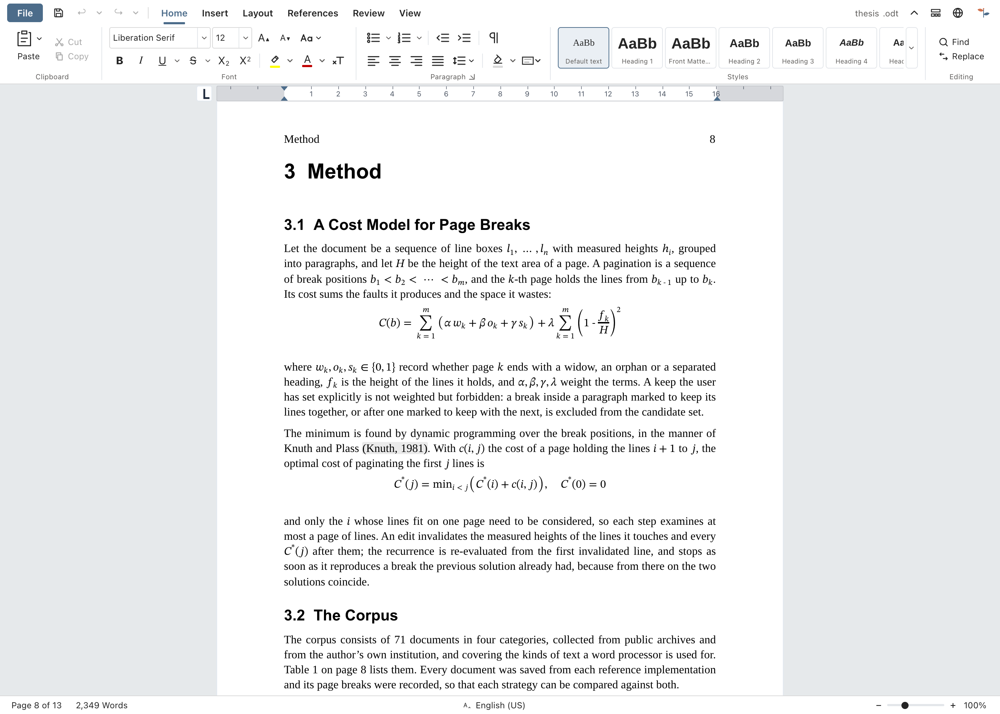
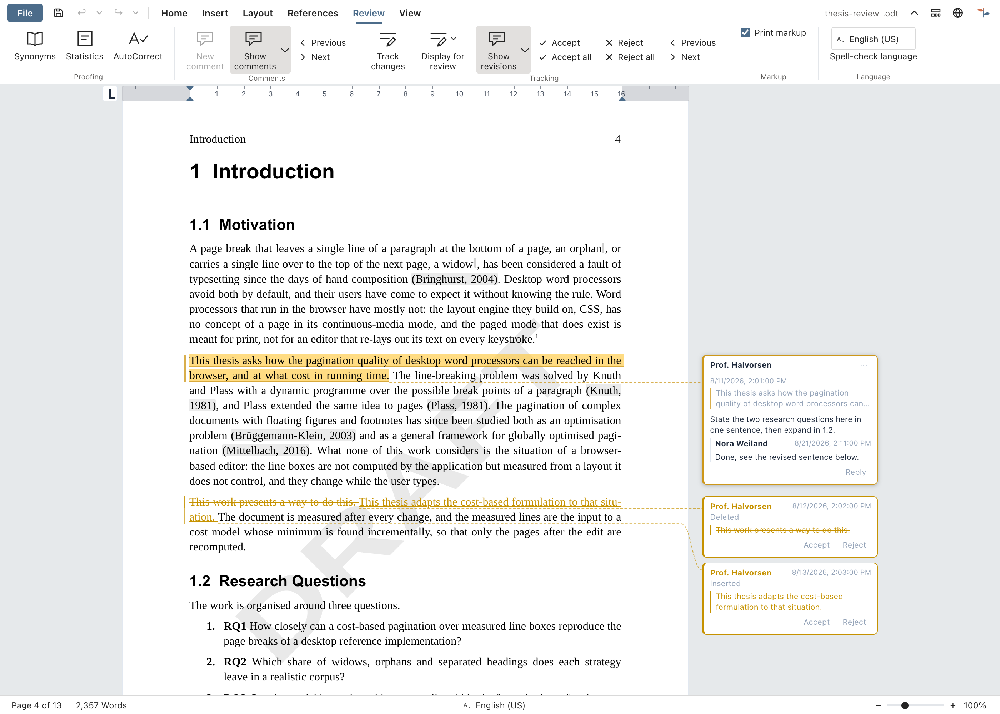
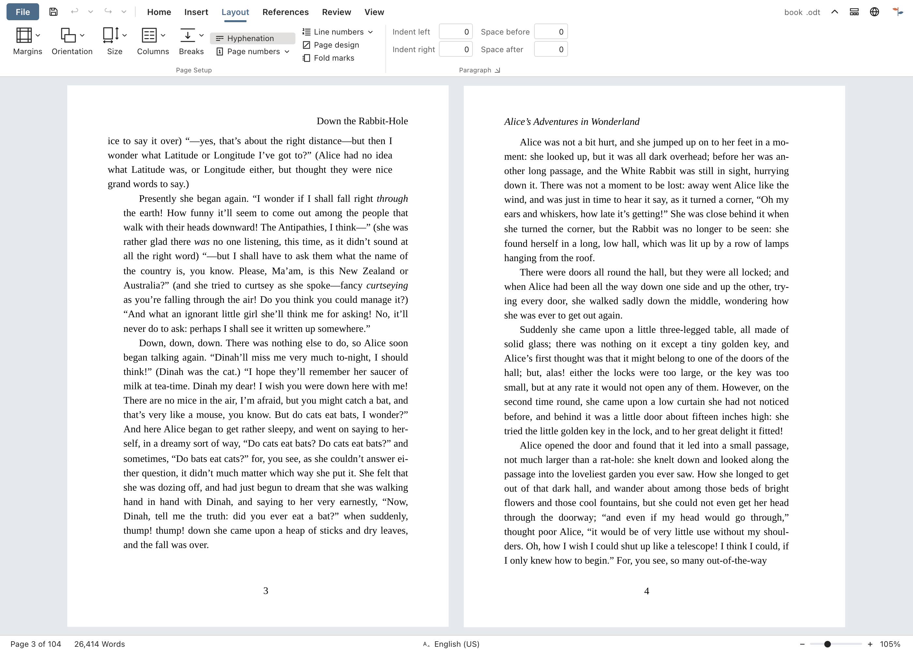
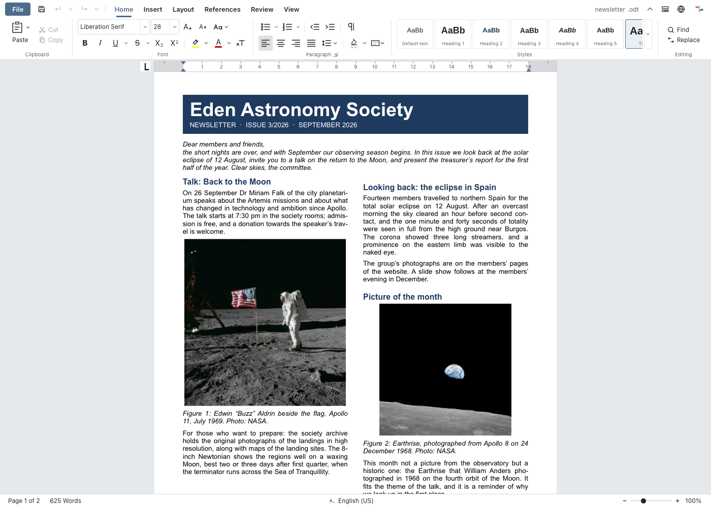
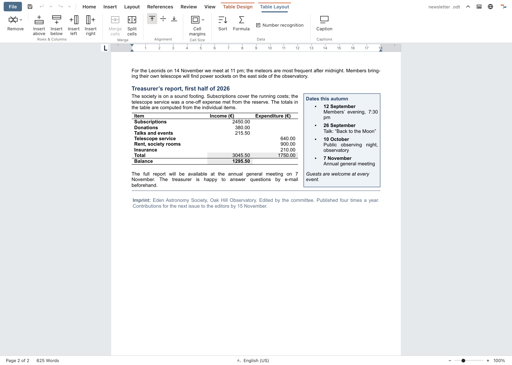
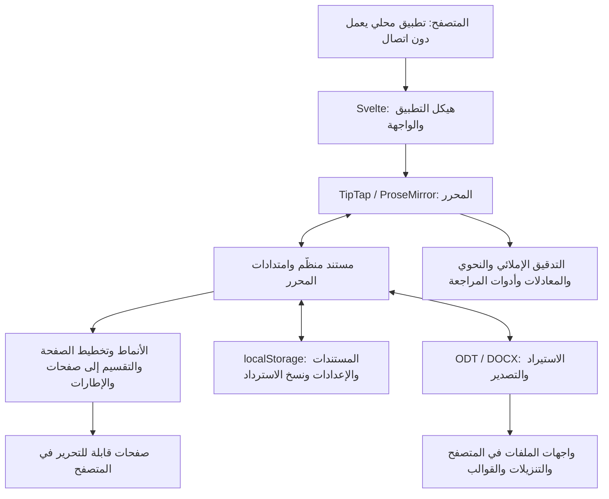

<p align="center">
  
</p>

<h1 align="center">
  
</h1>

<p align="center" dir="rtl">
  <strong>معالج نصوص متكامل، مباشرة في المتصفح</strong><br>
  مجاني · مفتوح المصدر · Private by Design
</p>

<p align="center">
  <a href="https://github.com/stffnb/edentext/actions/workflows/ci.yml"></a>
  <a href="../../LICENSE"></a>
  <a href="../../CHANGELOG.md"></a>
  
</p>

<p align="center" dir="rtl">
  <a href="https://edentext.app"><strong>◀ افتح EdenText</strong></a>
</p>

<p align="center">
  <a href="../../README.md">English</a> · <a href="README.de.md">Deutsch</a> · <a href="README.es.md">Español</a> · <a href="README.fr.md">Français</a> · <a href="README.it.md">Italiano</a> · <a href="README.pt.md">Português</a> · <a href="README.el.md">Ελληνικά</a> · <a href="README.ru.md">Русский</a> · <a href="README.uk.md">Українська</a> · <a href="README.pl.md">Polski</a> · <a href="README.id.md">Bahasa Indonesia</a> · <b>العربية</b> · <a href="README.ja.md">日本語</a> · <a href="README.ko.md">한국어</a> · <a href="README.zh-CN.md">简体中文</a> · <a href="README.zh-TW.md">繁體中文</a>
</p>

<picture>
  <source media="(prefers-color-scheme: dark)" srcset="../hero-dark.webp">
  
</picture>

---

<div dir="rtl">

يُعدّ EdenText معالج نصوص قويًا يعمل في المتصفح، ويصلح لكل شيء من الملاحظات السريعة إلى الكتب الكاملة. لا خادم ولا حساب: تجري المعالجة كلها محليًا، ولا تغادر مستنداتك جهازك أبدًا. افتح الرابط فحسب، أو ثبّته تطبيقًا واعمل دون اتصال بالإنترنت. يبلغ حجم التنزيل الأول لمعظم اللغات نحو 2 ميغابايت، أما القواميس والخطوط فتُحمَّل عند الحاجة إليها[^1]. وتتوفر الواجهة بالإنجليزية والألمانية والإسبانية والفرنسية والإيطالية والبرتغالية واليونانية والروسية والأوكرانية والبولندية والإندونيسية والعربية واليابانية والكورية والصينية (المبسطة والتقليدية).

> [!NOTE]
> ما زال EdenText في المرحلة **التجريبية** وقيد التطوير المستمر. تتحقق الاختبارات وفحوص
> الذهاب والإياب (round-trip) من سلامة عمله، ومع ذلك لا يمكن استبعاد الأخطاء في هذه المرحلة،
> لذا احتفظ بنسخ احتياطية من مستنداتك المهمة. ويحتفظ المتصفح أيضًا بآخر ثلاث نسخ من المستند
> المفتوح، تحسّبًا لتعذّر تحميله يومًا ما.
>
> **وجدت خطأً، أو مستندًا لا يظهر كما ينبغي؟** يُرجى
> [إنشاء بلاغ (issue)](https://github.com/stffnb/edentext/issues)، فكل بلاغ يساعد.
> ونرحّب خصوصًا بالمستندات التي يعرضها EdenText على نحو مختلف عن Word أو LibreOffice أو WPS Office:
> أرفق الملف (أو نسخة مختصرة منه) ليصبح حالة اختبار.

</div>

<a href="https://edentext.app"><picture>
  <source media="(prefers-color-scheme: dark)" srcset="../showcase/thesis-dark.png">
  
</picture></a>

<div dir="rtl">

## الميزات

- **تخطيط صفحات حقيقي** — صفحات A4 وLetter، والهوامش، والرأس والتذييل، والحواشي السفلية،
  والأعمدة، وترقيم الصفحات والأسطر، والعلامات المائية؛ وللكتب هوامش معكوسة وفصول
  تبدأ في صفحة يمنى
- **يفتح ملفات <span dir="ltr">`.odt`</span> و<span dir="ltr">`.docx`</span> ويحفظها**، ويصدّر إلى PDF؛ مع القوالب (<span dir="ltr">`.ott`/`.dotx`</span>)
  ومجموعة من قوالب الرسائل (DIN 5008)، والملفات المحمية بكلمة مرور في كلا التنسيقين
- **متوافق مع Word وLibreOffice وWPS Office** — تحتفظ المستندات بتخطيطها، وتتحقق من ذلك
  اختبارات آلية للذهاب والإياب وللتخطيط بالمقارنة مع LibreOffice
- **الأنماط** — أنماط الفقرات والأحرف والجداول والقوائم مع التوارث، وترقيم الفصول
- **الجداول** مع أنماط الجداول والفرز وصيغ كما في جداول البيانات
- **كل ما تحتاج إليه رسالة جامعية** — جدول المحتويات، والتسميات التوضيحية، والإسنادات الترافقية،
  والاقتباسات وقائمة المراجع، والفهرس الأبجدي، والمعادلات (LaTeX)
- **أدوات المراجعة** — تعقّب التغييرات والتعليقات المتسلسلة في بالونات على الهامش،
  ومقارنة المستند بملف آخر ودمجه معه، وطباعة العلامات، والتدقيق الإملائي (الإنجليزية
  والألمانية والإسبانية والفرنسية والإيطالية والبرتغالية واليونانية والروسية والأوكرانية والبولندية
  والإندونيسية والعربية والكورية)، والمرادفات (للغات نفسها عدا اليونانية والكورية)، والتدقيق النحوي
  (الإنجليزية)
- **التعاون في الوقت الفعلي** — يحرّر عدة أشخاص مستندًا واحدًا في الوقت نفسه عبر ارتباط:
  يرى كلٌّ منهم مؤشرات الآخرين، وتتوفر دردشة الجلسة وارتباط للقراءة فقط لمن يكتفي بالمتابعة.
  والاتصال مشفّر من طرف إلى طرف، فلا يستطيع الخادم الوسيط قراءة المستند. يحتاج إلى خادم
  ترحيل (relay)، انظر [التعاون](#التعاون)
- **مساعد ذكاء اصطناعي اختياري** — مع موفّر من اختيارك أو نموذج محلي؛ يجيب عن أسئلتك
  حول المستند ويعدّله في صورة تغييرات متعقَّبة. يمكن إيقافه، وتذهب الطلبات مباشرة إلى الموفّر
  دون المرور بأي خادم لـ EdenText
- **الإملاء** — تحدّث فيظهر النص عند المؤشر، عبر التعرّف على الكلام في المتصفح أو خادمك الخاص
  للتعرّف على الكلام، مثل Whisper
- **الخصوصية في صميم التصميم (Private by Design)** — لا تغادر مستنداتك جهازك أبدًا، وتجري
  المعالجة كلها محليًا؛ ويعمل دون اتصال بالإنترنت عند تثبيته تطبيقًا. لا يرسل المحرر شيئًا،
  إلا إذا شغّلت مساعد الذكاء الاصطناعي، فيرسل إلى الموفّر الذي اخترته. وفي الجلسة المشتركة يُرسَل المستند مشفّرًا عبر خادم الترحيل إلى المشاركين الآخرين فيها. ويستخدم الإملاء التعرّف على الكلام في المتصفح، الذي قد يرسل الصوت إلى خدمة الكلام الخاصة به. وعند اللصق من صفحة ويب تُجلب صورها مرة واحدة من مواقعها لتُحفظ في المستند.
  تُحفظ المستندات تلقائيًا في المتصفح؛ ويمكن ضبط «المستندات الأخيرة» لحذف المستندات المغلقة
  عند التشغيل التالي أو لعدم الاحتفاظ بها أصلًا، أما النافذة الخاصة فلا تترك أي أثر
  بعد إغلاقها
- **أي متصفح حديث** — في Chrome وEdge يحفظ أمر «حفظ» التغييرات في الملف المفتوح نفسه،
  وكذلك Brave بعد تفعيل `brave://flags/#file-system-access-api`؛ وفيما عدا ذلك يكون كل
  حفظ تنزيلًا، لذا فعّل في إعدادات المتصفح خيار «السؤال عن مكان حفظ كل ملف قبل التنزيل»
  لتختار مكان الحفظ بنفسك

الحالات التي يمنع فيها المتصفح EdenText من مطابقة Word أو LibreOffice تمامًا موصوفة في
[Known limitations](../../CHANGELOG.md#known-limitations) (بالإنجليزية).

## المعرض

توجد المستندات التي التُقطت منها هذه الصور في [<span dir="ltr">`docs/showcase/`</span>](../showcase/) بتنسيقَي <span dir="ltr">`.odt`</span>
و<span dir="ltr">`.docx`</span>، جاهزةً للفتح في EdenText أو LibreOffice أو Word. يُنشئها
`scripts/showcase/run.mjs`؛ والصور الفوتوغرافية من NASA والكتاب للويس كارول،
وكلاهما في الملك العام.

</div>

<table dir="rtl">
<tr>
<td width="50%" valign="top"><a href="../showcase/thesis-review.png"></a><br><b>المراجعة</b> — تغييرات متعقَّبة، وتعليقات متسلسلة في الهامش، وعلامة مائية «مسودة»</td>
<td width="50%" valign="top"><a href="../showcase/book-spread.png"></a><br><b>كتاب</b> — حجم A5 بهوامش معكوسة. يبدأ كل فصل في صفحة يمنى، ويعرض الرأس عنوان الكتاب في الصفحات اليسرى وعنوان الفصل في الصفحات اليمنى، ويبدأ ترقيم الصفحات من الفصل الأول</td>
</tr>
<tr>
<td width="50%" valign="top"><a href="../showcase/newsletter.png"></a><br><b>نشرة إخبارية</b> — أعمدة، وصور بتسميات توضيحية، ومربع نص جانبي</td>
<td width="50%" valign="top"><a href="../showcase/newsletter-tables.png"></a><br><b>الجداول</b> — أنماط الجداول وصيغ كما في جداول البيانات</td>
</tr>
</table>

<div dir="rtl">

## التعاون

يبدأ الأمر **ملف ← التعاون…** جلسةً للمستند المفتوح ويعطيك ارتباطين: أحدهما للتحرير والآخر
للقراءة فقط. ومن يفتح أحد الارتباطين يصله المستند في متصفحه ويرى كل تغيير لحظة حدوثه. ولا
يحتاج أحد إلى حساب أو إلى تثبيت أي شيء.

- ترى أين يعمل الآخرون (المؤشر والتحديد مع أسمائهم)، ويمكنك الانتقال إلى أحدهم أو متابعته،
  والإشارة إلى الأشخاص في التعليقات، والكتابة في دردشة الجلسة.
- لا يتراجع أمر «تراجع» إلا عن تعديلاتك أنت؛ وتحمل التعليقات والتغييرات المسجّلة اسم صاحبها.
- تبقى الجلسة قائمة ما دام أحدٌ يفتحها، وتتسع لستة أشخاص على الأكثر ما لم يحدد المشغّل حدًا
  آخر. ولا يحفظ المستند إلا من بدأ الجلسة؛ أما الآخرون فيمكنهم الاحتفاظ بنسخة منه عند المغادرة.
- ينبغي أن يستخدم جميع المشاركين في الجلسة الإصدار نفسه من EdenText.

**التشفير.** المفتاح هو الجزء الذي يلي <span dir="ltr">`#`</span> في الارتباط، ولا يرسله المتصفح إلى أي
خادم أبدًا. ويشفّر كل متصفح ما يرسله (AES-GCM)، فيمرّر خادم الترحيل بيانات لا يستطيع قراءتها،
ولا يخزّن شيئًا منها. لكنه يرى عناوين الشبكة والأوقات وأحجام الرسائل وعدد المشاركين في الجلسة.
ومن يملك ارتباط التحرير يستطيع تغيير المستند، فشاركه بالحرص نفسه الذي تشارك به المستند ذاته.

**أين تعمل الجلسات.** تحتاج الجلسات إلى خادم ترحيل (relay)، وهو خادم صغير موجود في
<span dir="ltr">[`relay/`](../../relay)</span> ويُنشر مع كل إصدار باسم `ghcr.io/stffnb/edentext-relay`. ولا يظهر
أمر «التعاون» إلا حيث يعثر التطبيق على هذا الخادم:

- **على Kubernetes:** يشغّل [مخطط Helm](../../charts/edentext) خادم الترحيل افتراضيًا.
- **على Docker:** شغّل صورة خادم الترحيل إلى جانب صورة حاوية التطبيق، واضبط
  `EDENTEXT_RELAY_UPSTREAM=http://relay:4390` في حاوية التطبيق، فتتولى الحاوية نفسها تمرير المسار
  <span dir="ltr">`/relay`</span> إليه. وتجد مثالًا لملف compose في [`docs/self-hosting.md#collaboration`](../self-hosting.md#collaboration) (بالإنجليزية).
- **على خادمك الخاص:** شغّل صورة خادم الترحيل (المنفذ 4390)، واجعل خادم الويب الذي أمامه يمرّر
  إليه المسار <span dir="ltr">`/relay`</span> على مضيف التطبيق بوصفه اتصال WebSocket. وتبحث صورة حاوية
  التطبيق عن خادم الترحيل هناك، وكذلك يفعل البناء الخاص بك عند إنشائه بالأمر
  `VITE_COLLAB_RELAY=same-origin npm run build`، أما `VITE_COLLAB_RELAY=wss://relay.example.org/relay`
  فيحدد خادم ترحيل على مضيف آخر. وحدود خادم الترحيل متغيرات بيئة مدرجة في
  [`relay/CLAUDE.md`](../../relay/CLAUDE.md) (بالإنجليزية).
- **أثناء التطوير:** شغّل `npm run relay` إلى جانب `npm run dev`.

أما صورة حاوية التطبيق دون `EDENTEXT_RELAY_UPSTREAM` أو خادم وكيل خاص بك، وأرشيف الإصدار،
و[edentext.app](https://edentext.app) فلا تتيح الجلسات.

## تطبيق سطح المكتب

يتضمن كل إصدار أيضًا مثبّتات غير موقّعة لسطح المكتب مبنية بـ Electron:

- **نظام macOS** — الملف `EdenText-<version>-arm64.dmg` (لأجهزة Apple silicon) أو `EdenText-<version>.dmg` (لأجهزة Intel).
  اسحب التطبيق إلى مجلد «التطبيقات». ولأنه غير موقّع، افتحه أول مرة بالنقر
  بزر الماوس الأيمن ← «فتح»، أو نفّذ `xattr -d com.apple.quarantine /Applications/EdenText.app`.
- **نظام Windows** — الملف `EdenText-Setup-<version>.exe`. يحذّر SmartScreen من ناشر غير
  معروف: «معلومات إضافية» ← «تشغيل على أي حال».
- **نظام Linux** — الملف `EdenText-<version>.AppImage` (نفّذ `chmod +x` ثم شغّله) أو حزمة <span dir="ltr">`.deb`</span>
  (`sudo apt install ./edentext_*.deb`).

يفتح تطبيق سطح المكتب المستندات من مدير الملفات ويحفظ التغييرات في الملف نفسه مباشرة،
ويكتب ملفات PDF مباشرة دون مربع حوار الطباعة، ويخبرك عند التشغيل بصدور إصدار
أحدث.

## التطوير

</div>

```bash
npm install
npm run dev      # dev server with hot-reload
npm run relay    # collaboration relay for shared sessions on the dev server
npm test         # test suite
npm run build    # production build → dist/
cd desktop && npm install && npm start   # desktop app on the same build
```

<div dir="rtl">

بُني باستخدام Svelte 5 وTypeScript وVite وTipTap 3 (ProseMirror).

## الاستضافة الذاتية

لا يحتاج EdenText إلى خادم خلفي ولا يخزّن شيئًا على الخادم؛ تبقى المستندات في المتصفح.
وتُنشر صورة حاوية مع كل إصدار (amd64 وarm64):

</div>

```bash
docker run -p 8080:80 ghcr.io/stffnb/edentext
```

<div dir="rtl">

وبدلًا من ذلك، يتضمن كل إصدار الملف `edentext-<tag>.zip` الذي يحوي التطبيق جاهزًا، كما
يُنشئ `npm run build` الملفات نفسها في <span dir="ltr">`dist/`</span>. ويمكن لأي خادم ويب استضافة هذا المجلد.
ويمكن أيضًا بناء صورة الحاوية محليًا باستخدام <span dir="ltr">`docker build -t edentext .`</span>.
ويوجد مخطط Helm لـ Kubernetes يتولى المجتمع صيانته في [`charts/edentext`](../../charts/edentext).
أما طريقة إعداد مساعد الذكاء الاصطناعي والإملاء وقوالب المستندات لجميع المستخدمين فموضّحة في [`docs/self-hosting.md`](../self-hosting.md) (بالإنجليزية).

عند التحديث، انسخ الملفات الجديدة فوق القديمة بدلًا من إفراغ المجلد أولًا. وتواصل علامات
التبويب المفتوحة قبل التحديث تحميل ملفات إصدارها إلى أن يُعاد تحميلها. وينبغي أن يردّ
الخادم على طلبات الملفات المفقودة بالرمز 404 لا بالملف `index.html`، كي تتمكن علامات
التبويب هذه من طلب إعادة التحميل.

نوصي بتقديم EdenText عبر HTTPS. يعمل المحرر أيضًا عبر HTTP العادي، لكن المتصفحات
تعطّل حينها بعض الميزات: العمل دون اتصال، وتثبيته تطبيقًا، والحفظ مباشرة في الملف
المفتوح (يُنزَّل بدلًا من ذلك)، وأزرار النسخ. أما على localhost فيعمل كل شيء كما
في HTTPS.

تتوفر نسخة مستضافة على GitHub Pages مجانًا للجميع على
[edentext.app](https://edentext.app) (تحصي الزيارات دون تحديد الهوية باستخدام GoatCounter
المستضاف في الاتحاد الأوروبي، دون ملفات تعريف الارتباط ودون تخزين عناوين IP؛ ولا يحتوي
تطبيق سطح المكتب ولا صورة الحاوية ولا ملف الإصدار المنزَّل ولا النسخ المبنية ذاتيًا على أي عدّاد).

## التضمين

يمكن لتطبيق ويب آخر أن يعرض EdenText داخل إطار iframe ويحتفظ بالمستند لديه.
ومع <span dir="ltr">`?embed=1`</span> يستغني المحرر عن إدارة الملفات الخاصة به. أما الأداة المساعدة `embed.js`،
التي يقدّمها كل مثيل، فتحمّل الملفات إليه وتستعيدها بتنسيق ODT أو DOCX أو PDF؛
راجع [docs/architecture/embed.md](../../docs/architecture/embed.md).
ويمكن للتطبيق المضيف أيضًا تحديد اللغة والسمة ولون التمييز، وإيقاف مساعد الذكاء الاصطناعي.
وفي وضع التضمين يعرض المحرر
شعار EdenText وإشعار «Powered by EdenText»، اللذين تشترط شروط AGPL بقاءهما
([NOTICE.md](../../NOTICE.md))، ولا يحذفهما إلا إصدار بعلامة بيضاء (white-label) بموجب
[الترخيص التجاري](../../LICENSE.commercial.md) (`VITE_EDENTEXT_ATTRIBUTION=off`).

لتشغيل المحرر من خادمك الخاص، ثبّت حزمتَي npm. تحتوي <span dir="ltr">`@edentext/app`</span>
على المحرر جاهزًا وتنسخه إلى ملفاتك الثابتة، مع مكوّن إضافي لـ Vite بديلًا عن ذلك؛
أما <span dir="ltr">`@edentext/embed`</span> فهي الأداة المساعدة، ومعها العنصر <span dir="ltr">`<eden-text>`</span> ومكوّن
React.

</div>

```sh
npm install @edentext/app @edentext/embed
npx edentext-copy public/edentext --languages en,de
```

<div dir="rtl">

## البنية

</div>



<div dir="rtl">

يعمل EdenText بالكامل في المتصفح: يبني `App.svelte` الواجهة حول نموذج مستند TipTap
وامتدادات المحرر الخاصة به. وتحوّل الأنماط والتخطيط هذا النموذج إلى صفحات قابلة للتحرير،
وتحتفظ طبقة التخزين بالحالة المحلية ونسخ الاسترداد. ويترجم الاستيراد والتصدير النموذج
نفسه إلى ODT وDOCX، بينما تحفظ واجهات الملفات في المتصفح الملفات الناتجة أو تنزّلها.
راجع [أدلة البنية](../architecture/) (بالإنجليزية) لمعرفة ثوابت التنسيقات والتخطيط.

## المساهمة

المساهمات مرحّب بها — راجع [CONTRIBUTING.md](../../CONTRIBUTING.md) (بالإنجليزية). ويتطلب
الدمج توقيع [اتفاقية ترخيص المساهم (CLA)](../../CLA.md)، ويُتحقق من ذلك تلقائيًا في كل طلب سحب (pull request).

### المساهمون

شكرًا لكل من ساعد بالأفكار وبلاغات الأخطاء والاختبار والملاحظات.
وإلى جانب المساهمين الذين يعرضهم GitHub، أودّ أن أشكر أيضًا:

</div>

Patrick R., [@Deleh](https://github.com/Deleh), [@lukasmwerner](https://github.com/lukasmwerner), [@JinJieBeWater](https://github.com/JinJieBeWater), [@farragoo](https://github.com/farragoo), [@sbvelinga](https://github.com/sbvelinga)

<p>
<a href="https://github.com/stffnb"></a>
<a href="https://github.com/Camthalion77"></a>
<a href="https://github.com/ehrensperger-niklas"></a>
<a href="https://github.com/farragoo"></a>
<a href="https://github.com/blairhoddinott"></a>
<a href="https://github.com/Deleh"></a>
<a href="https://github.com/lukasmwerner"></a>
<a href="https://github.com/JinJieBeWater"></a>
<a href="https://github.com/sbvelinga"></a>
</p>

<div dir="rtl">

## الترخيص

حقوق النشر © 2026 Steffen Becker · صُنع في ألمانيا

يخضع EdenText لترخيص [AGPL-3.0](../../LICENSE)، مع شرط إضافي بموجب البند (b) من القسم 7 منه
يخص وضع التضمين ([NOTICE.md](../../NOTICE.md)). ويتوفر [ترخيص تجاري](../../LICENSE.commercial.md)
لحالات الاستخدام التي لا يناسبها ترخيص AGPL. وتحتفظ الخطوط وبيانات اللغات المضمّنة بتراخيصها
الخاصة — راجع [THIRD-PARTY-NOTICES.md](../../THIRD-PARTY-NOTICES.md).
وتخضع الأداة المساعدة للتضمين وأدوات npm لترخيص MIT، فيمكن لأي صفحة مضيفة استخدامها
أيًّا كان ترخيصها ([NOTICE.md](../../NOTICE.md)).

*يُعدّ EdenText مشروعًا مستقلًا لا يرتبط بشركة Microsoft ولا بمؤسسة The Document Foundation،
ويُدعم تنسيقا <span dir="ltr">`.docx`</span> و<span dir="ltr">`.odt`</span> لأغراض التشغيل البيني.*

*هذه ترجمة لملف [README](../../README.md) الإنجليزي، والنسخة الإنجليزية هي المرجع المعتمد.*

</div>

[^1]: الحجم مضغوطًا أثناء النقل: نحو 1.0 ميغابايت من شيفرة التطبيق، والباقي للمدقق الإملائي مع قاموس
    لغة المتصفح والخطوط التي تعرضها الصفحة؛ ويضيف قاموسا اليونانية والأوكرانية نحو 2.5 ونحو 1.5 ميغابايت.
    وكل ما عدا ذلك يُجلب عند الحاجة إليه ويُحفظ للاستخدام دون اتصال؛ ويبلغ حجم كل الخطوط
    والقواميس وقواميس المرادفات معًا نحو 22 ميغابايت، أو نحو 31 ميغابايت مع التدقيق النحوي للإنجليزية.
