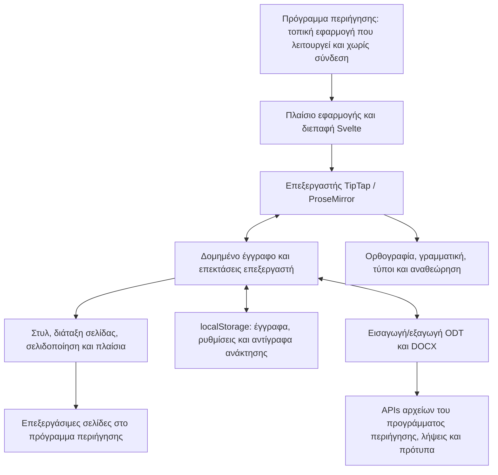

<p align="center">
  
</p>

<h1 align="center">
  
</h1>

<p align="center">
  <strong>Ολοκληρωμένος επεξεργαστής κειμένου απευθείας στο πρόγραμμα περιήγησης</strong><br>
  Δωρεάν · Ανοιχτός κώδικας · Private by Design
</p>

<p align="center">
  <a href="https://github.com/stffnb/edentext/actions/workflows/ci.yml"></a>
  <a href="../../LICENSE"></a>
  <a href="../../CHANGELOG.md"></a>
  
</p>

<p align="center">
  <a href="https://edentext.app"><strong>▶ Άνοιγμα του EdenText</strong></a>
</p>

<p align="center">
  <a href="../../README.md">English</a> · <a href="README.de.md">Deutsch</a> · <a href="README.es.md">Español</a> · <a href="README.fr.md">Français</a> · <a href="README.pt.md">Português</a> · <b>Ελληνικά</b> · <a href="README.ru.md">Русский</a> · <a href="README.uk.md">Українська</a> · <a href="README.ja.md">日本語</a> · <a href="README.zh-CN.md">简体中文</a> · <a href="README.zh-TW.md">繁體中文</a>
</p>

<picture>
  <source media="(prefers-color-scheme: dark)" srcset="../hero-dark.webp">
  
</picture>

---

Το EdenText είναι ένας ισχυρός επεξεργαστής κειμένου στο πρόγραμμα περιήγησης, από μια γρήγορη σημείωση μέχρι ολόκληρο βιβλίο. Χωρίς διακομιστή, χωρίς λογαριασμό: όλα γίνονται τοπικά και τα έγγραφα δεν φεύγουν ποτέ από τον υπολογιστή. Αρκεί να ανοίξετε τον σύνδεσμο ή να εγκαταστήσετε το EdenText ως εφαρμογή και να δουλεύετε χωρίς σύνδεση. Για τις περισσότερες γλώσσες η πρώτη λήψη είναι περίπου 2 MB, ενώ τα λεξικά και οι γραμματοσειρές φορτώνονται όταν χρειαστούν[^1]. Η διεπαφή είναι διαθέσιμη στα αγγλικά, γερμανικά, ισπανικά, γαλλικά, πορτογαλικά, ελληνικά, ρωσικά, ουκρανικά, ιαπωνικά και κινεζικά (απλοποιημένα και παραδοσιακά).

> [!NOTE]
> Το EdenText είναι ακόμη σε **beta** και αναπτύσσεται ενεργά. Δοκιμές και έλεγχοι
> round-trip επιβεβαιώνουν ότι λειτουργεί. Παρ’ όλα αυτά, σε αυτή τη φάση δεν αποκλείονται
> σφάλματα, γι’ αυτό κρατήστε αντίγραφα ασφαλείας των σημαντικών εγγράφων. Επιπλέον, το
> πρόγραμμα περιήγησης κρατά τις τρεις τελευταίες εκδόσεις του ανοιχτού εγγράφου, σε
> περίπτωση που κάποτε δεν ανοίγει.
>
> **Βρήκατε σφάλμα ή ένα έγγραφο δεν εμφανίζεται σωστά;**
> [Ανοίξτε ένα issue](https://github.com/stffnb/edentext/issues), κάθε αναφορά βοηθά.
> Μας ενδιαφέρουν ιδιαίτερα έγγραφα που εμφανίζονται διαφορετικά στο EdenText από ό,τι
> στο Word, στο LibreOffice ή στο WPS Office: επισυνάψτε το αρχείο (ή ένα συντομευμένο
> αντίγραφο) και θα γίνει περίπτωση ελέγχου.

<a href="https://edentext.app"><picture>
  <source media="(prefers-color-scheme: dark)" srcset="../showcase/thesis-dark.png">
  
</picture></a>

## Δυνατότητες

- **Πραγματική σελιδοποίηση** — σελίδες A4/Letter, περιθώρια, κεφαλίδες και υποσέλιδα,
  υποσημειώσεις, στήλες, αρίθμηση σελίδων και γραμμών, υδατογραφήματα· για βιβλία,
  κατοπτρικά περιθώρια και κεφάλαια που ξεκινούν σε δεξιά σελίδα
- **Ανοίγει και αποθηκεύει `.odt` και `.docx`**, εξάγει PDF· πρότυπα (`.ott`/`.dotx`) και
  συλλογή επιστολών (DIN 5008)· αρχεία με κωδικό πρόσβασης και στις δύο μορφές
- **Συμβατό με Word, LibreOffice και WPS Office** — τα έγγραφα διατηρούν τη διάταξή τους·
  αυτόματες δοκιμές round-trip και διάταξης το ελέγχουν σε σύγκριση με το LibreOffice
- **Στυλ** — στυλ παραγράφου, χαρακτήρα, πίνακα και λίστας με κληρονομικότητα, αρίθμηση
  κεφαλαίων
- **Πίνακες** με στυλ, ταξινόμηση και τύπους όπως σε υπολογιστικό φύλλο
- **Ό,τι χρειάζεται μια διπλωματική** — πίνακας περιεχομένων, λεζάντες, παραπομπές,
  αναφορές και βιβλιογραφία, ευρετήριο, μαθηματικοί τύποι (LaTeX)
- **Αναθεώρηση** — παρακολούθηση αλλαγών και νήματα σχολίων σε μπαλόνια στο περιθώριο,
  σύγκριση και συγχώνευση με άλλο αρχείο,
  εκτυπώσιμες σημάνσεις, ορθογραφικός έλεγχος (αγγλικά, γερμανικά, ισπανικά, γαλλικά,
  πορτογαλικά, ελληνικά, ρωσικά και ουκρανικά), συνώνυμα (οι ίδιες γλώσσες εκτός από τα
  ελληνικά), γραμματικός έλεγχος (αγγλικά)
- **Προαιρετικός βοηθός ΤΝ** — με πάροχο της επιλογής σας ή τοπικό μοντέλο· απαντά σε
  ερωτήσεις για το έγγραφο και το επεξεργάζεται με παρακολούθηση αλλαγών. Μπορεί να
  απενεργοποιηθεί· τα αιτήματα πηγαίνουν απευθείας στον πάροχο, χωρίς να περνούν από
  διακομιστή του EdenText
- **Private by Design** — τα έγγραφα δεν φεύγουν ποτέ από τον υπολογιστή, όλα γίνονται
  τοπικά· ως εγκατεστημένη εφαρμογή λειτουργεί και χωρίς σύνδεση. Το edentext.app μετρά
  ανώνυμα τις επισκέψεις (GoatCounter, φιλοξενία στην ΕΕ, χωρίς cookies· οι αυτο-φιλοξενούμενες εγκαταστάσεις και η εφαρμογή επιφάνειας εργασίας δεν μετρούν τίποτα)· ο ίδιος ο
  επεξεργαστής δεν στέλνει τίποτα, εκτός από τα αιτήματα προς τον επιλεγμένο πάροχο όταν
  ο βοηθός ΤΝ είναι ενεργός. Τα έγγραφα αποθηκεύονται αυτόματα στο πρόγραμμα περιήγησης·
  στα «Πρόσφατα έγγραφα» μπορείτε να ορίσετε τα κλειστά έγγραφα να διαγράφονται στην
  επόμενη εκκίνηση ή να μην αποθηκεύονται καθόλου. Ένα ιδιωτικό παράθυρο δεν αφήνει ίχνη
  αφού κλείσει
- **Κάθε σύγχρονο πρόγραμμα περιήγησης** — στο Chrome και στο Edge η «Αποθήκευση» γράφει
  στο ανοιχτό αρχείο, το ίδιο και στο Brave μόλις ενεργοποιηθεί το
  `brave://flags/#file-system-access-api`· αλλιώς κάθε αποθήκευση είναι μια λήψη. Για να
  διαλέγετε πού θα αποθηκευτεί, ενεργοποιήστε στις ρυθμίσεις του προγράμματος περιήγησης
  την ερώτηση για τη θέση αποθήκευσης πριν από κάθε λήψη

Τα σημεία όπου το πρόγραμμα περιήγησης εμποδίζει το EdenText να δείχνει ακριβώς όπως το
Word ή το LibreOffice περιγράφονται στα [Known limitations](../../CHANGELOG.md#known-limitations) (στα αγγλικά).

## Συλλογή

Τα έγγραφα αυτών των εικόνων βρίσκονται στο [`docs/showcase/`](../showcase/) σε `.odt`
και `.docx` και ανοίγουν απευθείας στο EdenText, στο LibreOffice ή στο Word. Δημιουργούνται
από το `scripts/showcase/run.mjs`· οι φωτογραφίες είναι της NASA και το βιβλίο του Lewis
Carroll, όλα κοινό κτήμα.

<table>
<tr>
<td width="50%" valign="top"><a href="../showcase/thesis-review.png"></a><br><b>Αναθεώρηση</b> — παρακολούθηση αλλαγών, νήματα σχολίων στο περιθώριο, υδατογράφημα «Πρόχειρο»</td>
<td width="50%" valign="top"><a href="../showcase/book-spread.png"></a><br><b>Βιβλίο</b> — A5 με κατοπτρικά περιθώρια. Κάθε κεφάλαιο ξεκινά σε δεξιά σελίδα, η κεφαλίδα δείχνει τον τίτλο του βιβλίου στις αριστερές σελίδες και τον τίτλο του κεφαλαίου στις δεξιές, και η αρίθμηση ξεκινά από το πρώτο κεφάλαιο</td>
</tr>
<tr>
<td width="50%" valign="top"><a href="../showcase/newsletter.png"></a><br><b>Ενημερωτικό δελτίο</b> — στήλες, εικόνες με λεζάντα, πλαίσιο στο πλάι</td>
<td width="50%" valign="top"><a href="../showcase/newsletter-tables.png"></a><br><b>Πίνακες</b> — στυλ πινάκων και τύποι όπως σε υπολογιστικό φύλλο</td>
</tr>
</table>

## Εφαρμογή για υπολογιστή

Κάθε έκδοση περιλαμβάνει επίσης μη υπογεγραμμένα προγράμματα εγκατάστασης, φτιαγμένα με Electron:

- **macOS** — `EdenText-<version>-arm64.dmg` (Apple Silicon) ή `EdenText-<version>.dmg` (Intel).
  Σύρετε την εφαρμογή στον φάκελο «Εφαρμογές». Επειδή δεν είναι υπογεγραμμένη, την πρώτη
  φορά ανοίξτε την με δεξί κλικ → Άνοιγμα ή εκτελέστε `xattr -d com.apple.quarantine /Applications/EdenText.app`.
- **Windows** — `EdenText-Setup-<version>.exe`. Το SmartScreen προειδοποιεί για άγνωστο
  εκδότη: Περισσότερες πληροφορίες → Εκτέλεση οπωσδήποτε.
- **Linux** — `EdenText-<version>.AppImage` (`chmod +x` και μετά εκτέλεση) ή το `.deb`
  (`sudo apt install ./edentext_*.deb`).

Η εφαρμογή επιφάνειας εργασίας ανοίγει έγγραφα από τη διαχείριση αρχείων και αποθηκεύει
τις αλλαγές στο ίδιο αρχείο, γράφει PDF απευθείας χωρίς το παράθυρο εκτύπωσης και
ενημερώνει κατά την εκκίνηση όταν υπάρχει νεότερη έκδοση.

## Ανάπτυξη

```bash
npm install
npm run dev      # διακομιστής ανάπτυξης με hot reload
npm test         # σουίτα δοκιμών
npm run build    # build παραγωγής → dist/
cd desktop && npm install && npm start   # εφαρμογή υπολογιστή στο ίδιο build
```

Φτιαγμένο με Svelte 5, TypeScript, Vite και TipTap 3 (ProseMirror).

## Δική σας φιλοξενία

Το EdenText δεν χρειάζεται backend και δεν αποθηκεύει τίποτα στον διακομιστή· τα έγγραφα
μένουν στο πρόγραμμα περιήγησης. Για κάθε έκδοση δημοσιεύεται ένα container image (amd64
και arm64):

```bash
docker run -p 8080:80 ghcr.io/stffnb/edentext
```

Εναλλακτικά, κάθε έκδοση περιέχει το αρχείο `edentext-<tag>.zip` με την έτοιμη εφαρμογή·
το `npm run build` δημιουργεί τα ίδια αρχεία στο `dist/`. Ο φάκελος αυτός μπορεί να
φιλοξενηθεί σε οποιονδήποτε web server. Το container image μπορεί επίσης να δημιουργηθεί
τοπικά με `docker build -t edentext .`.
Για το Kubernetes υπάρχει στο [`charts/edentext`](../../charts/edentext) ένα Helm chart που συντηρείται από την κοινότητα.

Για ενημέρωση, αντιγράψτε τα νέα αρχεία πάνω στα παλιά αντί να αδειάσετε πρώτα τον φάκελο.
Οι καρτέλες που άνοιξαν πριν από την ενημέρωση συνεχίζουν να φορτώνουν τα αρχεία της δικής
τους έκδοσης μέχρι να ανανεωθούν. Ο διακομιστής πρέπει να απαντά στα αρχεία που λείπουν με
404 και όχι με `index.html`, ώστε αυτές οι καρτέλες να μπορούν να ζητήσουν ανανέωση.

Συνιστούμε να διαθέτετε το EdenText μέσω HTTPS. Μέσω απλού HTTP ο επεξεργαστής λειτουργεί
επίσης, αλλά τα προγράμματα περιήγησης απενεργοποιούν τότε ορισμένες λειτουργίες: τη χρήση
χωρίς σύνδεση, την εγκατάσταση ως εφαρμογή, την αποθήκευση απευθείας στο ανοιχτό αρχείο
(αντί γι’ αυτό γίνεται λήψη) και τα κουμπιά αντιγραφής. Στο localhost όλα λειτουργούν όπως
με HTTPS.

## Αρχιτεκτονική



Το EdenText τρέχει εξ ολοκλήρου στο πρόγραμμα περιήγησης: το `App.svelte` συνθέτει τη
διεπαφή γύρω από το μοντέλο εγγράφου του TipTap και τις επεκτάσεις του. Τα στυλ και η
διάταξη μετατρέπουν αυτό το μοντέλο σε επεξεργάσιμες σελίδες· η αποθήκευση κρατά την
τοπική κατάσταση και τα αντίγραφα ανάκτησης. Η εισαγωγή και η εξαγωγή μεταφράζουν το ίδιο
μοντέλο σε ODT και DOCX, και τα APIs αρχείων του προγράμματος περιήγησης αποθηκεύουν ή
κατεβάζουν το αποτέλεσμα. Λεπτομέρειες για τις μορφές και τη διάταξη υπάρχουν στην
[τεκμηρίωση αρχιτεκτονικής](../architecture/) (στα αγγλικά).

## Συνεισφορά

Οι συνεισφορές είναι ευπρόσδεκτες: δείτε το [CONTRIBUTING.md](../../CONTRIBUTING.md) (στα
αγγλικά). Για το merge χρειάζεται υπογεγραμμένο [CLA](../../CLA.md)· ελέγχεται αυτόματα σε κάθε
pull request.

### Ευχαριστίες

Ευχαριστώ όλους όσοι βοήθησαν με ιδέες, αναφορές σφαλμάτων, δοκιμές και σχόλια. Πέρα από τους συνεισφέροντες που εμφανίζει το GitHub, θέλω επίσης να ευχαριστήσω:

Patrick R., [@Deleh](https://github.com/Deleh), [@lukasmwerner](https://github.com/lukasmwerner), [@JinJieBeWater](https://github.com/JinJieBeWater), [@farragoo](https://github.com/farragoo), [@sbvelinga](https://github.com/sbvelinga)

<p>
<a href="https://github.com/stffnb"></a>
<a href="https://github.com/Camthalion77"></a>
<a href="https://github.com/ehrensperger-niklas"></a>
<a href="https://github.com/farragoo"></a>
<a href="https://github.com/blairhoddinott"></a>
<a href="https://github.com/Deleh"></a>
<a href="https://github.com/lukasmwerner"></a>
<a href="https://github.com/JinJieBeWater"></a>
<a href="https://github.com/sbvelinga"></a>
</p>

## Άδεια

Copyright © 2026 Steffen Becker · Φτιαγμένο στη Γερμανία

[AGPL-3.0](../../LICENSE). Αν η AGPL δεν ταιριάζει, υπάρχει [εμπορική άδεια](../../LICENSE.commercial.md).
Οι ενσωματωμένες γραμματοσειρές και τα γλωσσικά δεδομένα διατηρούν τις δικές τους άδειες:
δείτε το [THIRD-PARTY-NOTICES.md](../../THIRD-PARTY-NOTICES.md).

*Το EdenText είναι ανεξάρτητο έργο, χωρίς σχέση με τη Microsoft ή το The Document
Foundation. Τα `.docx` και `.odt` υποστηρίζονται για λόγους διαλειτουργικότητας.*

*Αυτή είναι μετάφραση του αγγλικού [README](../../README.md)· σε περίπτωση απόκλισης ισχύει η αγγλική έκδοση.*

[^1]: Συμπιεσμένη μεταφορά: ~1,0 MB κώδικας εφαρμογής· τα υπόλοιπα είναι ο ορθογραφικός
    έλεγχος με το λεξικό της γλώσσας του προγράμματος περιήγησης και οι γραμματοσειρές της
    σελίδας που εμφανίζεται. Το ελληνικό λεξικό προσθέτει ~2,5 MB και το ουκρανικό
    ~1,5 MB. Όλα τα άλλα φορτώνονται μόνο όταν χρειαστούν και μένουν αποθηκευμένα για
    χρήση χωρίς σύνδεση· όλες οι γραμματοσειρές, τα λεξικά και οι θησαυροί μαζί είναι
    ~18 MB, ή ~26 MB με τον αγγλικό γραμματικό έλεγχο.
