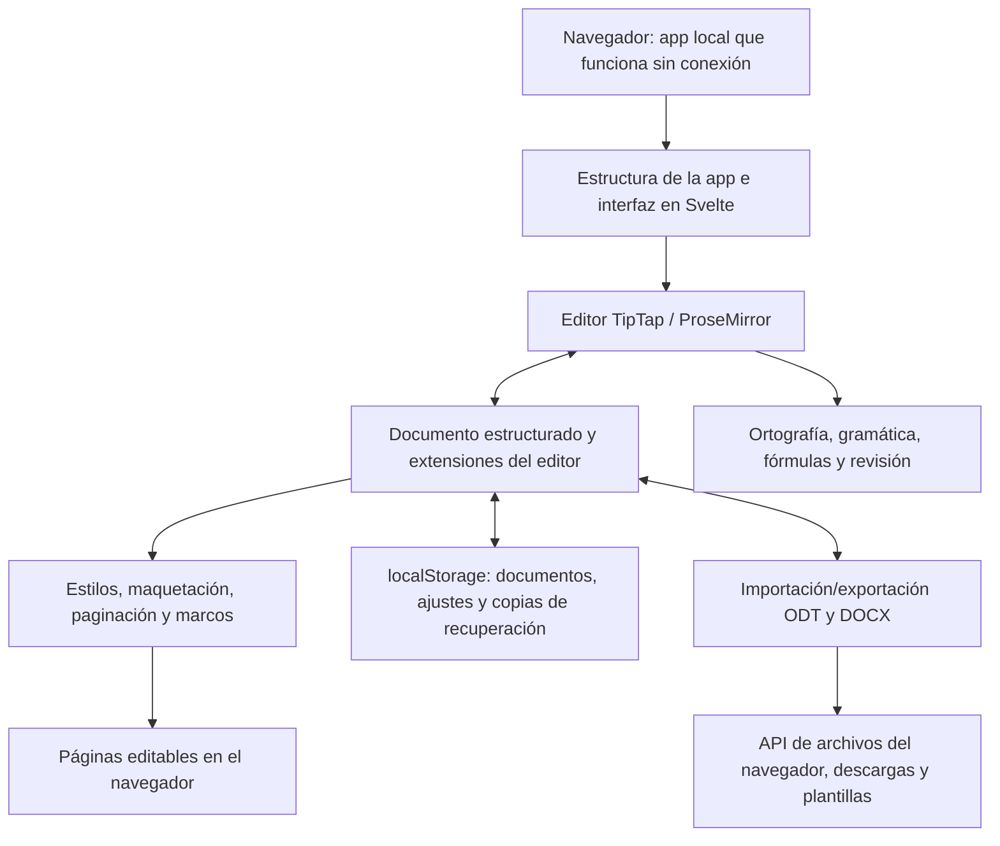

<p align="center">
  
</p>

<h1 align="center">
  
</h1>

<p align="center">
  <strong>Procesador de textos completo, directamente en el navegador</strong><br>
  Gratuito · Código abierto · Privacidad desde el diseño
</p>

<p align="center">
  <a href="https://github.com/stffnb/edentext/actions/workflows/ci.yml"></a>
  <a href="../../LICENSE"></a>
  <a href="../../CHANGELOG.md"></a>
  
</p>

<p align="center">
  <a href="https://edentext.app"><strong>▶ Abrir EdenText</strong></a>
</p>

<p align="center">
  <a href="../../README.md">English</a> · <a href="README.de.md">Deutsch</a> · <b>Español</b> · <a href="README.fr.md">Français</a> · <a href="README.pt.md">Português</a> · <a href="README.el.md">Ελληνικά</a> · <a href="README.ru.md">Русский</a> · <a href="README.uk.md">Українська</a> · <a href="README.ja.md">日本語</a> · <a href="README.zh-CN.md">简体中文</a> · <a href="README.zh-TW.md">繁體中文</a>
</p>

<picture>
  <source media="(prefers-color-scheme: dark)" srcset="../hero-dark.webp">
  
</picture>

---

EdenText es un potente procesador de textos que funciona en el navegador y sirve para todo: desde notas rápidas hasta libros completos. Sin servidor ni cuenta: todo se procesa en local y tus documentos nunca salen de tu equipo. Basta con abrir el enlace, o instalar EdenText como app y usarlo sin conexión. En la mayoría de los idiomas, la primera descarga ocupa unos 2 MB; los diccionarios y las fuentes se cargan cuando hacen falta[^1]. La interfaz está disponible en inglés, alemán, español, francés, portugués, griego, ruso, ucraniano, japonés y chino (simplificado y tradicional).

> [!NOTE]
> EdenText todavía está en **beta** y en pleno desarrollo. Las pruebas y las
> comprobaciones de ida y vuelta verifican su funcionamiento. Aun así, en esta fase no se
> pueden descartar errores, así que guarda copias de los documentos importantes. Además, el navegador
> conserva las tres últimas versiones del documento abierto por si alguna vez no se
> puede cargar.
>
> **¿Encontraste un error, o un documento no se ve como debería?**
> [Abre un issue](https://github.com/stffnb/edentext/issues), cada aviso ayuda. Nos
> interesan sobre todo los documentos que se ven distintos en EdenText que en Word,
> LibreOffice o WPS Office: adjunta el archivo (o una copia reducida) y se convertirá en
> un caso de prueba.

<a href="https://edentext.app"><picture>
  <source media="(prefers-color-scheme: dark)" srcset="../showcase/thesis-dark.png">
  
</picture></a>

## Funciones

- **Maquetación de página de verdad** — páginas A4/Carta, márgenes, encabezados y pies de
  página, notas al pie, columnas, numeración de páginas y de líneas, marcas de agua; para
  libros, márgenes simétricos y capítulos que empiezan en página impar
- **Abre y guarda `.odt` y `.docx`**, exporta a PDF; plantillas (`.ott`/`.dotx`) y una
  galería de cartas (DIN 5008); archivos protegidos con contraseña en ambos formatos
- **Compatible con Word, LibreOffice y WPS Office** — los documentos conservan su
  maquetación; pruebas automáticas de ida y vuelta y de maquetación lo comprueban frente a
  LibreOffice
- **Estilos** — de párrafo, de carácter, de tabla y de lista, con herencia; numeración de
  capítulos
- **Tablas** con estilos, ordenación y fórmulas como en una hoja de cálculo
- **Todo lo que necesita una tesis** — índice general, leyendas, referencias cruzadas,
  citas y bibliografía, índice alfabético, fórmulas (LaTeX)
- **Herramientas de revisión** — control de cambios e hilos de comentarios en globos al
  margen, comparación y combinación con otro archivo, marcas imprimibles, corrector ortográfico (inglés, alemán, español, francés,
  portugués, griego, ruso y ucraniano), sinónimos (los mismos idiomas salvo el griego), corrector
  gramatical (inglés)
- **Asistente de IA opcional** — con tu propio proveedor o un modelo local; responde
  preguntas sobre el documento y lo edita con control de cambios. Se puede desactivar;
  las solicitudes van directamente al proveedor, sin pasar por ningún servidor de EdenText
- **Privacidad desde el diseño** — tus documentos nunca salen de tu equipo y todo se
  procesa en local; funciona sin conexión como app instalable. edentext.app cuenta las
  visitas de forma anónima (GoatCounter, alojado en la UE, sin cookies; las instalaciones propias y la app de escritorio no cuentan nada); el editor no
  envía nada, salvo al proveedor elegido si activas el asistente de IA. Los documentos se
  guardan automáticamente en el navegador; en «Documentos recientes» se puede elegir que
  los documentos cerrados se borren en el siguiente inicio o que no se guarden. Una
  ventana privada no deja rastro al cerrarla
- **Cualquier navegador actual** — en Chrome y Edge, «Guardar» escribe en el archivo
  abierto, y en Brave también una vez activado `brave://flags/#file-system-access-api`;
  en los demás casos cada guardado es una descarga. Para elegir la ubicación, activa en
  los ajustes del navegador que pregunte dónde guardar cada descarga

Dónde el navegador impide que EdenText se vea exactamente como Word o LibreOffice se
explica en [Known limitations](../../CHANGELOG.md#known-limitations) (en inglés).

## Galería

Los documentos de estas imágenes están en [`docs/showcase/`](../showcase/) en `.odt` y
`.docx`, listos para abrir en EdenText, LibreOffice o Word. Los genera
`scripts/showcase/run.mjs`; las fotografías son de la NASA y el libro es de Lewis Carroll,
ambos de dominio público.

<table>
<tr>
<td width="50%" valign="top"><a href="../showcase/thesis-review.png"></a><br><b>Revisión</b> — control de cambios, hilos de comentarios al margen, una marca de agua de borrador</td>
<td width="50%" valign="top"><a href="../showcase/book-spread.png"></a><br><b>Libro</b> — A5 con márgenes simétricos. Cada capítulo empieza en una página derecha, el encabezado muestra el título del libro en las páginas izquierdas y el del capítulo en las derechas, y la numeración empieza en el primer capítulo</td>
</tr>
<tr>
<td width="50%" valign="top"><a href="../showcase/newsletter.png"></a><br><b>Boletín</b> — columnas, imágenes con leyenda, un recuadro lateral</td>
<td width="50%" valign="top"><a href="../showcase/newsletter-tables.png"></a><br><b>Tablas</b> — estilos de tabla y fórmulas como en una hoja de cálculo</td>
</tr>
</table>

## Aplicación de escritorio

Cada versión incluye además instaladores de escritorio sin firmar, creados con Electron:

- **macOS** — `EdenText-<version>-arm64.dmg` (Apple Silicon) o `EdenText-<version>.dmg` (Intel).
  Arrastra la app a Aplicaciones. Como no está firmada, ábrela la primera vez con clic
  derecho → Abrir, o ejecuta `xattr -d com.apple.quarantine /Applications/EdenText.app`.
- **Windows** — `EdenText-Setup-<version>.exe`. SmartScreen avisa de un editor
  desconocido: Más información → Ejecutar de todas formas.
- **Linux** — `EdenText-<version>.AppImage` (`chmod +x` y luego ejecútalo) o el `.deb`
  (`sudo apt install ./edentext_*.deb`).

La app de escritorio abre documentos desde el gestor de archivos y guarda los cambios en
el mismo archivo, escribe PDF directamente sin el diálogo de impresión y avisa al
iniciarse cuando hay una versión más reciente.

## Desarrollo

```bash
npm install
npm run dev      # servidor de desarrollo con recarga en caliente
npm test         # suite de pruebas
npm run build    # compilación de producción → dist/
cd desktop && npm install && npm start   # app de escritorio sobre la misma compilación
```

Creado con Svelte 5, TypeScript, Vite y TipTap 3 (ProseMirror).

## Autoalojamiento

EdenText no necesita backend ni guarda nada en el servidor; los documentos se quedan en el
navegador. Con cada versión se publica una imagen de contenedor (amd64 y arm64):

```bash
docker run -p 8080:80 ghcr.io/stffnb/edentext
```

Como alternativa, cada versión incluye el archivo `edentext-<tag>.zip` con la app
compilada; `npm run build` genera los mismos archivos en `dist/`. Cualquier servidor web
puede alojar esa carpeta. La imagen de contenedor también se puede crear en local con
`docker build -t edentext .`.
Para Kubernetes hay un chart de Helm mantenido por la comunidad en [`charts/edentext`](../../charts/edentext).

Para actualizar, copia los archivos nuevos sobre los antiguos en lugar de vaciar antes la
carpeta. Las pestañas abiertas antes de la actualización siguen cargando los archivos de
su versión hasta que se recargan. El servidor debe responder a los archivos que faltan con
404 y no con `index.html`, para que esas pestañas puedan pedir que se recarguen.

Recomendamos servir EdenText por HTTPS. Por HTTP simple el editor también funciona, pero
los navegadores desactivan entonces algunas funciones: el uso sin conexión, la instalación
como app, guardar directamente en el archivo abierto (en su lugar se descarga) y los
botones de copiar. En localhost todo funciona igual que con HTTPS.

## Arquitectura



EdenText funciona por completo en el navegador: `App.svelte` compone la interfaz en torno
al modelo de documento de TipTap y sus extensiones. Los estilos y la maquetación convierten
ese modelo en páginas editables; el almacenamiento guarda el estado local y las copias de
recuperación. La importación y la exportación traducen ese mismo modelo a ODT y DOCX, y las
API de archivos del navegador guardan o descargan los archivos resultantes. Los detalles
sobre formatos y maquetación están en la [documentación de arquitectura](../architecture/) (en inglés).

## Contribuir

Las contribuciones son bienvenidas: consulta [CONTRIBUTING.md](../../CONTRIBUTING.md) (en
inglés). Para fusionar hace falta haber firmado el [CLA](../../CLA.md), algo que se comprueba
automáticamente en cada pull request.

### Agradecimientos

Gracias a todas las personas que han ayudado con ideas, informes de errores, pruebas y
comentarios. Además de los colaboradores que muestra GitHub, también quiero dar las
gracias a:

Patrick R., [@Deleh](https://github.com/Deleh), [@lukasmwerner](https://github.com/lukasmwerner), [@JinJieBeWater](https://github.com/JinJieBeWater), [@farragoo](https://github.com/farragoo), [@sbvelinga](https://github.com/sbvelinga)

<p>
<a href="https://github.com/stffnb"></a>
<a href="https://github.com/Camthalion77"></a>
<a href="https://github.com/ehrensperger-niklas"></a>
<a href="https://github.com/farragoo"></a>
<a href="https://github.com/blairhoddinott"></a>
<a href="https://github.com/Deleh"></a>
<a href="https://github.com/lukasmwerner"></a>
<a href="https://github.com/JinJieBeWater"></a>
<a href="https://github.com/sbvelinga"></a>
</p>

## Licencia

Copyright © 2026 Steffen Becker · Hecho en Alemania

[AGPL-3.0](../../LICENSE). Si la AGPL no encaja, hay una [licencia comercial](../../LICENSE.commercial.md). Las fuentes y los datos lingüísticos incluidos conservan
sus propias licencias: consulta [THIRD-PARTY-NOTICES.md](../../THIRD-PARTY-NOTICES.md).

*EdenText es un proyecto independiente, sin relación con Microsoft ni con The Document
Foundation. `.docx` y `.odt` se admiten por interoperabilidad.*

*Esta es una traducción del [README](../../README.md) en inglés; en caso de discrepancia, prevalece la versión inglesa.*

[^1]: Transferencia por red, comprimida: ~1,0 MB de código de la app; el resto es el
    corrector ortográfico con el diccionario del idioma del navegador y las fuentes que
    muestra una página. Los diccionarios de griego y ucraniano añaden ~2,5 y ~1,5 MB.
    Todo lo demás se descarga cuando hace falta y se conserva para usarlo sin conexión;
    todas las fuentes, diccionarios y tesauros juntos suman ~18 MB, o ~26 MB con el
    corrector gramatical de inglés.
