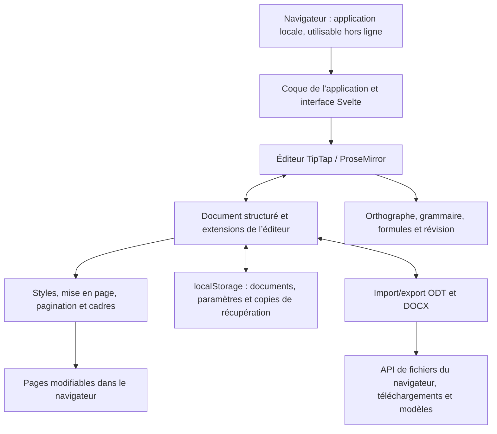

<p align="center">
  
</p>

<h1 align="center">
  
</h1>

<p align="center">
  <strong>Traitement de texte complet, directement dans le navigateur</strong><br>
  Gratuit · Open source · Private by Design
</p>

<p align="center">
  <a href="https://github.com/stffnb/edentext/actions/workflows/ci.yml"></a>
  <a href="../../LICENSE"></a>
  <a href="../../CHANGELOG.md"></a>
  
</p>

<p align="center">
  <a href="https://edentext.app"><strong>▶ Ouvrir EdenText</strong></a>
</p>

<p align="center">
  <a href="../../README.md">English</a> · <a href="README.de.md">Deutsch</a> · <a href="README.es.md">Español</a> · <b>Français</b> · <a href="README.pt.md">Português</a> · <a href="README.el.md">Ελληνικά</a> · <a href="README.ru.md">Русский</a> · <a href="README.uk.md">Українська</a> · <a href="README.ja.md">日本語</a> · <a href="README.zh-CN.md">简体中文</a> · <a href="README.zh-TW.md">繁體中文</a>
</p>

<picture>
  <source media="(prefers-color-scheme: dark)" srcset="../hero-dark.webp">
  
</picture>

---

EdenText est un traitement de texte puissant qui s’utilise dans le navigateur, de la note rapide au livre entier. Ni serveur ni compte : tout est traité en local et vos documents ne quittent jamais votre ordinateur. Il suffit d’ouvrir le lien, ou d’installer EdenText comme application pour l’utiliser hors ligne. Pour la plupart des langues, le premier téléchargement fait environ 2 Mo ; les dictionnaires et les polices sont chargés au besoin[^1]. L’interface est disponible en anglais, allemand, espagnol, français, portugais, grec, russe, ukrainien, japonais et chinois (simplifié et traditionnel).

> [!NOTE]
> EdenText est encore en **bêta** et en développement actif. Des tests et des
> vérifications d’aller-retour en vérifient le fonctionnement. Des bugs restent néanmoins
> possibles à ce stade : gardez des sauvegardes de vos documents importants. Le navigateur
> conserve aussi les trois dernières versions du document ouvert, au cas où il ne se
> chargerait plus.
>
> **Un bug, ou un document qui s’affiche mal ?** Merci
> d’[ouvrir une issue](https://github.com/stffnb/edentext/issues), chaque signalement compte.
> Les documents qui s’affichent autrement dans EdenText que dans Word, LibreOffice ou WPS
> Office nous intéressent particulièrement : joignez le fichier (ou une copie allégée) et
> il deviendra un cas de test.

<a href="https://edentext.app"><picture>
  <source media="(prefers-color-scheme: dark)" srcset="../showcase/thesis-dark.png">
  
</picture></a>

## Fonctionnalités

- **Une vraie mise en page** – pages A4/Letter, marges, en-têtes et pieds de page, notes
  de bas de page, colonnes, numérotation des pages et des lignes, filigranes ; pour les
  livres, marges en miroir et chapitres qui commencent sur une page de droite
- **Ouvre et enregistre `.odt` et `.docx`**, exporte en PDF ; modèles (`.ott`/`.dotx`) et
  galerie de lettres (DIN 5008) ; fichiers protégés par mot de passe dans les deux formats
- **Compatible avec Word, LibreOffice et WPS Office** – les documents gardent leur mise en
  page ; des tests automatisés d’aller-retour et de mise en page le vérifient par rapport
  à LibreOffice
- **Styles** – styles de paragraphe, de caractère, de tableau et de liste avec héritage,
  numérotation des chapitres
- **Tableaux** avec styles, tri et formules façon tableur
- **Tout ce qu’il faut pour un mémoire ou une thèse** – table des matières, légendes,
  renvois, citations et bibliographie, index alphabétique, formules (LaTeX)
- **Outils de révision** – suivi des modifications et fils de commentaires dans des bulles
  en marge, comparaison et fusion avec un autre fichier, annotations imprimables, correction orthographique (anglais, allemand,
  espagnol, français, portugais, grec, russe et ukrainien), synonymes (toutes ces langues
  sauf le grec), correction grammaticale (anglais)
- **Assistant IA facultatif** – avec le fournisseur de votre choix ou un modèle local ; il
  répond aux questions sur le document et le modifie avec suivi des modifications. Il
  peut être désactivé ; les requêtes vont directement au fournisseur, sans passer par
  un serveur EdenText
- **Private by Design** – vos documents ne quittent jamais votre
  ordinateur, tout est traité en local ; fonctionne hors ligne comme application
  installable. edentext.app compte les visites de façon anonyme (GoatCounter, hébergé dans
  l’UE, sans cookies ; les instances auto-hébergées et l’application de bureau ne comptent rien) ; l’éditeur lui-même n’envoie rien, sauf au fournisseur choisi si
  l’assistant IA est activé. Les documents sont enregistrés automatiquement dans le
  navigateur ; dans « Documents récents », on peut choisir de supprimer les documents
  fermés au démarrage suivant ou de ne pas les enregistrer du tout. Une fenêtre de
  navigation privée ne laisse aucune trace une fois fermée
- **Tous les navigateurs actuels** – dans Chrome et Edge, « Enregistrer » écrit dans le
  fichier ouvert, et Brave aussi une fois `brave://flags/#file-system-access-api` activé ;
  sinon, chaque enregistrement est un téléchargement. Pour choisir l’emplacement, il
  suffit d’indiquer dans les paramètres du navigateur qu’il doit demander où enregistrer
  chaque fichier

Les cas où le navigateur empêche EdenText de reproduire exactement Word ou LibreOffice sont
décrits dans [Known limitations](../../CHANGELOG.md#known-limitations) (en anglais).

## Galerie

Les documents de ces images se trouvent dans [`docs/showcase/`](../showcase/) en
`.odt` et `.docx`, prêts à être ouverts dans EdenText, LibreOffice ou Word. Ils sont générés
par `scripts/showcase/run.mjs` ; les photos viennent de la NASA et le livre est de Lewis
Carroll, tous deux dans le domaine public.

<table>
<tr>
<td width="50%" valign="top"><a href="../showcase/thesis-review.png"></a><br><b>Révision</b> – suivi des modifications, fils de commentaires en marge, filigrane « brouillon »</td>
<td width="50%" valign="top"><a href="../showcase/book-spread.png"></a><br><b>Livre</b> – A5 avec marges en miroir. Chaque chapitre commence sur une page de droite, l’en-tête affiche le titre du livre sur les pages de gauche et celui du chapitre sur les pages de droite, et la numérotation commence au premier chapitre</td>
</tr>
<tr>
<td width="50%" valign="top"><a href="../showcase/newsletter.png"></a><br><b>Lettre d’information</b> – colonnes, images légendées, encadré latéral</td>
<td width="50%" valign="top"><a href="../showcase/newsletter-tables.png"></a><br><b>Tableaux</b> – styles de tableau et formules façon tableur</td>
</tr>
</table>

## Application de bureau

Chaque version est aussi livrée avec des installateurs de bureau non signés, construits avec Electron :

- **macOS** – `EdenText-<version>-arm64.dmg` (Apple Silicon) ou `EdenText-<version>.dmg` (Intel).
  Glissez l’application dans Applications. Comme elle n’est pas signée, ouvrez-la la première
  fois par clic droit → Ouvrir, ou exécutez `xattr -d com.apple.quarantine /Applications/EdenText.app`.
- **Windows** – `EdenText-Setup-<version>.exe`. SmartScreen signale un éditeur inconnu :
  Informations complémentaires → Exécuter quand même.
- **Linux** – `EdenText-<version>.AppImage` (`chmod +x`, puis lancez-le) ou le `.deb`
  (`sudo apt install ./edentext_*.deb`).

L’application de bureau ouvre les documents depuis le gestionnaire de fichiers et y
enregistre directement, écrit les PDF sans passer par la boîte de dialogue d’impression et
signale au démarrage qu’une version plus récente est disponible.

## Développement

```bash
npm install
npm run dev      # serveur de développement avec rechargement à chaud
npm test         # suite de tests
npm run build    # build de production → dist/
cd desktop && npm install && npm start   # application de bureau sur le même build
```

Construit avec Svelte 5, TypeScript, Vite et TipTap 3 (ProseMirror).

## Auto-hébergement

EdenText n’a pas besoin de backend et ne stocke rien sur le serveur ; les documents
restent dans le navigateur. Une image de conteneur est publiée pour chaque version (amd64
et arm64) :

```bash
docker run -p 8080:80 ghcr.io/stffnb/edentext
```

Sinon, chaque version contient le fichier `edentext-<tag>.zip` avec l’application compilée
; `npm run build` produit les mêmes fichiers dans `dist/`. N’importe quel serveur web peut
héberger ce dossier. L’image de conteneur peut aussi être construite localement avec
`docker build -t edentext .`.
Pour Kubernetes, un chart Helm maintenu par la communauté se trouve dans [`charts/edentext`](../../charts/edentext).

Pour une mise à jour, copiez les nouveaux fichiers par-dessus les anciens au lieu de vider
d’abord le dossier. Les onglets ouverts avant la mise à jour continuent de charger les
fichiers de leur version jusqu’à ce qu’ils soient rechargés. Le serveur doit répondre aux
fichiers manquants par une erreur 404 et non par `index.html`, afin que ces onglets
puissent demander à être rechargés.

Nous recommandons de servir EdenText en HTTPS. En HTTP simple, l’éditeur fonctionne aussi,
mais les navigateurs désactivent alors certaines fonctions : l’usage hors ligne,
l’installation comme application, l’enregistrement direct dans le fichier ouvert (il est
téléchargé à la place) et les boutons de copie. Sur localhost, tout fonctionne comme en
HTTPS.

## Architecture



EdenText fonctionne entièrement dans le navigateur : `App.svelte` assemble l’interface
autour du modèle de document TipTap et de ses extensions. Les styles et la mise en page
transforment ce modèle en pages modifiables ; le stockage conserve l’état local et les
copies de récupération. L’import et l’export traduisent ce même modèle en ODT et DOCX, et
les API de fichiers du navigateur enregistrent ou téléchargent les fichiers obtenus. Les
détails sur les formats et la mise en page se trouvent dans la
[documentation d’architecture](../architecture/) (en anglais).

## Contribuer

Les contributions sont les bienvenues – voir [CONTRIBUTING.md](../../CONTRIBUTING.md) (en
anglais). Pour qu’une pull request soit fusionnée, il faut avoir signé le [CLA](../../CLA.md) ; c’est
vérifié automatiquement.

### Remerciements

Merci à toutes celles et tous ceux qui ont aidé par leurs idées, leurs signalements de
bugs, leurs tests et leurs retours. Outre les contributeurs listés sur GitHub, je
remercie également :

Patrick R., [@Deleh](https://github.com/Deleh), [@lukasmwerner](https://github.com/lukasmwerner), [@JinJieBeWater](https://github.com/JinJieBeWater), [@farragoo](https://github.com/farragoo), [@sbvelinga](https://github.com/sbvelinga)

<p>
<a href="https://github.com/stffnb"></a>
<a href="https://github.com/Camthalion77"></a>
<a href="https://github.com/ehrensperger-niklas"></a>
<a href="https://github.com/farragoo"></a>
<a href="https://github.com/blairhoddinott"></a>
<a href="https://github.com/Deleh"></a>
<a href="https://github.com/lukasmwerner"></a>
<a href="https://github.com/JinJieBeWater"></a>
<a href="https://github.com/sbvelinga"></a>
</p>

## Licence

Copyright © 2026 Steffen Becker · Fabriqué en Allemagne

[AGPL-3.0](../../LICENSE). Si l’AGPL ne convient pas, une
[licence commerciale](../../LICENSE.commercial.md) est disponible. Les polices et données linguistiques fournies
conservent leurs propres licences – voir [THIRD-PARTY-NOTICES.md](../../THIRD-PARTY-NOTICES.md).

*EdenText est un projet indépendant, sans lien avec Microsoft ni avec The Document
Foundation. Les formats `.docx` et `.odt` sont pris en charge à des fins d’interopérabilité.*

*Ceci est une traduction du [README](../../README.md) anglais ; en cas de divergence, la version anglaise fait foi.*

[^1]: Volume transféré, compressé : ~1,0 Mo de code d’application, le reste étant le
    correcteur orthographique avec le dictionnaire de la langue du navigateur et les
    polices qu’affiche une page ; les dictionnaires grec et ukrainien ajoutent ~2,5 et
    ~1,5 Mo. Tout le reste est téléchargé à la première utilisation puis conservé pour le
    hors-ligne ; l’ensemble des polices, dictionnaires et thésaurus pèse ~18 Mo, ou ~26 Mo
    avec la correction grammaticale anglaise.
