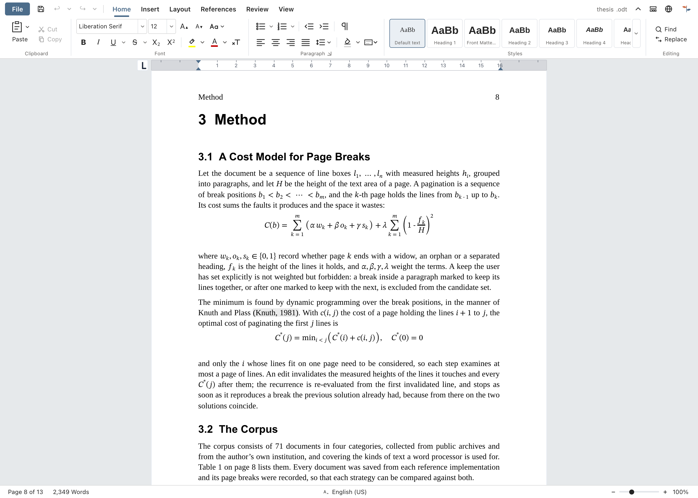
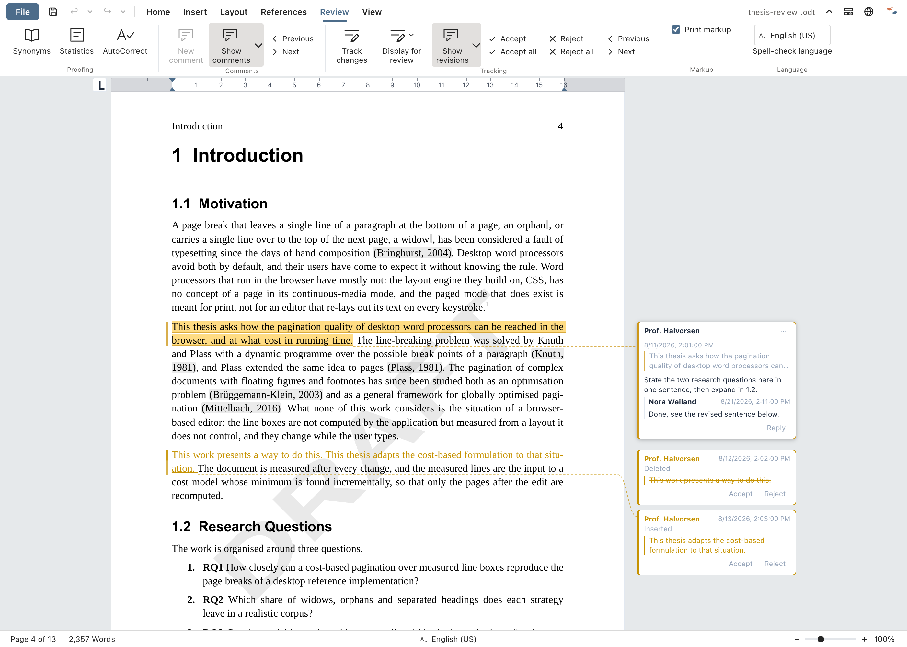
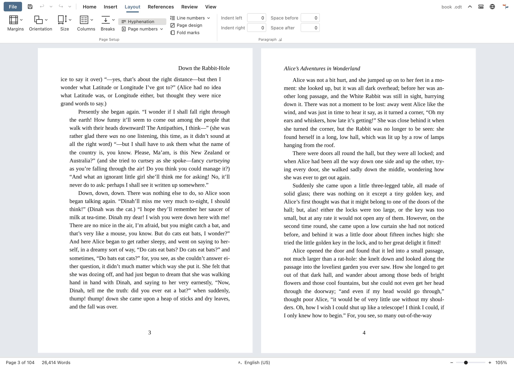
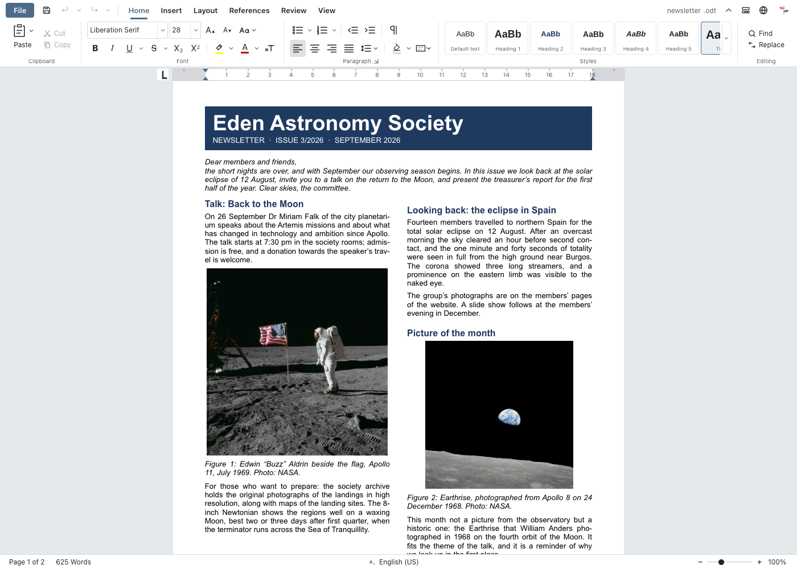
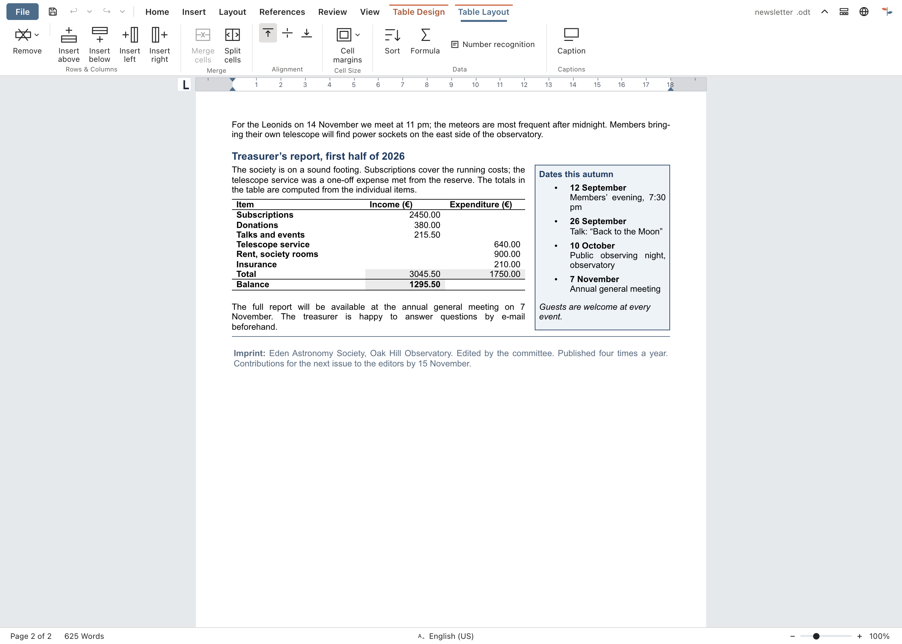
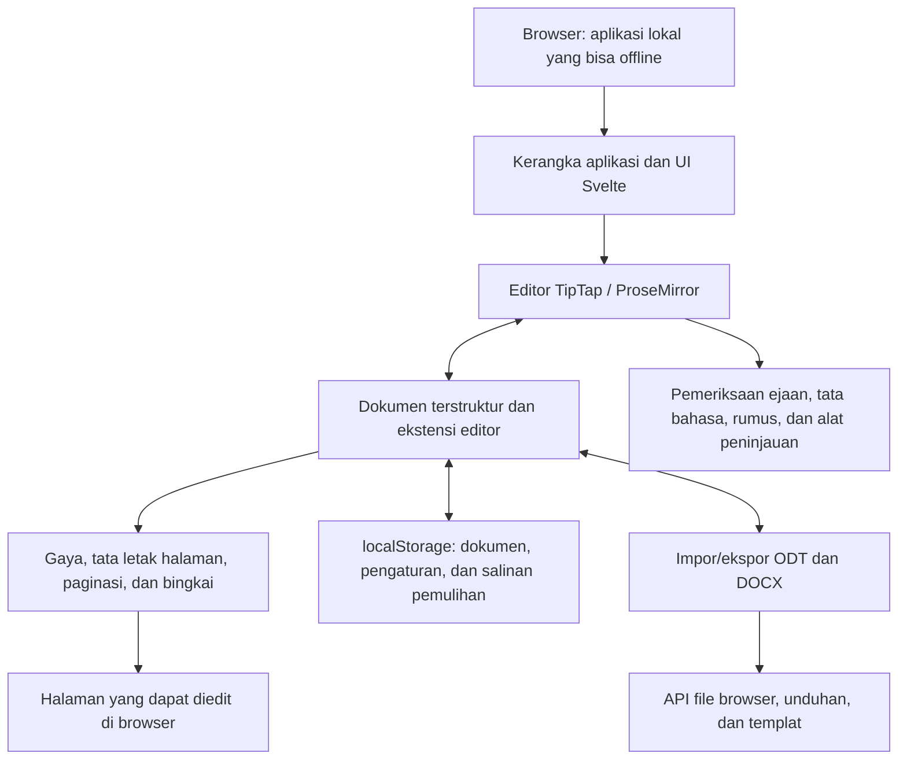

<p align="center">
  
</p>

<h1 align="center">
  
</h1>

<p align="center">
  <strong>Pengolah kata lengkap, langsung di browser</strong><br>
  Gratis · Sumber Terbuka · Private by Design
</p>

<p align="center">
  <a href="https://github.com/stffnb/edentext/actions/workflows/ci.yml"></a>
  <a href="../../LICENSE"></a>
  <a href="../../CHANGELOG.md"></a>
  
</p>

<p align="center">
  <a href="https://edentext.app"><strong>▶ Buka EdenText</strong></a>
</p>

<p align="center">
  <a href="../../README.md">English</a> · <a href="README.de.md">Deutsch</a> · <a href="README.es.md">Español</a> · <a href="README.fr.md">Français</a> · <a href="README.it.md">Italiano</a> · <a href="README.pt.md">Português</a> · <a href="README.el.md">Ελληνικά</a> · <a href="README.ru.md">Русский</a> · <a href="README.uk.md">Українська</a> · <a href="README.pl.md">Polski</a> · <b>Bahasa Indonesia</b> · <a href="README.ar.md">العربية</a> · <a href="README.ja.md">日本語</a> · <a href="README.ko.md">한국어</a> · <a href="README.zh-CN.md">简体中文</a> · <a href="README.zh-TW.md">繁體中文</a>
</p>

<picture>
  <source media="(prefers-color-scheme: dark)" srcset="../hero-dark.webp">
  
</picture>

---

EdenText adalah pengolah kata berbasis web yang tangguh untuk segala keperluan, dari catatan singkat hingga buku utuh. Tanpa server, tanpa akun: semuanya diproses secara lokal dan dokumen Anda tidak pernah keluar dari komputer. Cukup buka tautannya, atau instal EdenText sebagai aplikasi dan bekerja secara offline. Untuk sebagian besar bahasa, unduhan pertamanya sekitar 2 MB; kamus dan font dimuat saat dibutuhkan[^1]. Antarmukanya tersedia dalam bahasa Inggris, Jerman, Spanyol, Prancis, Italia, Portugis, Yunani, Rusia, Ukraina, Polandia, Indonesia, Arab, Jepang, Korea, dan Tionghoa (sederhana dan tradisional).

> [!NOTE]
> EdenText masih dalam tahap **beta** dan terus dikembangkan. Pengujian dan pemeriksaan
> round-trip memastikan semuanya berfungsi; meski begitu, bug belum bisa sepenuhnya
> dihindari pada tahap ini, jadi simpanlah cadangan dokumen yang penting bagi Anda. Browser
> juga menyimpan tiga versi terakhir dokumen yang sedang dibuka, untuk berjaga-jaga jika
> dokumen itu suatu saat gagal dimuat.
>
> **Menemukan bug, atau dokumen yang tampilannya tidak sesuai?** Silakan
> [buat issue](https://github.com/stffnb/edentext/issues) — setiap laporan sangat membantu.
> Kami terutama menantikan dokumen yang ditampilkan EdenText secara berbeda dari Word,
> LibreOffice, atau WPS Office: lampirkan file-nya (atau salinan yang sudah dipangkas),
> dan dokumen itu akan menjadi kasus uji.

<a href="https://edentext.app"><picture>
  <source media="(prefers-color-scheme: dark)" srcset="../showcase/thesis-dark.png">
  
</picture></a>

## Fitur

- **Tata letak halaman sungguhan** — halaman A4/Letter, margin, header & footer, catatan kaki,
  kolom, penomoran halaman dan baris, tanda air; untuk buku tersedia margin cermin dan bab
  yang dimulai di halaman kanan
- **Membuka dan menyimpan `.odt` dan `.docx`**, mengekspor PDF; templat (`.ott`/`.dotx`)
  dan galeri surat (DIN 5008); file yang dilindungi kata sandi dalam kedua format
- **Kompatibel dengan Word, LibreOffice, dan WPS Office** — tata letak dokumen tetap terjaga;
  pengujian round-trip dan tata letak otomatis memeriksanya terhadap LibreOffice
- **Gaya** — gaya paragraf, karakter, tabel, dan daftar yang dapat mewarisi gaya induknya,
  penomoran bab
- **Tabel** dengan gaya tabel, pengurutan, dan rumus seperti di lembar kerja
- **Semua yang dibutuhkan skripsi dan tesis** — daftar isi, keterangan, referensi silang,
  kutipan & bibliografi, indeks alfabetis, rumus (LaTeX)
- **Alat peninjauan** — lacak perubahan dan utas komentar dalam balon di margin,
  membandingkan dan menggabungkan dengan file lain,
  markup yang dapat dicetak, pemeriksaan ejaan (bahasa Inggris, Jerman, Spanyol, Prancis, Italia,
  Portugis, Yunani, Rusia, Ukraina, Polandia, Indonesia, Arab, dan Korea), sinonim (semua bahasa
  tersebut kecuali Yunani dan Korea), pemeriksaan tata bahasa (bahasa Inggris)
- **Asisten AI opsional** — dengan penyedia pilihan Anda sendiri atau model lokal;
  menjawab pertanyaan tentang dokumen dan mengeditnya sebagai perubahan terlacak. Dapat
  dimatikan; permintaan langsung dikirim ke penyedia, tanpa melalui server EdenText
- **Dikte** — bicaralah dan teksnya muncul di posisi kursor, dengan tanda baca yang diucapkan
  dalam bahasa Inggris dan Jerman. Memakai pengenalan ucapan browser (Chrome, Edge, Safari), yang
  mungkin mengirim audio ke layanan ucapannya; EdenText meminta izin sebelum pertama kali
  dipakai. Atau gunakan server pengenalan ucapan Anda sendiri, mis. Whisper di komputer ini,
  yang berfungsi di browser apa pun dan di aplikasi desktop
- **Private by Design** — dokumen Anda tidak pernah keluar dari komputer, semua
  pemrosesan berjalan secara lokal; dapat bekerja offline sebagai aplikasi yang diinstal. Editor
  tidak mengirim apa pun, kecuali jika Anda mengaktifkan asisten AI, yang mengirim ke penyedia
  pilihan Anda. Dikte memakai pengenalan ucapan browser, yang mungkin mengirim audio ke layanan ucapannya.
  Dokumen disimpan otomatis di browser; di “Dokumen terbaru”, Anda dapat mengatur agar dokumen
  yang ditutup dihapus saat aplikasi dibuka berikutnya atau tidak disimpan sama sekali, dan jendela
  pribadi tidak meninggalkan jejak apa pun setelah ditutup
- **Semua browser terkini** — di Chrome dan Edge, perintah “Simpan” menyimpan langsung ke file
  yang dibuka, begitu pula di Brave setelah `brave://flags/#file-system-access-api`
  diaktifkan; jika tidak, setiap penyimpanan menjadi unduhan, jadi aktifkan “Selalu tanyakan
  lokasi penyimpanan file” di pengaturan browser untuk memilih lokasinya

Hal-hal yang membuat EdenText tidak bisa sama persis dengan Word atau LibreOffice karena
keterbatasan browser dijelaskan di [Known limitations](../../CHANGELOG.md#known-limitations) (dalam bahasa Inggris).

## Galeri

Dokumen di balik gambar-gambar ini tersedia di [`docs/showcase/`](../showcase/) dalam format `.odt`
dan `.docx`, siap dibuka di EdenText, LibreOffice, atau Word. Dokumen-dokumen itu dibuat oleh
`scripts/showcase/run.mjs`; foto-fotonya milik NASA dan bukunya karya Lewis Carroll,
keduanya berstatus domain publik.

<table>
<tr>
<td width="50%" valign="top"><a href="../showcase/thesis-review.png"></a><br><b>Peninjauan</b> — perubahan terlacak, utas komentar di margin, tanda air draf</td>
<td width="50%" valign="top"><a href="../showcase/book-spread.png"></a><br><b>Buku</b> — A5 dengan margin cermin. Setiap bab dimulai di halaman kanan, header menampilkan judul buku di halaman kiri dan judul bab di halaman kanan, dan penomoran halaman dimulai dari bab pertama</td>
</tr>
<tr>
<td width="50%" valign="top"><a href="../showcase/newsletter.png"></a><br><b>Buletin</b> — kolom, gambar dengan keterangan, kotak samping</td>
<td width="50%" valign="top"><a href="../showcase/newsletter-tables.png"></a><br><b>Tabel</b> — gaya tabel dan rumus seperti di lembar kerja</td>
</tr>
</table>

## Aplikasi desktop

Setiap rilis juga menyertakan penginstal desktop tanpa tanda tangan digital yang dibuat dengan Electron:

- **macOS** — `EdenText-<version>-arm64.dmg` (Apple silicon) atau `EdenText-<version>.dmg` (Intel).
  Seret aplikasinya ke folder “Aplikasi”. Karena tidak ditandatangani, buka pertama kali melalui
  klik kanan → “Buka”, atau jalankan `xattr -d com.apple.quarantine /Applications/EdenText.app`.
- **Windows** — `EdenText-Setup-<version>.exe`. SmartScreen akan memperingatkan tentang penerbit
  yang tidak dikenal: “Info selengkapnya” → “Tetap jalankan”.
- **Linux** — `EdenText-<version>.AppImage` (`chmod +x`, lalu jalankan) atau paket `.deb`
  (`sudo apt install ./edentext_*.deb`).

Aplikasi desktop membuka dokumen dari pengelola file dan menyimpan perubahan langsung ke
file yang sama, menulis PDF langsung tanpa dialog cetak, dan memberi tahu Anda saat dimulai
jika versi yang lebih baru sudah tersedia.

## Pengembangan

```bash
npm install
npm run dev      # server pengembangan dengan hot reload
npm test         # rangkaian pengujian
npm run build    # build produksi → dist/
cd desktop && npm install && npm start   # aplikasi desktop di atas build yang sama
```

Dibuat dengan Svelte 5, TypeScript, Vite, dan TipTap 3 (ProseMirror).

## Hosting mandiri

EdenText tidak memerlukan backend dan tidak menyimpan apa pun di server; dokumen tetap berada
di browser. Image container diterbitkan untuk setiap rilis (amd64 dan arm64):

```bash
docker run -p 8080:80 ghcr.io/stffnb/edentext
```

Sebagai alternatif, setiap rilis menyertakan `edentext-<tag>.zip` berisi aplikasi yang sudah
di-build, dan `npm run build` menghasilkan file yang sama di `dist/`. Folder ini dapat
di-host oleh server web apa pun. Image container juga dapat di-build secara lokal dengan
`docker build -t edentext .`.
Helm chart untuk Kubernetes yang dikelola komunitas tersedia di [`charts/edentext`](../../charts/edentext).
Cara menyiapkan asisten AI, dikte, dan templat dokumen untuk semua pengguna dijelaskan di [`docs/self-hosting.md`](../self-hosting.md) (dalam bahasa Inggris).

Untuk memperbarui, salin file baru hingga menimpa file lama, alih-alih mengosongkan foldernya
terlebih dahulu. Tab yang dibuka sebelum pembaruan tetap memuat file dari versinya sendiri hingga
dimuat ulang. Server sebaiknya menjawab permintaan untuk file yang tidak ada dengan 404,
bukan dengan `index.html`, agar tab-tab tersebut dapat meminta untuk dimuat ulang.

Kami menyarankan agar EdenText disajikan melalui HTTPS. Editor ini juga berfungsi melalui HTTP
biasa, tetapi browser kemudian menonaktifkan beberapa fitur: penggunaan offline, instalasi
sebagai aplikasi, penyimpanan langsung ke file yang dibuka (file akan diunduh sebagai gantinya),
dan tombol salin. Di localhost semuanya berfungsi seperti melalui HTTPS.

Versi yang di-host di GitHub Pages tersedia gratis untuk semua orang di
[edentext.app](https://edentext.app) (versi ini menghitung kunjungan secara anonim dengan
GoatCounter, yang di-host di UE, tanpa cookie dan tanpa menyimpan alamat IP; aplikasi desktop,
image container, unduhan rilis, dan hasil build sendiri tidak berisi penghitung).

## Penyematan

Aplikasi web lain dapat menampilkan EdenText dalam iframe, sementara dokumennya tetap dikelola
oleh aplikasi tersebut.
Dengan `?embed=1`, editor tidak menampilkan pengelolaan file-nya sendiri. Skrip bantu `embed.js`,
yang disajikan oleh setiap instans, memuat file ke dalamnya dan mengambilnya kembali sebagai ODT,
DOCX, atau PDF; lihat [docs/architecture/embed.md](../../docs/architecture/embed.md).
Aplikasi host juga dapat mengatur bahasa, tema, dan warna aksen, serta mematikan asisten AI.
Dalam mode sematan, editor
menampilkan logo EdenText dan keterangan “Powered by EdenText”, yang wajib dipertahankan menurut
ketentuan AGPL ([NOTICE.md](../../NOTICE.md)) dan hanya dihilangkan oleh build white-label di bawah
[lisensi komersial](../../LICENSE.commercial.md) (`VITE_EDENTEXT_ATTRIBUTION=off`).

Untuk menjalankan editor dari server Anda sendiri, instal kedua paket npm. `@edentext/app`
berisi editor yang sudah di-build dan menyalinnya ke file statis Anda, dengan plugin Vite sebagai
alternatif; `@edentext/embed` adalah skrip bantunya, beserta elemen `<eden-text>` dan
komponen React.

```sh
npm install @edentext/app @edentext/embed
npx edentext-copy public/edentext --languages en,de
```

## Arsitektur



EdenText berjalan sepenuhnya di browser: `App.svelte` menyusun antarmuka di sekitar
model dokumen TipTap beserta ekstensi editornya. Gaya dan tata letak mengubah model itu
menjadi halaman yang dapat diedit; lapisan penyimpanan menjaga status lokal dan salinan
pemulihan. Impor dan ekspor menerjemahkan model yang sama ke ODT dan DOCX, sementara API file
browser menyimpan atau mengunduh file hasilnya. Lihat [panduan arsitektur](../architecture/)
(dalam bahasa Inggris) untuk invarian format dan tata letak.

## Berkontribusi

Kontribusi sangat kami sambut — lihat [CONTRIBUTING.md](../../CONTRIBUTING.md) (dalam bahasa
Inggris). Untuk melakukan merge, diperlukan [CLA](../../CLA.md) yang sudah ditandatangani; hal ini
diperiksa secara otomatis pada setiap pull request.

### Kontributor

Terima kasih kepada semua yang telah membantu — dengan ide, laporan bug, pengujian, dan masukan.
Selain kontributor yang tercantum di GitHub, saya juga ingin berterima kasih kepada:

Patrick R., [@Deleh](https://github.com/Deleh), [@lukasmwerner](https://github.com/lukasmwerner), [@JinJieBeWater](https://github.com/JinJieBeWater), [@farragoo](https://github.com/farragoo), [@sbvelinga](https://github.com/sbvelinga)

<p>
<a href="https://github.com/stffnb"></a>
<a href="https://github.com/Camthalion77"></a>
<a href="https://github.com/ehrensperger-niklas"></a>
<a href="https://github.com/farragoo"></a>
<a href="https://github.com/blairhoddinott"></a>
<a href="https://github.com/Deleh"></a>
<a href="https://github.com/lukasmwerner"></a>
<a href="https://github.com/JinJieBeWater"></a>
<a href="https://github.com/sbvelinga"></a>
</p>

## Lisensi

Copyright © 2026 Steffen Becker · Dibuat di Jerman

[AGPL-3.0](../../LICENSE), dengan ketentuan tambahan berdasarkan bagian 7(b) untuk mode sematan
([NOTICE.md](../../NOTICE.md)). [Lisensi komersial](../../LICENSE.commercial.md) tersedia
untuk kebutuhan yang tidak cocok dengan AGPL. Font dan data bahasa yang disertakan tetap
memakai lisensinya masing-masing — lihat [THIRD-PARTY-NOTICES.md](../../THIRD-PARTY-NOTICES.md).
Skrip bantu sematan dan perkakas npm berada di bawah Lisensi MIT, sehingga halaman host dapat
memakainya apa pun lisensinya sendiri ([NOTICE.md](../../NOTICE.md)).

*EdenText adalah proyek independen dan tidak berafiliasi dengan Microsoft maupun The
Document Foundation. `.docx` dan `.odt` didukung demi interoperabilitas.*

*Ini adalah terjemahan dari [README](../../README.md) berbahasa Inggris; jika ada perbedaan, versi bahasa Inggris yang berlaku.*

[^1]: Ukuran transfer terkompresi: ~1,0 MB kode aplikasi, sisanya pemeriksa ejaan dengan
    kamus untuk bahasa browser serta font yang ditampilkan di halaman; kamus bahasa Yunani dan
    Ukraina menambah ~2,5 MB dan ~1,5 MB. Semua yang lain diunduh saat dibutuhkan, lalu disimpan
    untuk penggunaan offline; seluruh font, kamus, dan tesaurus totalnya ~22 MB, atau ~31 MB
    dengan pemeriksaan tata bahasa Inggris.
