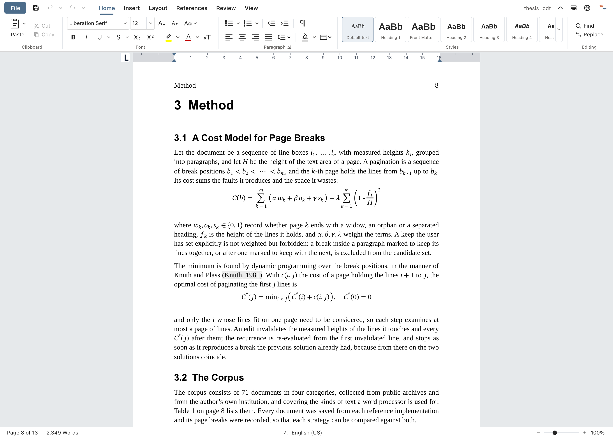
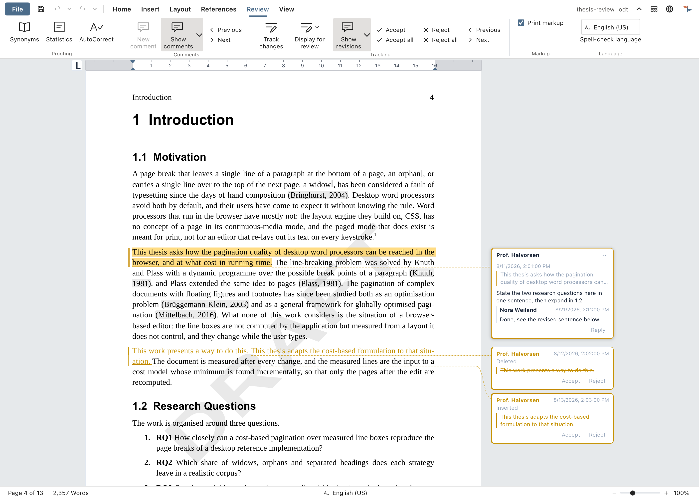
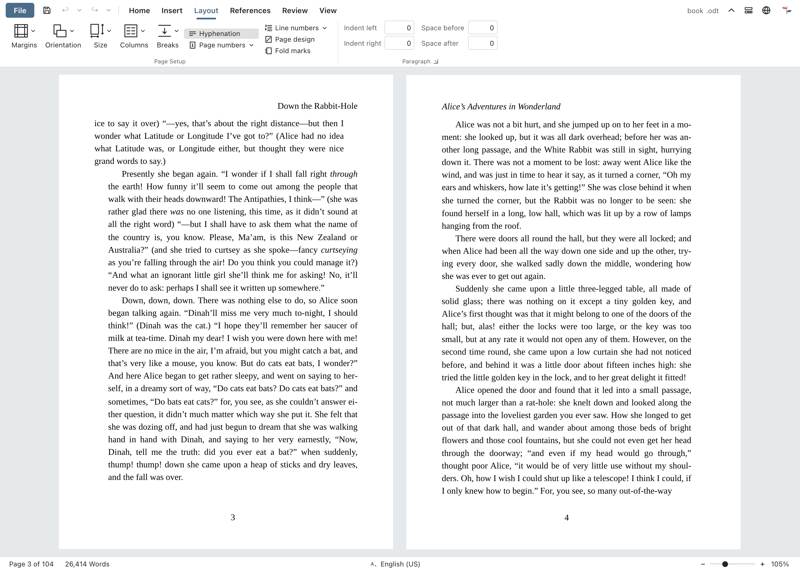
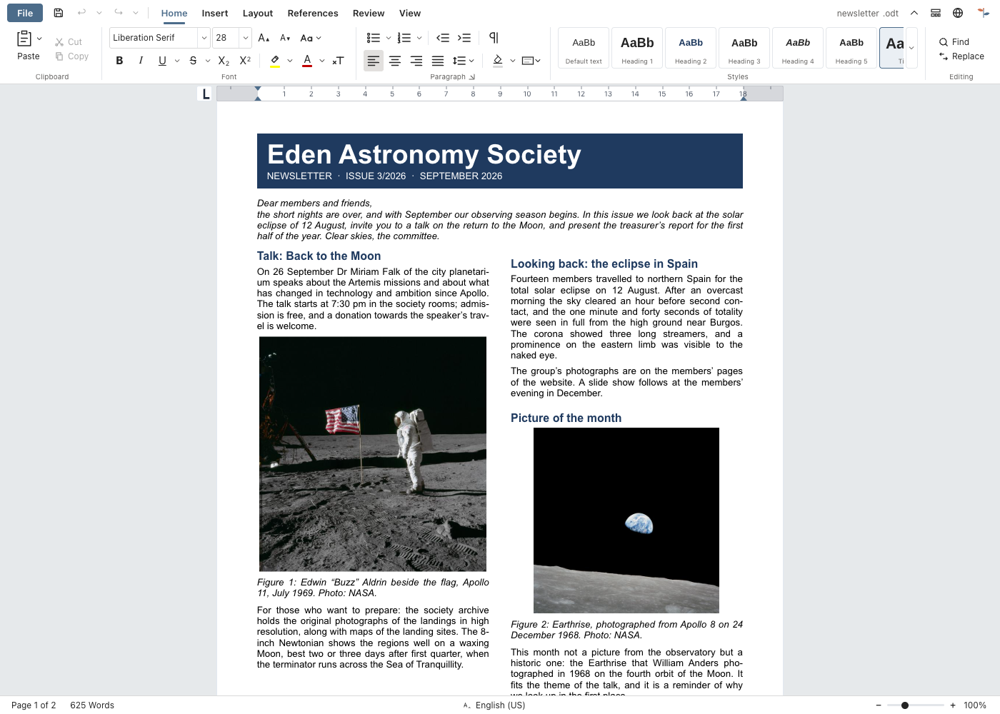
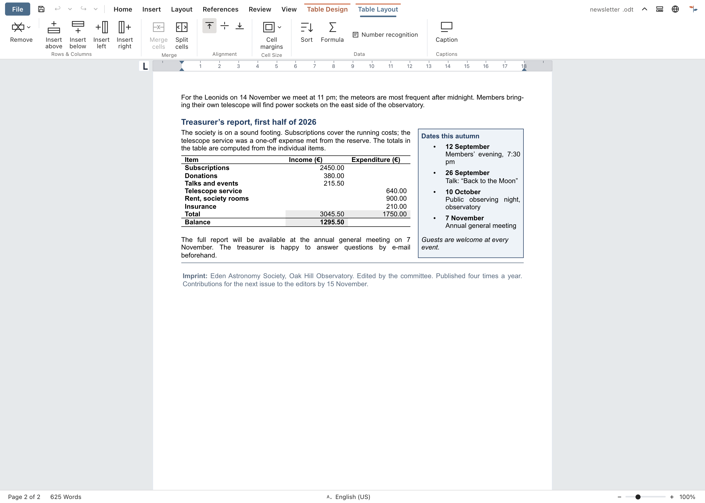
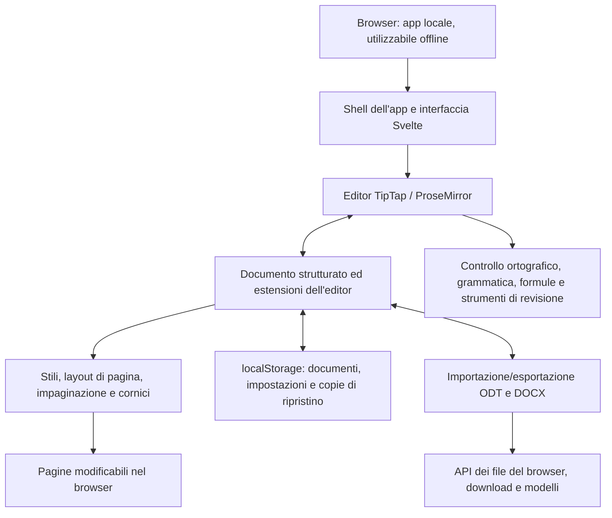

<p align="center">
  
</p>

<h1 align="center">
  
</h1>

<p align="center">
  <strong>Un elaboratore di testi completo, direttamente nel browser</strong><br>
  Gratuito · Open source · Private by Design
</p>

<p align="center">
  <a href="https://github.com/stffnb/edentext/actions/workflows/ci.yml"></a>
  <a href="../../LICENSE"></a>
  <a href="../../CHANGELOG.md"></a>
  
</p>

<p align="center">
  <a href="https://edentext.app"><strong>▶ Apri EdenText</strong></a>
</p>

<p align="center">
  <a href="../../README.md">English</a> · <a href="README.de.md">Deutsch</a> · <a href="README.es.md">Español</a> · <a href="README.fr.md">Français</a> · <b>Italiano</b> · <a href="README.pt.md">Português</a> · <a href="README.el.md">Ελληνικά</a> · <a href="README.ru.md">Русский</a> · <a href="README.uk.md">Українська</a> · <a href="README.ja.md">日本語</a> · <a href="README.zh-CN.md">简体中文</a> · <a href="README.zh-TW.md">繁體中文</a>
</p>

<picture>
  <source media="(prefers-color-scheme: dark)" srcset="../hero-dark.webp">
  
</picture>

---

EdenText è un elaboratore di testi potente che funziona nel browser, adatto a tutto: dagli appunti veloci ai libri interi. Niente server, niente account: l'elaborazione avviene in locale e i tuoi documenti non lasciano mai il computer. Basta aprire il link, oppure installarlo come app e lavorare offline. Per la maggior parte delle lingue il primo download è di circa 2 MB; dizionari e caratteri vengono caricati quando servono[^1]. L'interfaccia è disponibile in inglese, tedesco, spagnolo, francese, italiano, portoghese, greco, russo, ucraino, giapponese e cinese (semplificato e tradizionale).

> [!NOTE]
> EdenText è ancora in **beta** ed è in pieno sviluppo. Test automatici e prove di
> andata e ritorno tra i formati ne verificano il funzionamento; in questa fase però
> non si possono escludere errori, quindi conserva una copia dei documenti importanti.
> Il browser mantiene inoltre le ultime tre versioni del documento aperto, nel caso
> in cui non si riesca più a caricarlo.
>
> **Hai trovato un bug o un documento che non viene visualizzato bene?**
> [Apri una segnalazione](https://github.com/stffnb/edentext/issues): ogni segnalazione è utile.
> Sono particolarmente graditi i documenti che EdenText mostra in modo diverso da Word,
> LibreOffice o WPS Office: allega il file (o una copia ridotta all'essenziale) e
> diventerà un caso di test.

<a href="https://edentext.app"><picture>
  <source media="(prefers-color-scheme: dark)" srcset="../showcase/thesis-dark.png">
  
</picture></a>

## Funzionalità

- **Vero layout di pagina**: pagine A4/Letter, margini, intestazioni e piè di pagina,
  note a piè di pagina, colonne, numerazione di pagine e righe, filigrane; per i libri
  margini simmetrici e capitoli che iniziano su una pagina destra
- **Apre e salva `.odt` e `.docx`** ed esporta in PDF; modelli (`.ott`/`.dotx`)
  e una raccolta di lettere (DIN 5008); file protetti da password in entrambi i formati
- **Compatibile con Word, LibreOffice e WPS Office**: i documenti mantengono il loro
  layout, e test automatici di andata e ritorno e di impaginazione lo verificano con LibreOffice
- **Stili**: stili di paragrafo, di carattere, di tabella e di elenco con ereditarietà,
  numerazione dei capitoli
- **Tabelle** con stili, ordinamento e formule come in un foglio di calcolo
- **Tutto ciò che serve per una tesi**: sommario, didascalie, riferimenti incrociati,
  citazioni e bibliografia, indice analitico, formule (LaTeX)
- **Strumenti di revisione**: revisioni e commenti con risposte nei fumetti a margine,
  confronto e unione con un altro file, stampa delle revisioni, controllo ortografico
  (inglese, tedesco, spagnolo, francese, italiano, portoghese, greco, russo e ucraino),
  sinonimi (in tutte queste lingue tranne il greco), controllo grammaticale (inglese)
- **Assistente IA facoltativo**: con il provider che preferisci o con un modello locale;
  risponde a domande sul documento e lo modifica sotto forma di revisioni. Si può
  disattivare; le richieste vanno direttamente al provider, senza passare da un server EdenText
- **Privacy by design**: i documenti non lasciano mai il computer e tutta
  l'elaborazione avviene in locale; installato come app funziona anche offline.
  L'editor non invia nulla, a meno che non si attivi l'assistente IA, che invia i dati al provider scelto.
  I documenti vengono salvati automaticamente nel browser; in Documenti recenti si può
  scegliere di eliminare quelli chiusi all'avvio successivo o di non conservarli affatto,
  e una finestra privata non lascia traccia una volta chiusa
- **Qualsiasi browser recente**: in Chrome ed Edge, Salva scrive direttamente nel file
  aperto, e lo stesso vale per Brave dopo aver attivato `brave://flags/#file-system-access-api`;
  negli altri casi ogni salvataggio è un download, quindi conviene attivare
  "Chiedi dove salvare ciascun file" nelle impostazioni del browser per scegliere la posizione

I casi in cui il browser impedisce a EdenText di riprodurre esattamente Word o
LibreOffice sono descritti in [Known limitations](../../CHANGELOG.md#known-limitations).

## Galleria

I documenti mostrati in queste immagini si trovano in [`docs/showcase/`](../showcase/) in formato
`.odt` e `.docx`, pronti da aprire in EdenText, LibreOffice o Word. Vengono generati da
`scripts/showcase/run.mjs`; le fotografie sono della NASA e il libro è di Lewis Carroll,
entrambi di pubblico dominio.

<table>
<tr>
<td width="50%" valign="top"><a href="../showcase/thesis-review.png"></a><br><b>Revisione</b>: revisioni, commenti con risposte a margine, filigrana di bozza</td>
<td width="50%" valign="top"><a href="../showcase/book-spread.png"></a><br><b>Libro</b>: formato A5 con margini simmetrici. Ogni capitolo inizia su una pagina destra, l'intestazione riporta il titolo del libro sulle pagine sinistre e quello del capitolo sulle pagine destre, e la numerazione delle pagine parte dal primo capitolo</td>
</tr>
<tr>
<td width="50%" valign="top"><a href="../showcase/newsletter.png"></a><br><b>Newsletter</b>: colonne, immagini con didascalia, un riquadro laterale</td>
<td width="50%" valign="top"><a href="../showcase/newsletter-tables.png"></a><br><b>Tabelle</b>: stili tabella e formule come in un foglio di calcolo</td>
</tr>
</table>

## App desktop

Ogni release include anche programmi di installazione desktop non firmati, realizzati con Electron:

- **macOS**: `EdenText-<version>-arm64.dmg` (Apple Silicon) o `EdenText-<version>.dmg` (Intel).
  Trascina l'app in Applicazioni. Poiché non è firmata, la prima volta aprila con
  clic destro → Apri, oppure esegui `xattr -d com.apple.quarantine /Applications/EdenText.app`.
- **Windows**: `EdenText-Setup-<version>.exe`. SmartScreen avvisa che l'editore è
  sconosciuto: Ulteriori informazioni → Esegui comunque.
- **Linux**: `EdenText-<version>.AppImage` (`chmod +x`, poi avvialo) oppure il pacchetto `.deb`
  (`sudo apt install ./edentext_*.deb`).

L'app desktop apre i documenti dal file manager e salva le modifiche direttamente nello
stesso file, crea i PDF senza passare dalla finestra di stampa e all'avvio avvisa quando
è disponibile una versione più recente.

## Sviluppo

```bash
npm install
npm run dev      # server di sviluppo con ricaricamento automatico
npm test         # suite di test
npm run build    # build di produzione → dist/
cd desktop && npm install && npm start   # app desktop sulla stessa build
```

Realizzato con Svelte 5, TypeScript, Vite e TipTap 3 (ProseMirror).

## Self-hosting

EdenText non ha bisogno di un backend e non salva nulla sul server; i documenti restano nel browser.
Per ogni release viene pubblicata un'immagine container (amd64 e arm64):

```bash
docker run -p 8080:80 ghcr.io/stffnb/edentext
```

In alternativa, ogni release contiene `edentext-<tag>.zip` con l'app già compilata, e
`npm run build` crea gli stessi file in `dist/`. Qualsiasi server web può ospitare questa cartella.
L'immagine container si può anche creare in locale con `docker build -t edentext .`.
Un chart Helm per Kubernetes, mantenuto dalla comunità, si trova in [`charts/edentext`](../../charts/edentext).

Per un aggiornamento, copia i nuovi file sopra quelli vecchi invece di svuotare prima la cartella.
Le schede aperte prima dell'aggiornamento continuano a caricare i file della propria versione
finché non vengono ricaricate. Il server dovrebbe rispondere alle richieste di file mancanti con
404 e non con `index.html`, così che queste schede possano chiedere di essere ricaricate.

Consigliamo di servire EdenText tramite HTTPS. L'editor funziona anche con il semplice HTTP,
ma in quel caso i browser disattivano alcune funzioni: l'uso offline, l'installazione come app,
il salvataggio diretto nel file aperto (che viene invece scaricato) e i pulsanti per copiare.
Su localhost tutto funziona come con HTTPS.

Su [edentext.app](https://edentext.app) c'è una versione ospitata su GitHub Pages,
liberamente accessibile a tutti (conta le visite in forma anonima con GoatCounter,
ospitato nell'UE, senza cookie né indirizzi IP salvati; l'app desktop, l'immagine
container, il download della release e le build proprie non contengono alcun contatore).

## Integrazione

Un'altra applicazione web può mostrare EdenText in un iframe e gestire da sé il documento.
Con `?embed=1` l'editor rinuncia alla propria gestione dei file. Lo script `embed.js`,
fornito da ogni istanza, vi carica i file e li restituisce in formato ODT, DOCX o PDF;
vedi [docs/architecture/embed.md](../architecture/embed.md). In modalità integrata l'editor
mostra il logo di EdenText e la dicitura “Powered by EdenText”, che i termini della AGPL
impongono di mantenere ([NOTICE.md](../../NOTICE.md)) e che solo una build white label con la
[licenza commerciale](../../LICENSE.commercial.md) omette (`VITE_EDENTEXT_ATTRIBUTION=off`).

## Architettura



EdenText funziona interamente nel browser: `App.svelte` costruisce l'interfaccia attorno
al modello di documento di TipTap e alle estensioni dell'editor. Stili e layout trasformano
questo modello in pagine modificabili; l'archiviazione conserva lo stato locale e le copie
di ripristino. Importazione ed esportazione traducono lo stesso modello in ODT e DOCX, mentre
le API dei file del browser salvano o scaricano i file risultanti. Le
[guide all'architettura](../architecture/) descrivono le invarianti di formato e di layout.

## Contribuire

I contributi sono benvenuti: vedi [CONTRIBUTING.md](../../CONTRIBUTING.md). Per il merge
è necessario firmare il [CLA](../../CLA.md), verificato automaticamente a ogni pull request.

### Collaboratori

Grazie a tutti coloro che hanno dato una mano con idee, segnalazioni di bug, test e commenti.
Oltre ai collaboratori elencati da GitHub, desidero ringraziare anche:

Patrick R., [@Deleh](https://github.com/Deleh), [@lukasmwerner](https://github.com/lukasmwerner), [@JinJieBeWater](https://github.com/JinJieBeWater), [@farragoo](https://github.com/farragoo), [@sbvelinga](https://github.com/sbvelinga)

<p>
<a href="https://github.com/stffnb"></a>
<a href="https://github.com/Camthalion77"></a>
<a href="https://github.com/ehrensperger-niklas"></a>
<a href="https://github.com/farragoo"></a>
<a href="https://github.com/blairhoddinott"></a>
<a href="https://github.com/Deleh"></a>
<a href="https://github.com/lukasmwerner"></a>
<a href="https://github.com/JinJieBeWater"></a>
<a href="https://github.com/sbvelinga"></a>
</p>

## Licenza

Copyright © 2026 Steffen Becker · Made in Germany

[AGPL-3.0](../../LICENSE), con un termine aggiuntivo ai sensi della sezione 7(b) per la
modalità integrata ([NOTICE.md](../../NOTICE.md)). Per i casi d'uso a cui la AGPL non si
adatta è disponibile una [licenza commerciale](../../LICENSE.commercial.md). I caratteri e
i dati linguistici inclusi mantengono le proprie licenze: vedi
[THIRD-PARTY-NOTICES.md](../../THIRD-PARTY-NOTICES.md).

*EdenText è un progetto indipendente, non affiliato a Microsoft né a The Document
Foundation. I formati `.docx` e `.odt` sono supportati per garantire l'interoperabilità.*

[^1]: Trasferiti in forma compressa: circa 1,0 MB di codice dell'app, il resto è il
    correttore ortografico con il dizionario per la lingua del browser e i caratteri
    usati nella pagina; i dizionari greco e ucraino aggiungono circa 2,5 e 1,5 MB.
    Tutto il resto viene scaricato e conservato per l'uso offline la prima volta che
    serve; tutti i caratteri, i dizionari e i thesauri insieme occupano circa 19 MB,
    o circa 27 MB con il controllo grammaticale per l'inglese.
