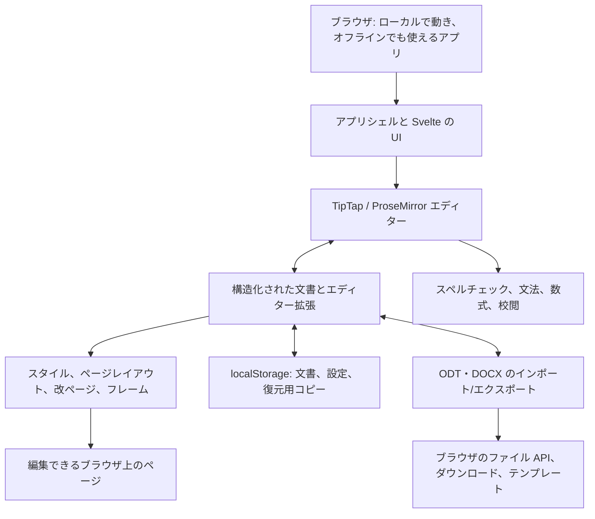

<p align="center">
  
</p>

<h1 align="center">
  
</h1>

<p align="center">
  <strong>本格的なワープロをブラウザで</strong><br>
  無料 · オープンソース · プライバシー重視
</p>

<p align="center">
  <a href="https://github.com/stffnb/edentext/actions/workflows/ci.yml"></a>
  <a href="../../LICENSE"></a>
  <a href="../../CHANGELOG.md"></a>
  
</p>

<p align="center">
  <a href="https://edentext.app"><strong>▶ EdenText を開く</strong></a>
</p>

<p align="center">
  <a href="../../README.md">English</a> · <a href="README.de.md">Deutsch</a> · <a href="README.es.md">Español</a> · <a href="README.fr.md">Français</a> · <a href="README.pt.md">Português</a> · <a href="README.el.md">Ελληνικά</a> · <a href="README.ru.md">Русский</a> · <a href="README.uk.md">Українська</a> · <b>日本語</b> · <a href="README.zh-CN.md">简体中文</a> · <a href="README.zh-TW.md">繁體中文</a>
</p>

<picture>
  <source media="(prefers-color-scheme: dark)" srcset="../hero-dark.webp">
  
</picture>

---

EdenText はブラウザで動く高機能なワープロです。ちょっとしたメモから一冊の本まで書けます。サーバーもアカウントも不要で、処理はすべてローカルで行われ、文書がパソコンの外に出ることはありません。リンクを開くだけで使えるほか、アプリとしてインストールすればオフラインでも使えます。ほとんどの言語で最初のダウンロードは約 2 MB で、辞書やフォントは必要になったときに読み込まれます[^1]。UI は英語、ドイツ語、スペイン語、フランス語、ポルトガル語、ギリシャ語、ロシア語、ウクライナ語、日本語、中国語（簡体字・繁体字）に対応しています。

> [!NOTE]
> EdenText はまだ**ベータ版**で、開発を続けています。テストとラウンドトリップ検証で
> 動作を確認していますが、現段階ではバグがないとは言い切れません。大事な文書は
> バックアップを取っておいてください。また、ブラウザには開いている文書の直近 3 つの
> 版が保存されるので、万一文書が開けなくなっても復元できます。
>
> **バグを見つけたり、文書が正しく表示されなかったりしたら**、
> [issue を作成](https://github.com/stffnb/edentext/issues)してください。どんな報告でも
> 助かります。特に、EdenText での表示が Word、LibreOffice、WPS Office と異なる文書は
> 大歓迎です。ファイル（または内容を削ったコピー）を添付していただければ、テスト
> ケースとして使わせていただきます。

<a href="https://edentext.app"><picture>
  <source media="(prefers-color-scheme: dark)" srcset="../showcase/thesis-dark.png">
  
</picture></a>

## 機能

- **本格的なページレイアウト** — A4/レターサイズ、余白、ヘッダー・フッター、脚注、
  段組み、ページ番号と行番号、透かし。書籍向けに見開きの余白や、章を右ページから
  始める設定も
- **`.odt` と `.docx` を開いて保存**、PDF 出力にも対応。テンプレート（`.ott`/`.dotx`）
  とレターテンプレート集（DIN 5008）、どちらの形式でもパスワード保護ファイルに対応
- **Word・LibreOffice・WPS Office と互換** — 文書のレイアウトはそのまま保たれます。
  自動のラウンドトリップテストとレイアウトテストで、LibreOffice と比較して確認しています
- **スタイル** — 段落・文字・表・リストのスタイル（継承あり）、章番号
- **表** — 表スタイル、並べ替え、表計算のような数式
- **論文に必要なものがひと通り** — 目次、図表番号、相互参照、引用と参考文献、索引、
  数式（LaTeX）
- **校閲** — 変更履歴、余白の吹き出しでのスレッド形式コメント、別のファイルとの比較と統合、印刷できる校閲記号、
  スペルチェック（英語、ドイツ語、スペイン語、フランス語、ポルトガル語、ギリシャ語、
  ロシア語、ウクライナ語）、類義語（このうちギリシャ語以外）、文法チェック（英語）
- **オプションの AI アシスタント** — 好きなプロバイダーやローカルモデルを使えます。
  文書についての質問に答え、変更履歴付きで文書を編集します。オフにもでき、リクエスト
  は EdenText のサーバーを経由せず、プロバイダーへ直接送られます
- **プライバシー重視の設計** — 文書がパソコンの外に出ることはなく、処理はすべて
  ローカル。インストールすればオフラインでも動きます。edentext.app は匿名でアクセス数を
  数えます（GoatCounter、EU 内でホスト、Cookie なし。セルフホスト版とデスクトップ版は何も数えません）。エディター自体は何も送信
  しません。例外は AI アシスタントをオンにしたときで、そのときだけ選んだプロバイダー
  にリクエストを送ります。文書はブラウザに自動保存されます。「最近使った文書」では、
  閉じた文書を次回起動時に削除するか、最初から保存しないように設定できます。
  プライベートウィンドウなら、閉じたあとに何も残りません
- **最新のブラウザならどれでも** — Chrome と Edge では「保存」で開いたファイルに直接
  書き戻します。Brave でも `brave://flags/#file-system-access-api` を有効にすれば
  同じです。それ以外では保存のたびにダウンロードになるので、保存先を選びたい場合は
  ブラウザの設定で「ダウンロード前に各ファイルの保存場所を確認する」をオンにして
  ください

ブラウザの制約で EdenText が Word や LibreOffice と完全には同じにならない点は、
[Known limitations](../../CHANGELOG.md#known-limitations)（英語）にまとめています。

## ギャラリー

これらの画像の元になった文書は [`docs/showcase/`](../showcase/) に `.odt` と `.docx`
で置いてあり、EdenText、LibreOffice、Word でそのまま開けます。`scripts/showcase/run.mjs`
で生成しています。写真は NASA、書籍はルイス・キャロルのもので、どちらもパブリック
ドメインです。

<table>
<tr>
<td width="50%" valign="top"><a href="../showcase/thesis-review.png"></a><br><b>校閲</b> — 変更履歴、余白のスレッド形式コメント、「下書き」の透かし</td>
<td width="50%" valign="top"><a href="../showcase/book-spread.png"></a><br><b>書籍</b> — A5、見開きで左右対称の余白。各章は右ページから始まり、ヘッダーには左ページに書名、右ページに章名が入ります。ページ番号は第 1 章から振られます</td>
</tr>
<tr>
<td width="50%" valign="top"><a href="../showcase/newsletter.png"></a><br><b>ニュースレター</b> — 段組み、キャプション付きの画像、サイドバーの囲み</td>
<td width="50%" valign="top"><a href="../showcase/newsletter-tables.png"></a><br><b>表</b> — 表スタイルと表計算のような数式</td>
</tr>
</table>

## デスクトップアプリ

各リリースには、Electron で作った署名なしのデスクトップ用インストーラーも付いています。

- **macOS** — `EdenText-<version>-arm64.dmg`（Apple シリコン）または `EdenText-<version>.dmg`（Intel）。
  アプリを「アプリケーション」フォルダーにドラッグします。署名がないため、初回は
  右クリック →「開く」で起動するか、`xattr -d com.apple.quarantine /Applications/EdenText.app` を実行してください。
- **Windows** — `EdenText-Setup-<version>.exe`。SmartScreen が「不明な発行元」と警告する
  ので、「詳細情報」→「実行」を選びます。
- **Linux** — `EdenText-<version>.AppImage`（`chmod +x` してから実行）または `.deb`
  （`sudo apt install ./edentext_*.deb`）。

デスクトップアプリはファイルマネージャーから文書を開いてそのまま上書き保存でき、印刷
ダイアログを経ずに PDF を書き出し、起動時に新しいバージョンがあれば知らせます。

## 開発

```bash
npm install
npm run dev      # ホットリロード付きの開発サーバー
npm test         # テストスイート
npm run build    # 本番ビルド → dist/
cd desktop && npm install && npm start   # 同じビルドでデスクトップアプリを起動
```

Svelte 5、TypeScript、Vite、TipTap 3（ProseMirror）で作られています。

## セルフホスト

EdenText はバックエンドを必要とせず、サーバーには何も保存しません。
文書はブラウザーの中にとどまります。
リリースごとにコンテナイメージ（amd64・arm64）を公開しています。

```bash
docker run -p 8080:80 ghcr.io/stffnb/edentext
```

このほか、各リリースにはビルド済みアプリを収めた `edentext-<tag>.zip` が含まれます。
`npm run build` を実行すると、同じファイルが `dist/` に作成されます。
このフォルダーは任意の Web サーバーで公開できます。
コンテナイメージは `docker build -t edentext .` で手元でもビルドできます。
Kubernetes 向けには、コミュニティが保守する Helm チャートが [`charts/edentext`](../../charts/edentext) にあります。

更新するときは、フォルダーを空にせず、新しいファイルを古いファイルの上にコピーしてください。
更新前に開いていたタブは、再読み込みされるまで自分のバージョンのファイルを読み込み続けます。
存在しないファイルへのリクエストには、`index.html` ではなく 404 を返すようにサーバーを設定してください。
そうすれば、こうしたタブが再読み込みを促せます。

EdenText は HTTPS で公開することをおすすめします。HTTP でもエディターは動作しますが、
ブラウザーによって一部の機能が無効になります。オフラインでの利用、アプリとしてのインストール、
開いたファイルへの直接保存（代わりにダウンロードされます）、コピーボタンです。
localhost では HTTPS と同じようにすべて使えます。

## アーキテクチャ



EdenText は完全にブラウザ内で動きます。`App.svelte` が TipTap の文書モデルとエディター
拡張を中心に UI を組み立てます。スタイルとレイアウトがそのモデルを編集できるページに
変え、ストレージ層がローカルの状態と復元用コピーを保持します。インポートとエクスポート
は同じモデルを ODT や DOCX と相互に変換し、ブラウザのファイル API が結果を保存または
ダウンロードします。形式やレイアウトの詳細は[アーキテクチャ文書](../architecture/)
（英語）をご覧ください。

## コントリビュート

コントリビューションを歓迎します。[CONTRIBUTING.md](../../CONTRIBUTING.md)（英語）をご覧
ください。マージには署名済みの [CLA](../../CLA.md) が必要で、プルリクエストごとに自動で
チェックされます。

### 協力者

アイデア、バグ報告、テスト、フィードバックで協力してくださった皆さんに感謝します。GitHub に表示されるコントリビューターに加えて、次の方々にも感謝します。

Patrick R.、[@Deleh](https://github.com/Deleh)、[@lukasmwerner](https://github.com/lukasmwerner)、[@JinJieBeWater](https://github.com/JinJieBeWater)、[@farragoo](https://github.com/farragoo), [@sbvelinga](https://github.com/sbvelinga)

<p>
<a href="https://github.com/stffnb"></a>
<a href="https://github.com/Camthalion77"></a>
<a href="https://github.com/ehrensperger-niklas"></a>
<a href="https://github.com/farragoo"></a>
<a href="https://github.com/blairhoddinott"></a>
<a href="https://github.com/Deleh"></a>
<a href="https://github.com/lukasmwerner"></a>
<a href="https://github.com/JinJieBeWater"></a>
<a href="https://github.com/sbvelinga"></a>
</p>

## ライセンス

Copyright © 2026 Steffen Becker · ドイツ製

[AGPL-3.0](../../LICENSE)。AGPL が合わない用途には[商用ライセンス](../../LICENSE.commercial.md)
もあります。同梱のフォントと言語データにはそれぞれのライセンスが適用されます。詳しくは
[THIRD-PARTY-NOTICES.md](../../THIRD-PARTY-NOTICES.md) をご覧ください。

*EdenText は独立したプロジェクトで、Microsoft や The Document Foundation とは関係
ありません。`.docx` と `.odt` には相互運用性のために対応しています。*

*これは英語版 [README](../../README.md) の翻訳です。内容に食い違いがある場合は英語版が優先されます。*

[^1]: 圧縮後の転送量です。アプリ本体のコードが約 1.0 MB、残りはブラウザの言語の辞書を
    含むスペルチェッカーと、表示中のページで使うフォントです。ギリシャ語の辞書では
    約 2.5 MB、ウクライナ語では約 1.5 MB が加わります。それ以外は必要になった時点で
    読み込まれ、オフライン用に保存されます。フォント、辞書、類義語辞典をすべて合わせる
    と約 18 MB、英語の文法チェックを含めると約 26 MB です。
