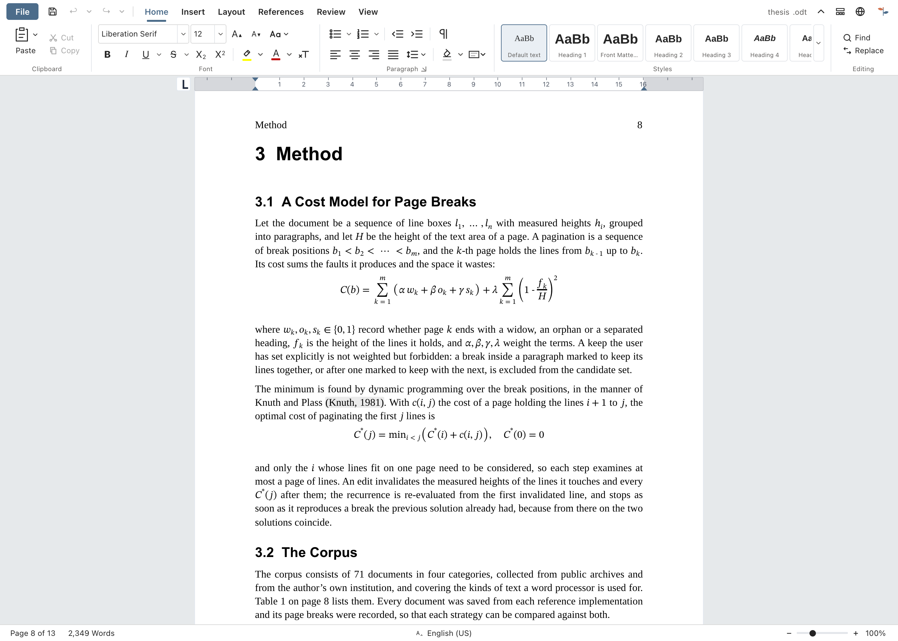
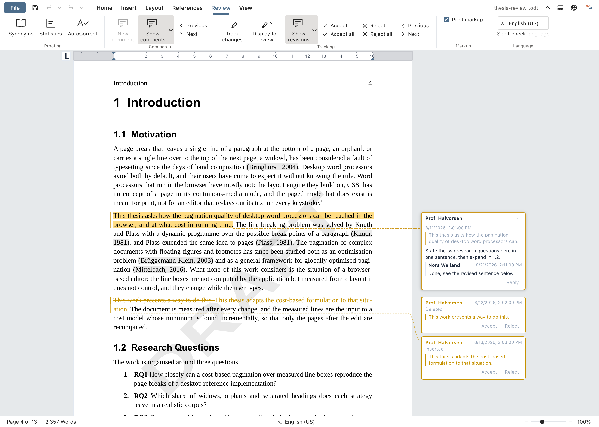
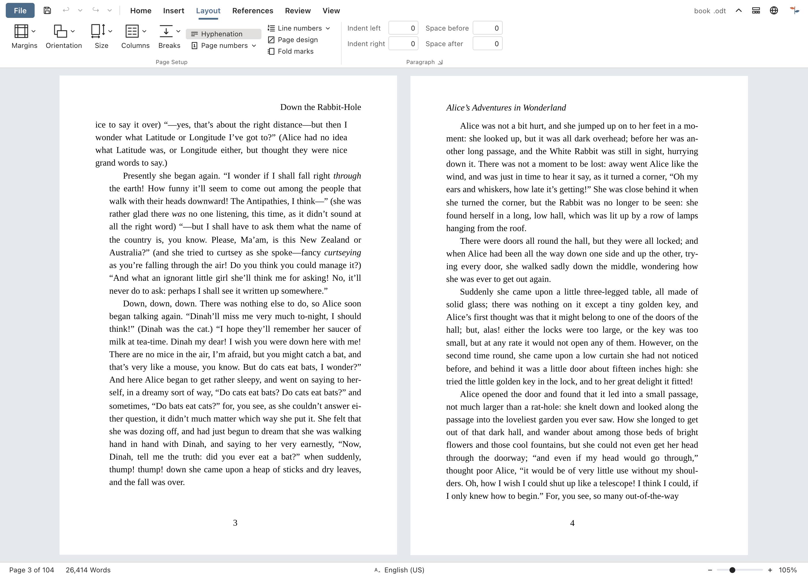
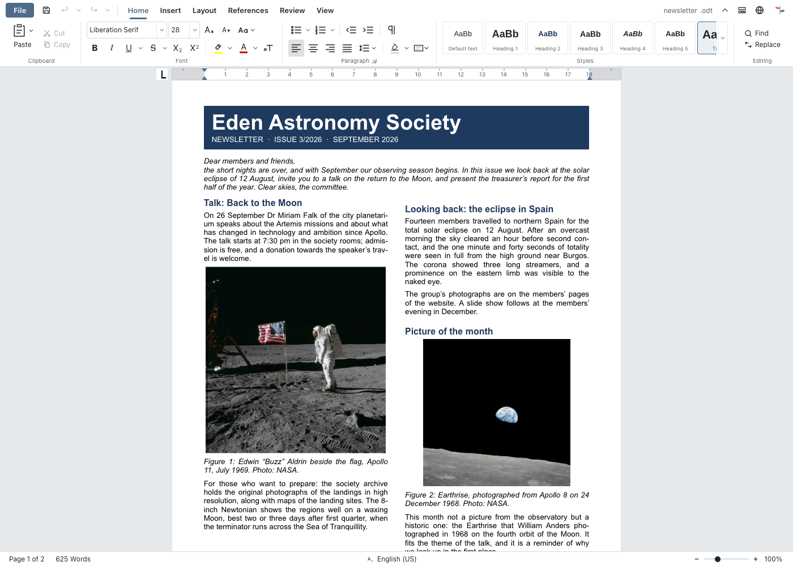
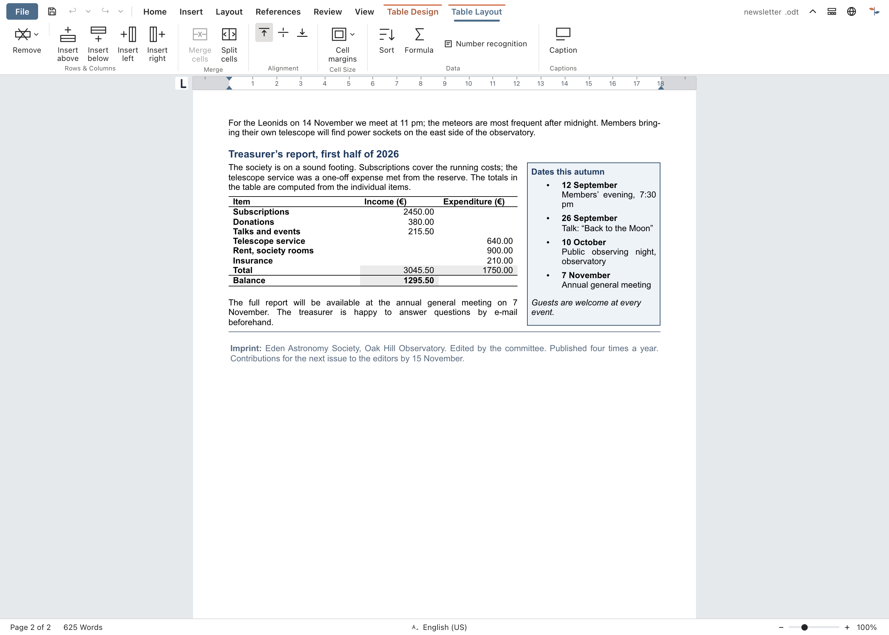
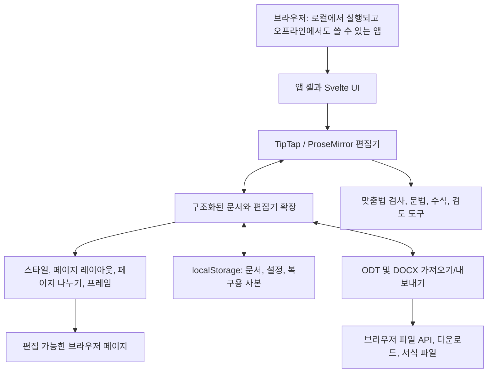

<p align="center">
  
</p>

<h1 align="center">
  
</h1>

<p align="center">
  <strong>브라우저에서 바로 쓰는 완전한 워드 프로세서</strong><br>
  무료 · 오픈 소스 · Private by Design
</p>

<p align="center">
  <a href="https://github.com/stffnb/edentext/actions/workflows/ci.yml"></a>
  <a href="../../LICENSE"></a>
  <a href="../../CHANGELOG.md"></a>
  
</p>

<p align="center">
  <a href="https://edentext.app"><strong>▶ EdenText 열기</strong></a>
</p>

<p align="center">
  <a href="../../README.md">English</a> · <a href="README.de.md">Deutsch</a> · <a href="README.es.md">Español</a> · <a href="README.fr.md">Français</a> · <a href="README.it.md">Italiano</a> · <a href="README.pt.md">Português</a> · <a href="README.el.md">Ελληνικά</a> · <a href="README.ru.md">Русский</a> · <a href="README.uk.md">Українська</a> · <a href="README.pl.md">Polski</a> · <a href="README.id.md">Bahasa Indonesia</a> · <a href="README.ar.md">العربية</a> · <a href="README.ja.md">日本語</a> · <b>한국어</b> · <a href="README.zh-CN.md">简体中文</a> · <a href="README.zh-TW.md">繁體中文</a>
</p>

<picture>
  <source media="(prefers-color-scheme: dark)" srcset="../hero-dark.webp">
  
</picture>

---

EdenText는 간단한 메모부터 책 한 권 분량의 원고까지 쓸 수 있는 강력한 웹 기반 워드 프로세서입니다. 서버도 계정도 필요 없습니다. 모든 처리가 로컬에서 이루어지므로 문서가 컴퓨터 밖으로 나가지 않습니다. 링크를 열어 바로 쓰거나, 앱으로 설치해 오프라인에서도 작업할 수 있습니다. 대부분의 언어에서 처음 내려받는 용량은 약 2 MB이며, 사전과 글꼴은 필요할 때 불러옵니다[^1]. 인터페이스는 영어, 독일어, 스페인어, 프랑스어, 이탈리아어, 포르투갈어, 그리스어, 러시아어, 우크라이나어, 폴란드어, 인도네시아어, 아랍어, 일본어, 한국어, 중국어(간체·번체)를 지원합니다.

> [!NOTE]
> EdenText는 아직 **베타** 단계이며 활발히 개발되고 있습니다. 테스트와 라운드트립
> 검증으로 동작을 확인하고 있지만, 현 단계에서는 버그가 없다고 장담할 수 없습니다.
> 중요한 문서는 꼭 백업해 두십시오. 또한 브라우저에는 열려 있는 문서의 최근 버전
> 세 개가 보관되므로, 문서를 불러오지 못하는 경우에도 복원할 수 있습니다.
>
> **버그를 발견했거나 문서가 제대로 표시되지 않습니까?**
> [이슈를 등록](https://github.com/stffnb/edentext/issues)해 주십시오. 모든 제보가 도움이 됩니다.
> 특히 EdenText에서 Word, LibreOffice, WPS Office와 다르게 표시되는 문서를 환영합니다.
> 파일(또는 내용을 줄인 사본)을 첨부하면 테스트 케이스로 활용합니다.

<a href="https://edentext.app"><picture>
  <source media="(prefers-color-scheme: dark)" srcset="../showcase/thesis-dark.png">
  
</picture></a>

## 기능

- **실제 페이지 레이아웃** — A4/Letter 페이지, 여백, 머리글/바닥글, 각주, 단,
  페이지 번호와 줄 번호, 워터마크. 책 작업을 위한 좌우 대칭 여백과 오른쪽 페이지부터
  시작하는 장
- **`.odt`와 `.docx` 열기 및 저장**, PDF 내보내기. 서식 파일(`.ott`/`.dotx`)과
  편지 서식 파일 모음(DIN 5008), 두 형식 모두에서 암호로 보호된 파일 지원
- **Word, LibreOffice, WPS Office와 호환** — 문서의 레이아웃이 그대로 유지됩니다.
  자동화된 라운드트립 테스트와 레이아웃 테스트로 LibreOffice와 비교해 확인합니다
- **스타일** — 상속을 지원하는 단락·문자·표·목록 스타일, 제목 번호 매기기
- **표** — 표 스타일, 정렬, 스프레드시트 방식의 수식
- **논문에 필요한 모든 것** — 목차, 캡션, 상호 참조, 인용 및 참고 문헌, 색인,
  수식(LaTeX)
- **검토 도구** — 변경 내용 추적, 여백 풍선에 표시되는 스레드형 메모, 다른 파일과의 비교 및 병합,
  변경 내용 인쇄, 맞춤법 검사(영어, 독일어, 스페인어, 프랑스어, 이탈리아어, 포르투갈어,
  그리스어, 러시아어, 우크라이나어, 폴란드어, 인도네시아어, 아랍어, 한국어), 동의어(그리스어와 한국어를 제외한 위 언어), 문법 검사
  (영어)
- **실시간 공동 작업** — 링크 하나로 여러 사람이 같은 문서를 동시에 편집합니다. 서로의 커서가
  보이고, 세션 채팅이 있으며, 지켜보기만 할 사람에게는 읽기 전용 링크를 줄 수 있습니다.
  종단 간 암호화를 사용하므로 중간의 서버는 문서를 읽을 수 없습니다. 릴레이 서버가 필요하며,
  자세한 내용은 [공동 작업](#공동-작업)을 참고하십시오
- **선택형 AI 도우미** — 원하는 공급자나 로컬 모델을 사용합니다.
  문서에 관한 질문에 답하고 문서를 직접 수정하며, 수정 사항은 변경 내용으로 표시됩니다. 끌 수 있으며,
  요청은 EdenText 서버를 거치지 않고 공급자에게 바로 전송됩니다
- **받아쓰기** — 말하면 커서 위치에 텍스트가 입력되며, 영어와 독일어에서는 문장 부호도 말로
  입력할 수 있습니다. 브라우저의 음성 인식(Chrome, Edge, Safari)을 사용하는데, 이 경우
  오디오가 브라우저의 음성 서비스로 전송될 수 있으므로 처음 사용하기 전에 EdenText가 확인을 요청합니다. 직접 운영하는
  음성 인식 서버(예: 이 컴퓨터의 Whisper)를 쓰면 어느 브라우저에서나 데스크톱 앱에서도 사용할 수 있습니다
- **Private by Design(개인 정보 보호 중심 설계)** — 문서는 컴퓨터 밖으로 나가지 않으며 모든
  처리가 로컬에서 이루어집니다. 앱으로 설치하면 오프라인에서도 동작합니다. 편집기는 아무것도 보내지 않습니다.
  예외는 AI 도우미를 켰을 때로, 이때만 선택한 공급자에게 요청을 보냅니다. 공유 세션에서는 문서가 암호화된 상태로 릴레이 서버를 거쳐 세션의 다른 참가자에게 전송됩니다. 받아쓰기에 쓰는 브라우저의 음성 인식은 오디오를 브라우저의 음성 서비스로 보낼 수 있습니다.
  문서는 브라우저에 자동 저장됩니다. [최근 문서]에서 닫은 문서를 다음에 시작할 때 삭제하거나
  아예 보관하지 않도록 설정할 수 있고, 시크릿 창에서는 창을 닫으면
  아무것도 남지 않습니다
- **최신 브라우저라면 어디서나** — Chrome과 Edge에서는 [저장]을 누르면 연 파일에 바로
  덮어쓰며, Brave도 `brave://flags/#file-system-access-api`를 켜면
  마찬가지입니다. 그 밖의 브라우저에서는 저장할 때마다 다운로드되므로, 저장 위치를 직접 고르려면
  브라우저 설정에서 "다운로드 전에 각 파일의 저장 위치 확인"을 켜십시오

브라우저의 제약 때문에 EdenText가 Word나 LibreOffice와 완전히 같게 표시할 수 없는 부분은
[Known limitations](../../CHANGELOG.md#known-limitations)(영어)에 정리되어 있습니다.

## 갤러리

아래 이미지의 원본 문서는 [`docs/showcase/`](../showcase/)에 `.odt`와 `.docx` 형식으로
들어 있으며, EdenText, LibreOffice, Word에서 바로 열 수 있습니다. 문서는
`scripts/showcase/run.mjs`로 생성합니다. 사진은 NASA의 것이고 책은 루이스 캐럴의 작품으로,
모두 퍼블릭 도메인입니다.

<table>
<tr>
<td width="50%" valign="top"><a href="../showcase/thesis-review.png"></a><br><b>검토</b> — 변경 내용 추적, 여백의 스레드형 메모, 초안 워터마크</td>
<td width="50%" valign="top"><a href="../showcase/book-spread.png"></a><br><b>책</b> — 좌우 대칭 여백을 적용한 A5 판형. 각 장은 오른쪽 페이지에서 시작하고, 머리글에는 왼쪽 페이지에 책 제목, 오른쪽 페이지에 장 제목이 표시되며, 페이지 번호는 첫 장부터 매겨집니다</td>
</tr>
<tr>
<td width="50%" valign="top"><a href="../showcase/newsletter.png"></a><br><b>소식지</b> — 단, 캡션이 달린 사진, 사이드바 상자</td>
<td width="50%" valign="top"><a href="../showcase/newsletter-tables.png"></a><br><b>표</b> — 표 스타일과 스프레드시트 방식의 수식</td>
</tr>
</table>

## 공동 작업

[파일] → [공동 작업…]을 선택하면 열려 있는 문서의 세션이 시작되고, 편집용 링크와 읽기 전용
링크가 하나씩 제공됩니다. 링크를 연 사람은 자신의 브라우저에서 문서를 받아 모든 변경 내용을
실시간으로 봅니다. 계정을 만들거나 프로그램을 설치할 필요는 없습니다.

- 다른 사람이 어디에 있는지(커서와 선택 영역, 이름 포함) 보이며, 그 사람의 위치로 이동하거나
  따라갈 수 있고, 메모에서 다른 사람을 언급하거나 세션 채팅에 글을 쓸 수 있습니다.
- [실행 취소]는 내가 한 편집만 되돌립니다. 메모와 변경 내용에는 각 작성자의 이름이 표시됩니다.
- 세션은 누군가 열어 두고 있는 동안 유지되며, 운영자가 다른 제한을 설정하지 않는 한 최대
  6명까지 참가할 수 있습니다. 문서는 세션을 시작한 사람만 저장하며, 다른 참가자는 나갈 때
  사본을 보관할 수 있습니다.
- 세션 참가자는 모두 같은 버전의 EdenText를 사용해야 합니다.

**암호화**: 키는 링크에서 `#` 뒤에 오는 부분이며, 브라우저는 이 부분을 서버로 보내지 않습니다.
각 브라우저가 보내는 내용을 암호화(AES-GCM)하므로 릴레이 서버는 읽을 수 없는 데이터를 전달할
뿐이며, 아무것도 저장하지 않습니다. 다만 네트워크 주소, 시각, 메시지 크기, 세션 참가 인원은
볼 수 있습니다. 편집 링크를 가진 사람은 누구나 문서를 변경할 수 있으므로, 문서 자체만큼
신중하게 전달하십시오.

**사용할 수 있는 환경**: 세션에는 릴레이 서버가 필요합니다. [`relay/`](../../relay)에 있는
작은 서버로, 릴리스마다 `ghcr.io/stffnb/edentext-relay`로 게시됩니다. [공동 작업] 명령은
앱이 릴레이 서버를 찾은 경우에만 나타납니다.

- **Kubernetes**: [Helm 차트](../../charts/edentext)는 기본적으로 릴레이 서버도 실행합니다.
- **직접 운영하는 서버**: 릴레이 서버 이미지(포트 4390)를 실행하고, 앞단의 웹 서버가 앱 호스트의
  `/relay`를 WebSocket으로 릴레이 서버에 전달하도록 설정하십시오. 앱의 컨테이너 이미지는
  그곳에서 릴레이 서버를 찾습니다. 직접 빌드하는 경우 `VITE_COLLAB_RELAY=same-origin npm run build`로
  빌드하면 같은 방식으로 동작하고, `VITE_COLLAB_RELAY=wss://relay.example.org/relay`로 다른
  호스트의 릴레이 서버를 지정할 수 있습니다. 릴레이 서버의 제한값은 환경 변수로 설정하며,
  목록은 [`relay/CLAUDE.md`](../../relay/CLAUDE.md)(영어)에 있습니다.
- **개발**: `npm run dev`와 함께 `npm run relay`를 실행합니다.

릴레이 서버가 없는 앱 컨테이너 이미지, 릴리스 압축 파일,
[edentext.app](https://edentext.app)에서는 세션을 사용할 수 없습니다.

## 데스크톱 앱

각 릴리스에는 Electron으로 만든 서명되지 않은 데스크톱 설치 파일도 포함되어 있습니다.

- **macOS** — `EdenText-<version>-arm64.dmg`(Apple 실리콘) 또는 `EdenText-<version>.dmg`(Intel).
  앱을 [응용 프로그램] 폴더로 끌어다 놓습니다. 서명되지 않은 앱이므로 처음에는
  마우스 오른쪽 버튼 → [열기]로 실행하거나 `xattr -d com.apple.quarantine /Applications/EdenText.app`을 실행하십시오.
- **Windows** — `EdenText-Setup-<version>.exe`. SmartScreen이 알 수 없는 게시자라고
  경고하면 [추가 정보] → [실행]을 선택하십시오.
- **Linux** — `EdenText-<version>.AppImage`(`chmod +x` 후 실행) 또는 `.deb`
  (`sudo apt install ./edentext_*.deb`).

데스크톱 앱에서는 파일 관리자에서 문서를 열고 변경 내용을 같은 파일에 바로 저장할 수 있습니다.
인쇄 대화 상자를 거치지 않고 PDF를 바로 만들며, 시작할 때 새 버전이 나왔으면 알려 줍니다.

## 개발

```bash
npm install
npm run dev      # 핫 리로드를 지원하는 개발 서버
npm run relay    # 개발 서버에서 공유 세션에 쓰는 릴레이 서버
npm test         # 테스트 모음
npm run build    # 프로덕션 빌드 → dist/
cd desktop && npm install && npm start   # 같은 빌드로 데스크톱 앱 실행
```

Svelte 5, TypeScript, Vite, TipTap 3(ProseMirror)로 만들었습니다.

## 자체 호스팅

EdenText는 백엔드가 필요 없고 서버에 아무것도 저장하지 않습니다. 문서는 브라우저 안에 머뭅니다.
릴리스마다 컨테이너 이미지(amd64 및 arm64)를 게시합니다.

```bash
docker run -p 8080:80 ghcr.io/stffnb/edentext
```

또는 각 릴리스에 포함된 `edentext-<tag>.zip`에 빌드된 앱이 들어 있으며,
`npm run build`를 실행해도 `dist/`에 같은 파일이 만들어집니다. 이 폴더는 어떤 웹 서버로도 호스팅할 수 있습니다.
컨테이너 이미지는 `docker build -t edentext .`로 직접 빌드할 수도 있습니다.
커뮤니티에서 관리하는 Kubernetes용 Helm 차트는 [`charts/edentext`](../../charts/edentext)에 있습니다.
AI 도우미, 받아쓰기, 문서 서식 파일을 모든 사용자에게 미리 설정하는 방법은 [`docs/self-hosting.md`](../self-hosting.md)(영어)를 참고하십시오.

업데이트할 때는 폴더를 먼저 비우지 말고 새 파일을 기존 파일 위에 덮어쓰십시오.
업데이트 전에 열어 둔 탭은 새로 고칠 때까지 자기 버전의 파일을 계속 불러옵니다.
서버는 존재하지 않는 파일 요청에 `index.html` 대신 404로 응답해야 합니다.
그래야 이런 탭이 새로 고침을 요청할 수 있습니다.

EdenText는 HTTPS로 제공하는 것을 권장합니다. 일반 HTTP에서도 편집기는 동작하지만,
브라우저가 일부 기능을 끕니다. 오프라인 사용, 앱으로 설치, 연 파일에 바로 저장(대신 다운로드됨),
복사 버튼이 여기에 해당합니다. localhost에서는 HTTPS와 마찬가지로 모든 기능이 동작합니다.

GitHub Pages에서 호스팅하는 버전을 [edentext.app](https://edentext.app)에서 누구나 무료로 사용할 수 있습니다(방문 수는 EU에서 호스팅되는 GoatCounter로 쿠키나 IP 주소 저장 없이 익명으로 집계합니다. 데스크톱 앱, 컨테이너 이미지, 릴리스 다운로드, 직접 빌드한 버전에는 카운터가 없습니다).

## 임베딩

다른 웹 애플리케이션이 EdenText를 iframe에 표시하면서 문서는 직접 관리할 수 있습니다.
`?embed=1`을 붙이면 편집기 자체의 파일 관리 기능이 빠집니다. 모든 인스턴스가 제공하는
`embed.js` 도우미로 파일을 불러오고 ODT, DOCX, PDF로 다시 받을 수 있습니다.
자세한 내용은 [docs/architecture/embed.md](../../docs/architecture/embed.md)를 참고하십시오.
호스트에서 언어, 테마, 강조 색을 지정하고 AI 도우미를 끌 수도 있습니다.
임베드 모드에서는 편집기에
EdenText 로고와 “Powered by EdenText” 표시가 나타납니다. 이 표시는 AGPL 조건에 따라 유지해야 하며
([NOTICE.md](../../NOTICE.md)), [상용 라이선스](../../LICENSE.commercial.md)에 따른
화이트 라벨 빌드에서만 뺄 수 있습니다(`VITE_EDENTEXT_ATTRIBUTION=off`).

자체 서버에서 편집기를 제공하려면 npm 패키지 두 개를 설치합니다. `@edentext/app`에는
빌드된 편집기가 들어 있으며 이를 정적 파일 위치로 복사합니다(Vite 플러그인도 사용 가능).
`@edentext/embed`는 도우미로, `<eden-text>` 요소와 React 컴포넌트도 함께 제공합니다.

```sh
npm install @edentext/app @edentext/embed
npx edentext-copy public/edentext --languages en,de
```

## 아키텍처



EdenText는 전적으로 브라우저 안에서 실행됩니다. `App.svelte`가 TipTap 문서 모델과
편집기 확장을 중심으로 인터페이스를 구성합니다. 스타일과 레이아웃이 이 모델을 편집 가능한
페이지로 바꾸고, 저장소 계층이 로컬 상태와 복구용 사본을 보관합니다. 가져오기와 내보내기는
같은 모델을 ODT 및 DOCX로 변환하며, 브라우저 파일 API가 결과 파일을 저장하거나
다운로드합니다. 형식과 레이아웃의 불변 조건은 [아키텍처 문서](../architecture/)(영어)를
참고하십시오.

## 기여하기

기여를 환영합니다. [CONTRIBUTING.md](../../CONTRIBUTING.md)(영어)를 참고하십시오. 병합하려면
서명된 [CLA](../../CLA.md)가 필요하며, 모든 풀 리퀘스트에서 자동으로 확인합니다.

### 기여자

아이디어, 버그 제보, 테스트, 피드백으로 도와주신 모든 분께 감사드립니다.
GitHub에 표시되는 기여자 외에도 다음 분들께 감사드립니다.

Patrick R., [@Deleh](https://github.com/Deleh), [@lukasmwerner](https://github.com/lukasmwerner), [@JinJieBeWater](https://github.com/JinJieBeWater), [@farragoo](https://github.com/farragoo), [@sbvelinga](https://github.com/sbvelinga)

<p>
<a href="https://github.com/stffnb"></a>
<a href="https://github.com/Camthalion77"></a>
<a href="https://github.com/ehrensperger-niklas"></a>
<a href="https://github.com/farragoo"></a>
<a href="https://github.com/blairhoddinott"></a>
<a href="https://github.com/Deleh"></a>
<a href="https://github.com/lukasmwerner"></a>
<a href="https://github.com/JinJieBeWater"></a>
<a href="https://github.com/sbvelinga"></a>
</p>

## 라이선스

Copyright © 2026 Steffen Becker · 독일에서 제작

[AGPL-3.0](../../LICENSE)이며, 임베드 모드에는 AGPL 제7조 (b)항에 따른 추가 조건이 있습니다
([NOTICE.md](../../NOTICE.md)). AGPL이 맞지 않는 용도에는 [상용 라이선스](../../LICENSE.commercial.md)를
이용할 수 있습니다. 함께 제공되는 글꼴과 언어 데이터에는 각각의 라이선스가 적용됩니다.
자세한 내용은 [THIRD-PARTY-NOTICES.md](../../THIRD-PARTY-NOTICES.md)를 참고하십시오.
임베드 도우미와 npm 도구는 MIT 라이선스이므로, 호스트 페이지는 자체 라이선스와 관계없이
사용할 수 있습니다([NOTICE.md](../../NOTICE.md)).

*EdenText는 독립 프로젝트로, Microsoft나 The Document Foundation과 관련이 없습니다.
`.docx`와 `.odt`는 상호 운용성을 위해 지원합니다.*

*이 문서는 영어 [README](../../README.md)의 번역본입니다. 내용이 다를 경우 영어판이 우선합니다.*

[^1]: 압축된 전송량 기준입니다. 앱 코드가 약 1.0 MB이고, 나머지는 브라우저 언어의 사전을
    포함한 맞춤법 검사기와 현재 페이지에 표시되는 글꼴입니다. 그리스어 사전은 약 2.5 MB,
    우크라이나어 사전은 약 1.5 MB를 더 차지합니다. 그 밖의 파일은 필요할 때 받아서 오프라인
    사용을 위해 보관합니다. 모든 글꼴, 사전, 동의어 사전을 합하면 약 22 MB이고, 영어 문법
    검사를 포함하면 약 31 MB입니다.
