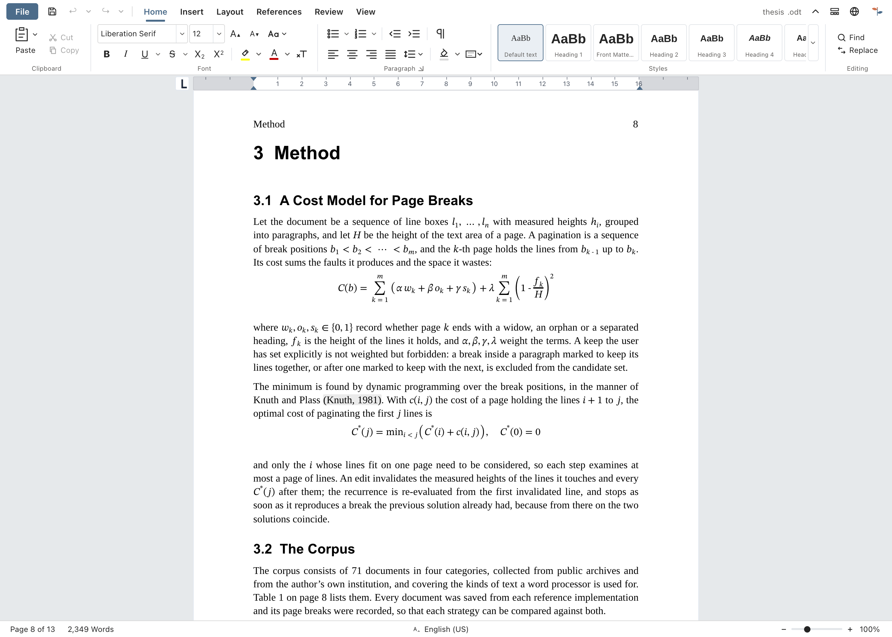
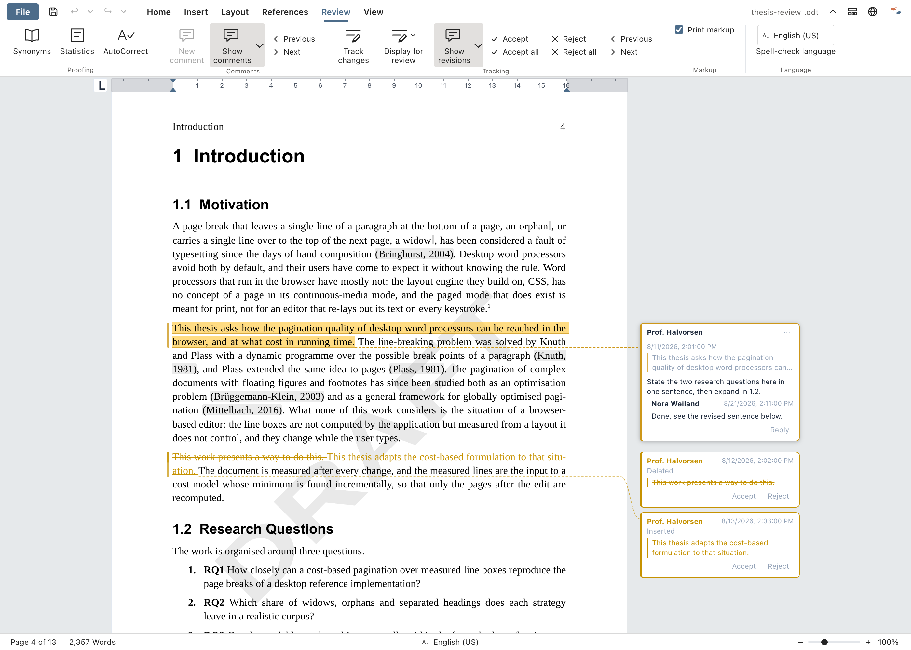
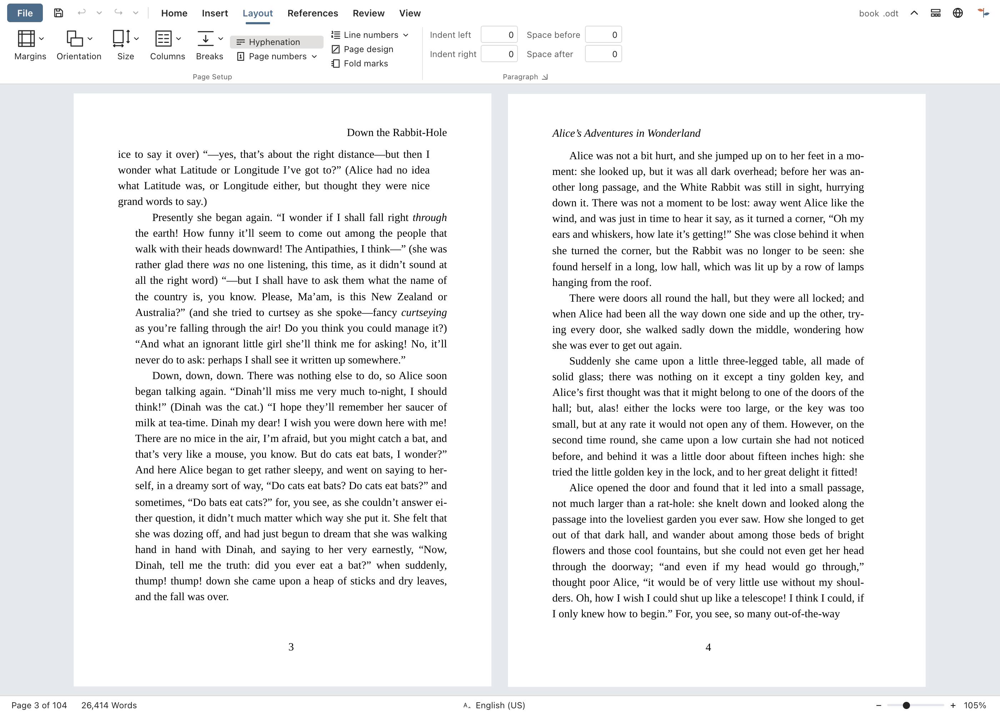
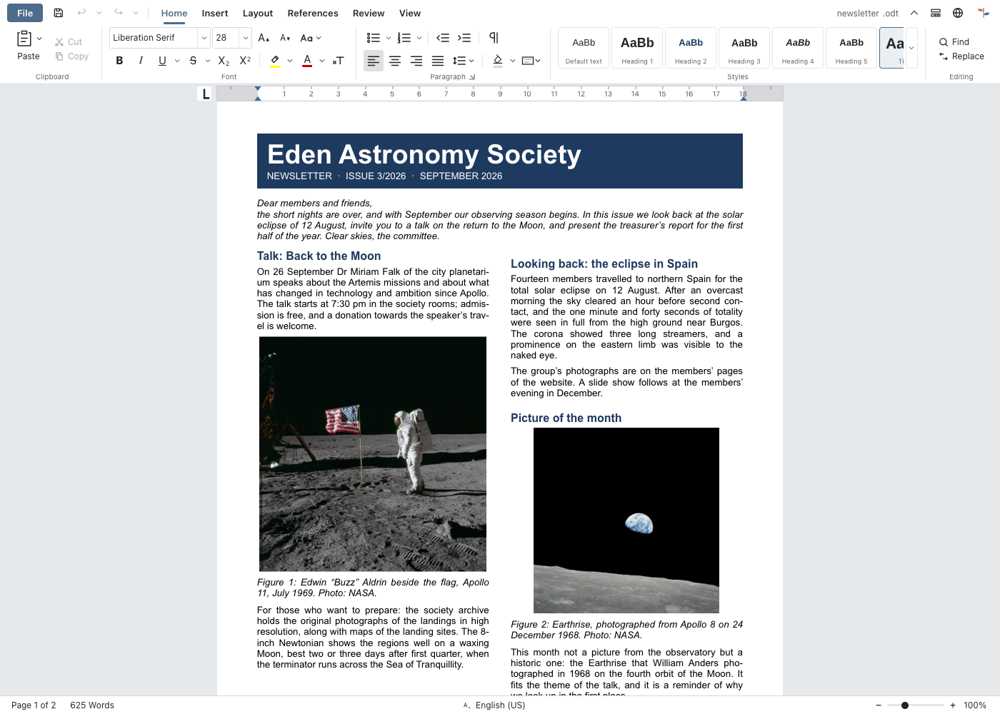
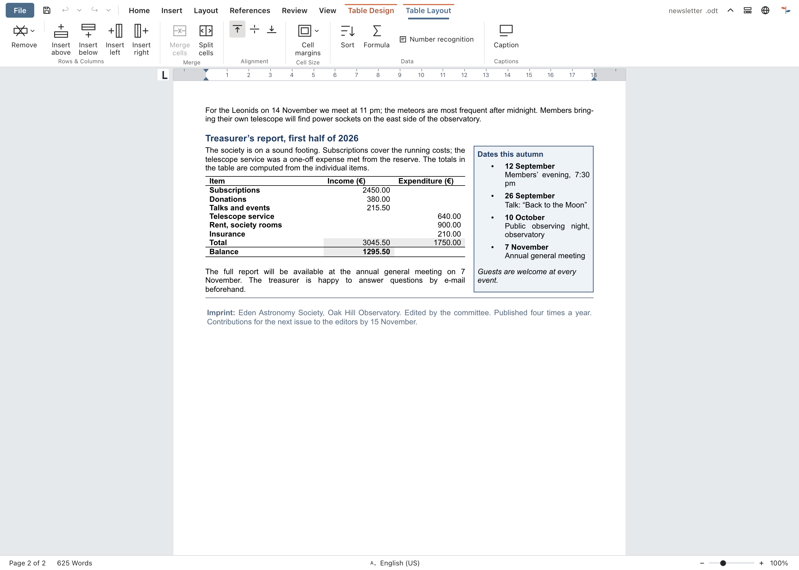
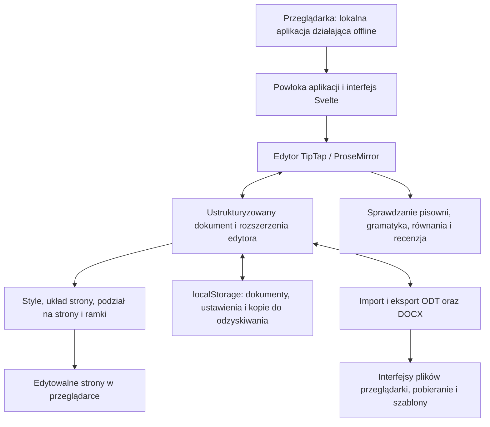

<p align="center">
  
</p>

<h1 align="center">
  
</h1>

<p align="center">
  <strong>Pełnowartościowy edytor tekstu bezpośrednio w przeglądarce</strong><br>
  Bezpłatny · Open Source · Private by Design
</p>

<p align="center">
  <a href="https://github.com/stffnb/edentext/actions/workflows/ci.yml"></a>
  <a href="../../LICENSE"></a>
  <a href="../../CHANGELOG.md"></a>
  
</p>

<p align="center">
  <a href="https://edentext.app"><strong>▶ Otwórz EdenText</strong></a>
</p>

<p align="center">
  <a href="../../README.md">English</a> · <a href="README.de.md">Deutsch</a> · <a href="README.es.md">Español</a> · <a href="README.fr.md">Français</a> · <a href="README.it.md">Italiano</a> · <a href="README.pt.md">Português</a> · <a href="README.el.md">Ελληνικά</a> · <a href="README.ru.md">Русский</a> · <a href="README.uk.md">Українська</a> · <b>Polski</b> · <a href="README.id.md">Bahasa Indonesia</a> · <a href="README.ar.md">العربية</a> · <a href="README.ja.md">日本語</a> · <a href="README.ko.md">한국어</a> · <a href="README.zh-CN.md">简体中文</a> · <a href="README.zh-TW.md">繁體中文</a>
</p>

<picture>
  <source media="(prefers-color-scheme: dark)" srcset="../hero-dark.webp">
  
</picture>

---

EdenText to rozbudowany edytor tekstu działający w przeglądarce – do wszystkiego, od krótkiej notatki po całą książkę. Bez serwera i bez konta: wszystko jest przetwarzane lokalnie, a dokumenty nigdy nie opuszczają komputera. Wystarczy otworzyć link albo zainstalować EdenText jako aplikację i pracować offline. Dla większości języków pierwsze pobieranie to około 2 MB; słowniki i czcionki są wczytywane dopiero wtedy, gdy są potrzebne[^1]. Interfejs jest dostępny w językach: angielskim, niemieckim, hiszpańskim, francuskim, włoskim, portugalskim, greckim, rosyjskim, ukraińskim, polskim, indonezyjskim, arabskim, japońskim, koreańskim i chińskim (uproszczonym i tradycyjnym).

> [!NOTE]
> EdenText jest wciąż w fazie **beta** i jest aktywnie rozwijany. Testy i kontrole
> zapisu z ponownym odczytem potwierdzają, że działa poprawnie; mimo to na tym etapie nie
> można wykluczyć błędów, dlatego warto przechowywać kopie zapasowe ważnych dokumentów.
> Przeglądarka zachowuje też trzy ostatnie wersje otwartego dokumentu na wypadek, gdyby
> nie dało się go wczytać.
>
> **Coś nie działa albo dokument wygląda nieprawidłowo?**
> [Utwórz zgłoszenie](https://github.com/stffnb/edentext/issues) – każde jest cenne.
> Szczególnie mile widziane są dokumenty, które EdenText wyświetla inaczej niż Word,
> LibreOffice lub WPS Office: wystarczy dołączyć plik (lub okrojoną kopię), a stanie się
> on przypadkiem testowym.

<a href="https://edentext.app"><picture>
  <source media="(prefers-color-scheme: dark)" srcset="../showcase/thesis-dark.png">
  
</picture></a>

## Funkcje

- **Prawdziwy układ strony** – strony A4 i Letter, marginesy, nagłówki i stopki, przypisy dolne,
  kolumny, numery stron i wierszy, znaki wodne; do książek marginesy lustrzane i rozdziały
  zaczynające się na prawej stronie
- **Otwiera i zapisuje pliki `.odt` i `.docx`**, eksportuje do PDF; szablony (`.ott`/`.dotx`)
  i galeria wzorów listów (DIN 5008); pliki chronione hasłem w obu formatach
- **Zgodność z programami Word, LibreOffice i WPS Office** – dokumenty zachowują swój układ;
  automatyczne testy zapisu, odczytu i układu sprawdzają to względem LibreOffice
- **Style** – style akapitu, znaku, tabeli i listy z dziedziczeniem,
  numerowanie rozdziałów
- **Tabele** ze stylami, sortowaniem i formułami jak w arkuszu kalkulacyjnym
- **Wszystko, czego potrzebuje praca dyplomowa** – spis treści, podpisy, odsyłacze,
  cytaty i bibliografia, indeks alfabetyczny, równania (LaTeX)
- **Recenzja** – śledzenie zmian i wątki komentarzy w dymkach na marginesie,
  porównywanie i łączenie z innym plikiem,
  drukowanie adiustacji, sprawdzanie pisowni (angielski, niemiecki, hiszpański, francuski, włoski, portugalski,
  grecki, rosyjski, ukraiński, polski, indonezyjski, arabski i koreański), synonimy (wszystkie te języki oprócz greckiego i koreańskiego), sprawdzanie gramatyki
  (angielski)
- **Współpraca w czasie rzeczywistym** – kilka osób edytuje jednocześnie ten sam dokument
  za pomocą linku: każdy widzi kursory pozostałych, jest czat sesji i link tylko do odczytu
  dla tych, którzy mają jedynie śledzić zmiany. Dzięki szyfrowaniu end-to-end serwer
  pośredniczący nie może odczytać dokumentu. Wymaga serwera relay, zob.
  [Współpraca](#współpraca)
- **Opcjonalny asystent AI** – z własnym dostawcą lub modelem lokalnym;
  odpowiada na pytania o dokument i wprowadza w nim zmiany jako śledzone zmiany. Można go
  wyłączyć; zapytania trafiają bezpośrednio do dostawcy, bez pośrednictwa serwera EdenText
- **Dyktowanie** – wypowiadane słowa pojawiają się w miejscu kursora dzięki rozpoznawaniu mowy
  przeglądarki albo własnemu serwerowi rozpoznawania mowy, np. Whisper
- **Private by Design** – dokumenty nigdy nie opuszczają komputera, całe
  przetwarzanie odbywa się lokalnie; jako zainstalowana aplikacja EdenText działa offline. Edytor niczego nie wysyła,
  chyba że zostanie włączony asystent AI – wtedy dane trafiają do wybranego dostawcy. We wspólnej sesji dokument trafia w postaci zaszyfrowanej przez serwer relay do pozostałych uczestników. Dyktowanie korzysta z rozpoznawania mowy przeglądarki, która może wysyłać nagranie do swojej usługi mowy. Przy wklejaniu ze strony internetowej jej obrazy są jednorazowo pobierane z ich serwerów i zapisywane w dokumencie.
  Dokumenty są zapisywane automatycznie w przeglądarce; listę „Ostatnie dokumenty” można ustawić tak, by zamknięte
  dokumenty były usuwane przy następnym uruchomieniu albo w ogóle nie były przechowywane, a okno prywatne
  po zamknięciu nie zostawia żadnych śladów
- **Każda aktualna przeglądarka** – w Chrome i Edge polecenie „Zapisz” zapisuje zmiany
  w otwartym pliku, podobnie w Brave po włączeniu `brave://flags/#file-system-access-api`;
  w pozostałych przypadkach każdy zapis to pobranie pliku, więc aby wybierać miejsce zapisu,
  należy włączyć w ustawieniach przeglądarki opcję „Pytaj, gdzie zapisać każdy plik”

Sytuacje, w których przez ograniczenia przeglądarki EdenText nie może wyglądać dokładnie tak jak Word
lub LibreOffice, opisuje sekcja [Known limitations](../../CHANGELOG.md#known-limitations) (po angielsku).

## Galeria

Dokumenty, z których pochodzą te zrzuty, znajdują się w [`docs/showcase/`](../showcase/) w formatach `.odt`
i `.docx` – gotowe do otwarcia w EdenText, LibreOffice lub Word. Tworzy je skrypt
`scripts/showcase/run.mjs`; zdjęcia pochodzą od NASA, a książka to dzieło Lewisa Carrolla –
wszystko w domenie publicznej.

<table>
<tr>
<td width="50%" valign="top"><a href="../showcase/thesis-review.png"></a><br><b>Recenzja</b> – śledzone zmiany, wątki komentarzy na marginesie, znak wodny „wersja robocza”</td>
<td width="50%" valign="top"><a href="../showcase/book-spread.png"></a><br><b>Książka</b> – format A5 z marginesami lustrzanymi. Każdy rozdział zaczyna się na prawej stronie, nagłówek pokazuje tytuł książki na stronach lewych i tytuł rozdziału na prawych, a numeracja stron zaczyna się od pierwszego rozdziału</td>
</tr>
<tr>
<td width="50%" valign="top"><a href="../showcase/newsletter.png"></a><br><b>Biuletyn</b> – kolumny, obrazy z podpisami, ramka boczna</td>
<td width="50%" valign="top"><a href="../showcase/newsletter-tables.png"></a><br><b>Tabele</b> – style tabeli i formuły jak w arkuszu kalkulacyjnym</td>
</tr>
</table>

## Współpraca

**Plik → Współpraca…** rozpoczyna sesję dla otwartego dokumentu i daje dwa linki: jeden do
edycji, drugi tylko do odczytu. Kto otworzy link, dostaje dokument w swojej przeglądarce
i widzi każdą zmianę na bieżąco. Nikt nie potrzebuje konta ani instalacji.

- Widać, gdzie są pozostali (kursor i zaznaczenie, z nazwami uczestników), można przejść do
  kogoś lub podążać za nim, wspominać osoby w komentarzach i pisać na czacie sesji.
- „Cofnij” wycofuje tylko własne zmiany; komentarze i śledzone zmiany są oznaczone nazwą
  autora.
- Sesja trwa, dopóki ktoś ma ją otwartą, i mieści do sześciu osób, chyba że administrator
  ustawi inny limit. Dokument zapisuje tylko osoba, która rozpoczęła sesję; pozostali mogą
  zachować kopię przy wyjściu.
- Wszyscy uczestnicy sesji powinni używać tej samej wersji EdenText.

**Szyfrowanie.** Kluczem jest część linku po `#`, której przeglądarka nigdy nie wysyła do
serwera. Każda przeglądarka szyfruje to, co wysyła (AES-GCM), więc serwer relay przekazuje
dane, których nie potrafi odczytać, i niczego z nich nie przechowuje. Widzi natomiast adresy
sieciowe, czas, rozmiary wiadomości i liczbę osób w sesji. Każdy, kto ma link do edycji,
może zmieniać dokument, dlatego należy przekazywać go równie ostrożnie jak sam dokument.

**Gdzie to działa.** Sesje wymagają serwera relay – niewielkiego serwera z katalogu
[`relay/`](../../relay), publikowanego z każdym wydaniem jako `ghcr.io/stffnb/edentext-relay`.
Polecenie „Współpraca” pojawia się tylko tam, gdzie aplikacja go znajdzie:

- **Kubernetes:** [chart Helm](../../charts/edentext) domyślnie uruchamia też serwer relay.
- **Docker:** należy uruchomić obraz serwera relay obok obrazu aplikacji i ustawić w kontenerze
  aplikacji `EDENTEXT_RELAY_UPSTREAM=http://relay:4390`; kontener sam przekazuje wtedy `/relay` do
  serwera relay. Przykład dla compose jest w [`docs/self-hosting.md#collaboration`](../self-hosting.md#collaboration) (po angielsku).
- **Własny serwer:** należy uruchomić obraz serwera relay (port 4390) i skonfigurować
  stojący przed nim serwer WWW tak, by przekazywał mu `/relay` na hoście aplikacji jako
  WebSocket. Obraz kontenera aplikacji szuka serwera relay właśnie tam; własna kompilacja
  również, jeśli zbudować ją poleceniem `VITE_COLLAB_RELAY=same-origin npm run build`, a
  `VITE_COLLAB_RELAY=wss://relay.example.org/relay` wskazuje serwer relay na innym hoście.
  Limity serwera relay ustawia się zmiennymi środowiskowymi wymienionymi w
  [`relay/CLAUDE.md`](../../relay/CLAUDE.md) (po angielsku).
- **Rozwój:** `npm run relay` obok `npm run dev`.

Obraz kontenera aplikacji bez `EDENTEXT_RELAY_UPSTREAM` i bez własnego serwera proxy, archiwum z wydania
i [edentext.app](https://edentext.app) nie oferują sesji.

## Aplikacja desktopowa

Każde wydanie zawiera też niepodpisane instalatory aplikacji desktopowej zbudowanej w Electronie:

- **macOS** – `EdenText-<version>-arm64.dmg` (układ Apple) lub `EdenText-<version>.dmg` (Intel).
  Aplikację należy przeciągnąć do folderu „Aplikacje”. Ponieważ nie jest podpisana, za pierwszym razem trzeba ją
  otworzyć przez kliknięcie prawym przyciskiem → „Otwórz” albo uruchomić `xattr -d com.apple.quarantine /Applications/EdenText.app`.
- **Windows** – `EdenText-Setup-<version>.exe`. SmartScreen ostrzega przed nieznanym
  wydawcą: „Więcej informacji” → „Uruchom mimo to”.
- **Linux** – `EdenText-<version>.AppImage` (`chmod +x`, a następnie uruchomić) lub pakiet `.deb`
  (`sudo apt install ./edentext_*.deb`).

Aplikacja desktopowa otwiera dokumenty z menedżera plików i zapisuje zmiany bezpośrednio
w tym samym pliku, tworzy pliki PDF bez okna drukowania, a przy uruchomieniu informuje
o dostępności nowszej wersji.

## Rozwój

```bash
npm install
npm run dev      # serwer deweloperski z hot-reloadem
npm run relay    # serwer relay dla wspólnych sesji na serwerze deweloperskim
npm test         # zestaw testów
npm run build    # kompilacja produkcyjna → dist/
cd desktop && npm install && npm start   # aplikacja desktopowa na tej samej kompilacji
```

Zbudowano z użyciem Svelte 5, TypeScript, Vite i TipTap 3 (ProseMirror).

## Własny hosting

EdenText nie potrzebuje backendu i niczego nie przechowuje na serwerze; dokumenty pozostają w przeglądarce.
Dla każdego wydania publikowany jest obraz kontenera (amd64 i arm64):

```bash
docker run -p 8080:80 ghcr.io/stffnb/edentext
```

Każde wydanie zawiera też plik `edentext-<tag>.zip` z gotową aplikacją, a
`npm run build` tworzy te same pliki w `dist/`. Ten folder można udostępnić z dowolnego serwera WWW.
Obraz kontenera można też zbudować lokalnie poleceniem `docker build -t edentext .`.
Utrzymywany przez społeczność chart Helm dla Kubernetesa znajduje się w [`charts/edentext`](../../charts/edentext).
Jak skonfigurować asystenta AI, dyktowanie i szablony dokumentów dla wszystkich użytkowników, opisuje [`docs/self-hosting.md`](../self-hosting.md) (po angielsku).

Przy aktualizacji należy skopiować nowe pliki na stare zamiast najpierw opróżniać folder.
Karty otwarte przed aktualizacją wczytują pliki swojej wersji, dopóki nie zostaną
odświeżone. Na żądania brakujących plików serwer powinien odpowiadać kodem 404, a nie
plikiem `index.html`, aby te karty mogły poprosić o odświeżenie.

Zalecamy udostępnianie EdenText przez HTTPS. Edytor działa też przez zwykłe HTTP, ale
przeglądarki wyłączają wtedy kilka funkcji: pracę offline, instalację aplikacji, zapisywanie
bezpośrednio w otwartym pliku (zamiast tego plik jest pobierany) oraz przyciski kopiowania.
W przypadku localhost wszystko działa tak samo jak przez HTTPS.

Wersja hostowana na GitHub Pages jest dostępna bezpłatnie dla wszystkich pod adresem
[edentext.app](https://edentext.app) (zlicza wizyty anonimowo za pomocą GoatCounter,
hostowanego w UE, bez plików cookie i bez zapisywania adresów IP; aplikacja desktopowa, obraz kontenera,
pakiet z wydania i samodzielnie zbudowane kopie nie zawierają licznika).

## Osadzanie

Inna aplikacja internetowa może wyświetlać EdenText w elemencie iframe i sama przechowywać dokument.
Z parametrem `?embed=1` edytor pomija własne zarządzanie plikami. Skrypt pomocniczy `embed.js`,
udostępniany przez każdą instancję, wczytuje do niego pliki i odbiera je z powrotem jako ODT, DOCX lub PDF;
zob. [docs/architecture/embed.md](../../docs/architecture/embed.md).
Aplikacja osadzająca może też ustawić język, motyw i kolor akcentu oraz wyłączyć asystenta AI.
W trybie osadzenia edytor
pokazuje logo EdenText i informację „Powered by EdenText”, które zgodnie z warunkami AGPL muszą
pozostać ([NOTICE.md](../../NOTICE.md)) i które pomija jedynie kompilacja white-label na
[licencji komercyjnej](../../LICENSE.commercial.md) (`VITE_EDENTEXT_ATTRIBUTION=off`).

Aby udostępniać edytor z własnego serwera, należy zainstalować dwa pakiety npm. `@edentext/app`
zawiera zbudowany edytor i kopiuje go do plików statycznych (alternatywnie służy do tego
wtyczka Vite); `@edentext/embed` to skrypt pomocniczy wraz z elementem `<eden-text>`
i komponentem React.

```sh
npm install @edentext/app @edentext/embed
npx edentext-copy public/edentext --languages en,de
```

## Architektura



EdenText działa w całości w przeglądarce: `App.svelte` buduje interfejs wokół
modelu dokumentu TipTap i jego rozszerzeń edytora. Style i układ zamieniają ten
model w edytowalne strony; warstwa przechowywania utrzymuje stan lokalny i kopie do odzyskiwania. Import
i eksport przekładają ten sam model na ODT i DOCX, a interfejsy plików przeglądarki zapisują
lub pobierają powstałe pliki. Niezmienniki formatów i układu opisuje [dokumentacja architektury](../architecture/)
(po angielsku).

## Współtworzenie

Wkład w projekt jest mile widziany – zob. [CONTRIBUTING.md](../../CONTRIBUTING.md) (po angielsku). Scalenie
wymaga podpisanej umowy [CLA](../../CLA.md), co jest automatycznie sprawdzane przy każdym pull requeście.

### Współtwórcy

Dziękuję wszystkim za pomoc – pomysły, zgłoszenia błędów, testy i opinie.
Oprócz współtwórców wymienionych przez GitHub chcę podziękować również:

Patrick R., [@Deleh](https://github.com/Deleh), [@lukasmwerner](https://github.com/lukasmwerner), [@JinJieBeWater](https://github.com/JinJieBeWater), [@farragoo](https://github.com/farragoo), [@sbvelinga](https://github.com/sbvelinga)

<p>
<a href="https://github.com/stffnb"></a>
<a href="https://github.com/Camthalion77"></a>
<a href="https://github.com/ehrensperger-niklas"></a>
<a href="https://github.com/farragoo"></a>
<a href="https://github.com/blairhoddinott"></a>
<a href="https://github.com/Deleh"></a>
<a href="https://github.com/lukasmwerner"></a>
<a href="https://github.com/JinJieBeWater"></a>
<a href="https://github.com/sbvelinga"></a>
</p>

## Licencja

Copyright © 2026 Steffen Becker · Stworzono w Niemczech

[AGPL-3.0](../../LICENSE), z dodatkowym warunkiem na podstawie jej sekcji 7(b) dotyczącym trybu osadzenia
([NOTICE.md](../../NOTICE.md)). Do zastosowań, do których AGPL się nie nadaje, dostępna jest
[licencja komercyjna](../../LICENSE.commercial.md). Dołączone czcionki i dane językowe zachowują
własne licencje – zob. [THIRD-PARTY-NOTICES.md](../../THIRD-PARTY-NOTICES.md).
Skrypt pomocniczy do osadzania i narzędzia npm są objęte licencją MIT, więc strona hostująca może
z nich korzystać niezależnie od własnej licencji ([NOTICE.md](../../NOTICE.md)).

*EdenText to niezależny projekt, niepowiązany z firmą Microsoft ani z The Document
Foundation. Formaty `.docx` i `.odt` są obsługiwane w celu zapewnienia interoperacyjności.*

*To jest tłumaczenie angielskiego pliku [README](../../README.md); w razie rozbieżności rozstrzyga wersja angielska.*

[^1]: Przesyłane w postaci skompresowanej: ~1,0 MB kodu aplikacji, reszta to sprawdzanie pisowni ze
    słownikiem dla języka przeglądarki oraz czcionki widoczne na stronie; słowniki grecki i
    ukraiński dodają ~2,5 i ~1,5 MB. Wszystko inne jest pobierane, gdy okaże się potrzebne, i zachowywane
    do pracy offline; wszystkie czcionki, słowniki i tezaurusy razem to
    ~22 MB, a ze sprawdzaniem gramatyki angielskiej ~31 MB.
