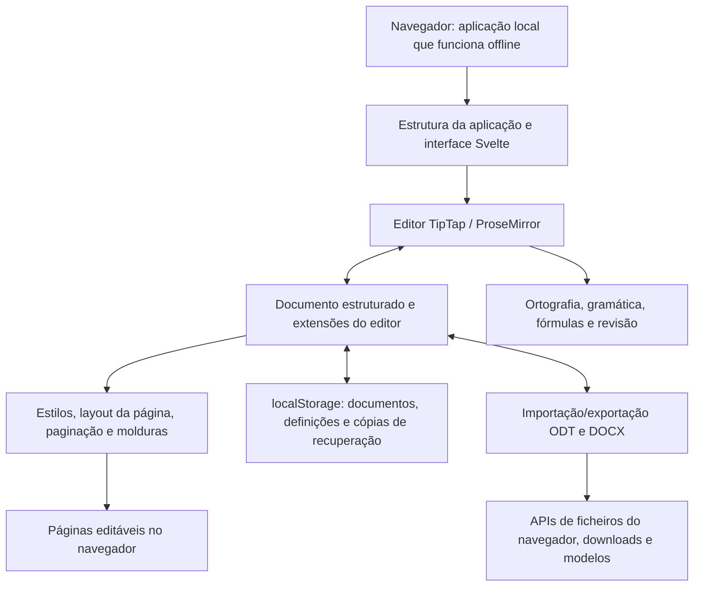

<p align="center">
  
</p>

<h1 align="center">
  
</h1>

<p align="center">
  <strong>Processador de texto completo, diretamente no navegador</strong><br>
  Gratuito · Código aberto · Privacidade desde a conceção
</p>

<p align="center">
  <a href="https://github.com/stffnb/edentext/actions/workflows/ci.yml"></a>
  <a href="../../LICENSE"></a>
  <a href="../../CHANGELOG.md"></a>
  
</p>

<p align="center">
  <a href="https://edentext.app"><strong>▶ Abrir o EdenText</strong></a>
</p>

<p align="center">
  <a href="../../README.md">English</a> · <a href="README.de.md">Deutsch</a> · <a href="README.es.md">Español</a> · <a href="README.fr.md">Français</a> · <b>Português</b> · <a href="README.el.md">Ελληνικά</a> · <a href="README.ru.md">Русский</a> · <a href="README.uk.md">Українська</a> · <a href="README.ja.md">日本語</a> · <a href="README.zh-CN.md">简体中文</a> · <a href="README.zh-TW.md">繁體中文</a>
</p>

<picture>
  <source media="(prefers-color-scheme: dark)" srcset="../hero-dark.webp">
  
</picture>

---

O EdenText é um processador de texto poderoso que funciona no navegador, das notas rápidas a livros inteiros. Sem servidor nem conta: tudo é processado localmente e os documentos nunca saem do computador. Basta abrir o link, ou instalar o EdenText como aplicação e trabalhar offline. Na maioria das línguas, o primeiro download tem cerca de 2 MB; os dicionários e os tipos de letra são carregados quando são precisos[^1]. A interface está disponível em inglês, alemão, espanhol, francês, português, grego, russo, ucraniano, japonês e chinês (simplificado e tradicional).

> [!NOTE]
> O EdenText ainda está em **beta** e em desenvolvimento ativo. Testes e verificações de
> ida e volta confirmam o funcionamento, mas nesta fase não é possível excluir erros, por
> isso guarde cópias de segurança dos documentos importantes. O navegador guarda também as
> três últimas versões do documento aberto, para o caso de este não abrir.
>
> **Encontrou um erro, ou um documento não aparece como devia?**
> [Abra uma issue](https://github.com/stffnb/edentext/issues), cada relato ajuda.
> Interessam-nos sobretudo documentos que no EdenText aparecem de forma diferente do Word,
> do LibreOffice ou do WPS Office: anexe o ficheiro (ou uma cópia reduzida) e ele passa a
> ser um caso de teste.

<a href="https://edentext.app"><picture>
  <source media="(prefers-color-scheme: dark)" srcset="../showcase/thesis-dark.png">
  
</picture></a>

## Funcionalidades

- **Paginação a sério** — páginas A4/Carta, margens, cabeçalhos e rodapés, notas de
  rodapé, colunas, numeração de páginas e de linhas, marcas de água; para livros, margens
  espelhadas e capítulos que começam numa página ímpar
- **Abre e guarda `.odt` e `.docx`**, exporta PDF; modelos (`.ott`/`.dotx`) e uma galeria
  de cartas (DIN 5008); ficheiros protegidos por palavra-passe nos dois formatos
- **Compatível com o Word, o LibreOffice e o WPS Office** — os documentos mantêm a
  paginação; testes automáticos de ida e volta e de paginação verificam-no em comparação
  com o LibreOffice
- **Estilos** — de parágrafo, de carácter, de tabela e de lista, com herança; numeração
  de capítulos
- **Tabelas** com estilos, ordenação e fórmulas como numa folha de cálculo
- **Tudo o que uma tese precisa** — índice, legendas, referências cruzadas, citações e
  bibliografia, índice remissivo, fórmulas (LaTeX)
- **Revisão** — controlo de alterações e conversas de comentários em balões na margem,
  comparação e junção com outro ficheiro,
  marcas imprimíveis, verificação ortográfica (inglês, alemão, espanhol, francês,
  português, grego, russo e ucraniano), sinónimos (as mesmas línguas, exceto o grego),
  verificação gramatical (inglês)
- **Assistente de IA opcional** — com um fornecedor à escolha ou um modelo local; responde
  a perguntas sobre o documento e edita-o com controlo de alterações. Pode ser desligado;
  os pedidos vão diretamente para o fornecedor, sem passar por um servidor do EdenText
- **Privacidade desde a conceção** — os documentos nunca saem do computador e tudo é
  processado localmente; instalado como aplicação, funciona offline. O edentext.app conta as
  visitas de forma anónima (GoatCounter, alojado na UE, sem cookies; instalações próprias e a aplicação de ambiente de trabalho não contam nada); o editor em si não
  envia nada, a não ser para o fornecedor escolhido quando o assistente de IA está ligado.
  Os documentos são guardados automaticamente no navegador; em «Documentos recentes» pode
  definir-se que os documentos fechados são apagados no arranque seguinte ou que nem
  chegam a ser guardados. Uma janela privada não deixa rasto depois de fechada
- **Qualquer navegador atual** — no Chrome e no Edge, «Guardar» escreve no ficheiro
  aberto, e no Brave também, depois de ativar `brave://flags/#file-system-access-api`;
  nos outros casos, cada gravação é um download. Para escolher o local, ative nas
  definições do navegador a opção de perguntar onde guardar cada ficheiro

Os pontos em que o navegador impede o EdenText de ficar exatamente igual ao Word ou ao
LibreOffice estão descritos em [Known limitations](../../CHANGELOG.md#known-limitations) (em inglês).

## Galeria

Os documentos destas imagens estão em [`docs/showcase/`](../showcase/) em `.odt` e
`.docx`, prontos a abrir no EdenText, no LibreOffice ou no Word. São gerados por
`scripts/showcase/run.mjs`; as fotografias são da NASA e o livro é de Lewis Carroll,
ambos do domínio público.

<table>
<tr>
<td width="50%" valign="top"><a href="../showcase/thesis-review.png"></a><br><b>Revisão</b> — controlo de alterações, conversas de comentários na margem, marca de água «Rascunho»</td>
<td width="50%" valign="top"><a href="../showcase/book-spread.png"></a><br><b>Livro</b> — A5 com margens espelhadas. Cada capítulo começa numa página da direita, o cabeçalho mostra o título do livro nas páginas da esquerda e o do capítulo nas da direita, e a numeração começa no primeiro capítulo</td>
</tr>
<tr>
<td width="50%" valign="top"><a href="../showcase/newsletter.png"></a><br><b>Boletim</b> — colunas, imagens com legenda, uma caixa lateral</td>
<td width="50%" valign="top"><a href="../showcase/newsletter-tables.png"></a><br><b>Tabelas</b> — estilos de tabela e fórmulas como numa folha de cálculo</td>
</tr>
</table>

## Aplicação para computador

Cada versão inclui também instaladores para computador, sem assinatura, feitos com Electron:

- **macOS** — `EdenText-<version>-arm64.dmg` (Apple Silicon) ou `EdenText-<version>.dmg` (Intel).
  Arraste a aplicação para a pasta Aplicações. Como não está assinada, abra-a da primeira
  vez com clique direito → Abrir, ou execute `xattr -d com.apple.quarantine /Applications/EdenText.app`.
- **Windows** — `EdenText-Setup-<version>.exe`. O SmartScreen avisa que o editor é
  desconhecido: Mais informações → Executar mesmo assim.
- **Linux** — `EdenText-<version>.AppImage` (`chmod +x` e depois executar) ou o `.deb`
  (`sudo apt install ./edentext_*.deb`).

A aplicação para computador abre documentos a partir do gestor de ficheiros e guarda as
alterações no mesmo ficheiro, grava PDF diretamente sem a caixa de impressão e avisa ao
iniciar quando há uma versão mais recente.

## Desenvolvimento

```bash
npm install
npm run dev      # servidor de desenvolvimento com recarregamento automático
npm test         # conjunto de testes
npm run build    # build de produção → dist/
cd desktop && npm install && npm start   # aplicação para computador sobre o mesmo build
```

Feito com Svelte 5, TypeScript, Vite e TipTap 3 (ProseMirror).

## Alojamento próprio

O EdenText não precisa de backend nem guarda nada no servidor; os documentos ficam no
navegador. Para cada versão é publicada uma imagem de contentor (amd64 e arm64):

```bash
docker run -p 8080:80 ghcr.io/stffnb/edentext
```

Em alternativa, cada versão inclui o ficheiro `edentext-<tag>.zip` com a aplicação
compilada; `npm run build` gera os mesmos ficheiros em `dist/`. Qualquer servidor web pode
alojar essa pasta. A imagem de contentor também pode ser criada localmente com
`docker build -t edentext .`.
Para Kubernetes, existe um chart Helm mantido pela comunidade em [`charts/edentext`](../../charts/edentext).

Para atualizar, copie os ficheiros novos por cima dos antigos em vez de esvaziar primeiro
a pasta. Os separadores abertos antes da atualização continuam a carregar os ficheiros da
sua versão até serem recarregados. O servidor deve responder aos ficheiros em falta com
404 e não com `index.html`, para que esses separadores possam pedir para ser recarregados.

Recomendamos disponibilizar o EdenText por HTTPS. Por HTTP simples o editor também
funciona, mas os navegadores desativam então algumas funções: o uso offline, a instalação
como aplicação, guardar diretamente no ficheiro aberto (em vez disso, é descarregado) e os
botões de copiar. Em localhost tudo funciona como com HTTPS.

## Arquitetura



O EdenText funciona inteiramente no navegador: `App.svelte` monta a interface à volta do
modelo de documento do TipTap e das suas extensões. Os estilos e a paginação transformam
esse modelo em páginas editáveis; o armazenamento guarda o estado local e as cópias de
recuperação. A importação e a exportação convertem o mesmo modelo para ODT e DOCX, e as
APIs de ficheiros do navegador guardam ou descarregam o resultado. Os detalhes sobre
formatos e paginação estão na [documentação de arquitetura](../architecture/) (em inglês).

## Contribuir

As contribuições são bem-vindas: veja [CONTRIBUTING.md](../../CONTRIBUTING.md) (em inglês).
Para o merge é preciso ter assinado o [CLA](../../CLA.md); isso é verificado automaticamente
em cada pull request.

### Agradecimentos

Obrigado a todos os que ajudaram com ideias, relatos de erros, testes e comentários. Além dos colaboradores listados no GitHub, também quero agradecer a:

Patrick R., [@Deleh](https://github.com/Deleh), [@lukasmwerner](https://github.com/lukasmwerner), [@JinJieBeWater](https://github.com/JinJieBeWater), [@farragoo](https://github.com/farragoo), [@sbvelinga](https://github.com/sbvelinga)

<p>
<a href="https://github.com/stffnb"></a>
<a href="https://github.com/Camthalion77"></a>
<a href="https://github.com/ehrensperger-niklas"></a>
<a href="https://github.com/farragoo"></a>
<a href="https://github.com/blairhoddinott"></a>
<a href="https://github.com/Deleh"></a>
<a href="https://github.com/lukasmwerner"></a>
<a href="https://github.com/JinJieBeWater"></a>
<a href="https://github.com/sbvelinga"></a>
</p>

## Licença

Copyright © 2026 Steffen Becker · Feito na Alemanha

[AGPL-3.0](../../LICENSE). Se a AGPL não servir, há uma [licença comercial](../../LICENSE.commercial.md).
Os tipos de letra e os dados linguísticos incluídos mantêm as suas próprias licenças: veja
[THIRD-PARTY-NOTICES.md](../../THIRD-PARTY-NOTICES.md).

*O EdenText é um projeto independente, sem ligação à Microsoft nem à The Document
Foundation. `.docx` e `.odt` são suportados por razões de interoperabilidade.*

*Esta é uma tradução do [README](../../README.md) em inglês; em caso de divergência, prevalece a versão inglesa.*

[^1]: Transferência comprimida: ~1,0 MB de código da aplicação; o resto é o verificador
    ortográfico com o dicionário da língua do navegador e os tipos de letra da página
    apresentada. O dicionário grego acrescenta ~2,5 MB e o ucraniano ~1,5 MB. Tudo o resto
    só é descarregado quando é preciso e fica guardado para uso offline; todos os tipos de
    letra, dicionários e tesauros juntos ocupam ~18 MB, ou ~26 MB com a verificação
    gramatical de inglês.
