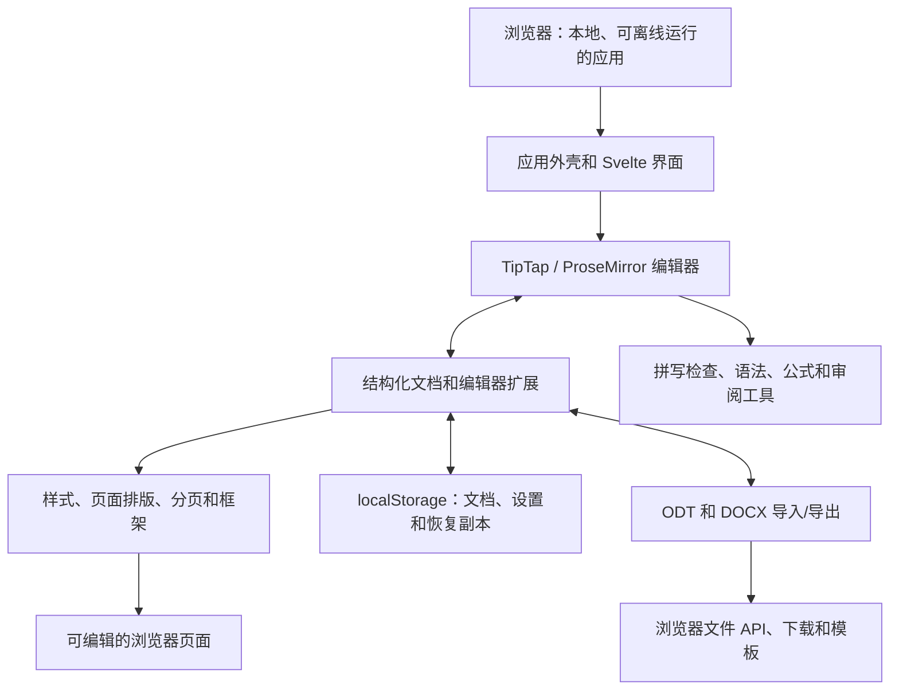

<p align="center">
  
</p>

<h1 align="center">
  
</h1>

<p align="center">
  <strong>功能强大的文字处理软件——打开网址即可使用。</strong><br>
  免费 · 开源 · 隐私优先
</p>

<p align="center">
  <a href="https://github.com/stffnb/edentext/actions/workflows/ci.yml"></a>
  <a href="../../LICENSE"></a>
  <a href="../../CHANGELOG.md"></a>
  
</p>

<p align="center">
  <a href="https://edentext.app"><strong>▶ 打开 EdenText</strong></a>
</p>

<p align="center">
  <a href="../../README.md">English</a> · <a href="README.de.md">Deutsch</a> · <a href="README.es.md">Español</a> · <a href="README.fr.md">Français</a> · <a href="README.pt.md">Português</a> · <a href="README.el.md">Ελληνικά</a> · <a href="README.ru.md">Русский</a> · <a href="README.uk.md">Українська</a> · <a href="README.ja.md">日本語</a> · <b>简体中文</b> · <a href="README.zh-TW.md">繁體中文</a>
</p>

<picture>
  <source media="(prefers-color-scheme: dark)" srcset="../hero-dark.webp">
  
</picture>

---

EdenText 是一款基于网页、功能强大的文字处理软件，从随手笔记到整本书籍都能胜任。无需服务器，无需账号——所有处理都在本地完成，文档绝不会离开你的电脑。打开网址即可使用，也可以安装成应用离线使用。大多数语言首次打开需下载约 2 MB，词典和字体按需加载[^1]。界面提供英语、德语、西班牙语、法语、葡萄牙语、希腊语、俄语、乌克兰语、日语和中文（简体与繁体）。

> [!NOTE]
> EdenText 目前还是 **beta** 版，仍在持续开发中。测试和往返转换检查
> 会验证各项功能，但现阶段仍不能排除 bug，重要文档请自行备份。另外，浏览器会
> 保留当前文档最近的三个版本，万一文档打不开，可以从中恢复。
>
> **发现了问题，或者文档显示不正确？** 欢迎
> [提 issue](https://github.com/stffnb/edentext/issues)，每条反馈都很有帮助。
> 尤其欢迎在 EdenText 里显示得和 Word、LibreOffice 或 WPS Office 不一样的文档：
> 附上文件（或删减后的副本），它就会变成一个测试用例。

<a href="https://edentext.app"><picture>
  <source media="(prefers-color-scheme: dark)" srcset="../showcase/thesis-dark.png">
  
</picture></a>

## 功能

- **真正的页面排版**——A4/Letter 页面、页边距、页眉页脚、脚注、分栏、页码与行号、
  水印；为书籍提供对称页边距以及章节从右页开始
- **打开并保存 `.odt` 和 `.docx`**，可导出 PDF；支持模板（`.ott`/`.dotx`）和信函模板库
  （DIN 5008）；两种格式均支持密码保护文件
- **与 Word、LibreOffice 和 WPS Office 兼容**——文档保持原有版式；
  自动化往返转换和排版测试以 LibreOffice 为基准进行验证
- **样式**——支持继承的段落、字符、表格和列表样式，章节编号
- **表格**——表格样式、排序以及类似电子表格的公式
- **论文所需的一切**——目录、题注、交叉引用、引文与参考文献、索引、公式（LaTeX）
- **审阅工具**——修订跟踪和带页边批注框的讨论式批注，与其他文件比较和合并，可打印的修订标记，拼写检查
  （英语、德语、西班牙语、法语、葡萄牙语、希腊语、俄语和乌克兰语），同义词
  （以上除希腊语外的所有语言），语法检查（英语）
- **可选的 AI 助手**——使用你自己的服务商或本地模型；回答关于文档的问题，并以修订
  的形式编辑文档。可以关闭；请求直接发送给服务商，不经过任何 EdenText 服务器
- **隐私优先**——文档绝不会离开你的电脑，所有处理均在本地完成；可作为可安装的应用
  离线使用。edentext.app 会统计匿名访问量（GoatCounter，托管于欧盟，不使用 Cookie；自托管实例和桌面版不统计任何内容）；编辑器
  本身不发送任何内容，只有开启 AI 助手后，才会把请求发给你选择的服务商。文档会自动
  保存在浏览器中；在“最近使用的文档”里可以设置已关闭的文档在下次启动时删除，或者干脆
  不保存。隐私窗口关闭后不会留下任何痕迹
- **支持所有现代浏览器**——在 Chrome 和 Edge 中，"保存"会写回打开的文件；在 Brave 中
  启用 `brave://flags/#file-system-access-api` 后同样如此；其他浏览器每次保存都是一次
  下载，想自己选保存位置的话，在浏览器设置里打开“下载前询问每个文件的保存位置”

因浏览器限制而无法与 Word 或 LibreOffice 完全一致的地方，见
[已知限制](../../CHANGELOG.md#known-limitations)（英文）。

## 展示

这些图片背后的文档以 `.odt` 和 `.docx` 格式存放在 [`docs/showcase/`](../showcase/) 中，
可直接在 EdenText、LibreOffice 或 Word 中打开。它们由 `scripts/showcase/run.mjs` 生成；
照片来自 NASA，书籍为刘易斯·卡罗尔的作品，均属公有领域。

<table>
<tr>
<td width="50%" valign="top"><a href="../showcase/thesis-review.png"></a><br><b>审阅</b>——修订跟踪、页边的讨论式批注、草稿水印</td>
<td width="50%" valign="top"><a href="../showcase/book-spread.png"></a><br><b>书籍</b>——A5，对称页边距。每章从右页开始，页眉在左页显示书名、在右页显示章节名，页码从第一章开始编号</td>
</tr>
<tr>
<td width="50%" valign="top"><a href="../showcase/newsletter.png"></a><br><b>简报</b>——分栏、带题注的图片、侧栏文本框</td>
<td width="50%" valign="top"><a href="../showcase/newsletter-tables.png"></a><br><b>表格</b>——表格样式和类似电子表格的公式</td>
</tr>
</table>

## 桌面应用

每个发行版还附带使用 Electron 构建的未签名桌面安装包：

- **macOS**——`EdenText-<version>-arm64.dmg`（Apple 芯片）或 `EdenText-<version>.dmg`（Intel）。
  将应用拖入"应用程序"文件夹。由于未签名，首次请通过右键 → 打开来启动，或运行
  `xattr -d com.apple.quarantine /Applications/EdenText.app`。
- **Windows**——`EdenText-Setup-<version>.exe`。SmartScreen 会提示发布者未知：
  点击"更多信息"→"仍要运行"。
- **Linux**——`EdenText-<version>.AppImage`（先 `chmod +x`，再运行）或 `.deb`
  （`sudo apt install ./edentext_*.deb`）。

桌面应用可以从文件管理器打开文档并直接保存回原文件，无需打印对话框即可写出 PDF，
并在启动时提示是否有新版本。

## 开发

```bash
npm install
npm run dev      # 带热重载的开发服务器
npm test         # 测试套件
npm run build    # 生产构建 → dist/
cd desktop && npm install && npm start   # 基于同一构建的桌面应用
```

使用 Svelte 5、TypeScript、Vite 和 TipTap 3（ProseMirror）构建。

## 自行部署

EdenText 不需要后端，也不在服务器上保存任何内容；文档始终留在浏览器中。
每个发行版都会发布一个容器镜像（amd64 和 arm64）：

```bash
docker run -p 8080:80 ghcr.io/stffnb/edentext
```

此外，每个发行版都附带包含已构建应用的 `edentext-<tag>.zip`；运行 `npm run build` 也会在 `dist/` 中生成相同的文件。
任何 Web 服务器都可以托管这个目录。
也可以用 `docker build -t edentext .` 在本地构建容器镜像。
适用于 Kubernetes 的社区维护 Helm chart 位于 [`charts/edentext`](../../charts/edentext)。

更新时，请将新文件覆盖到旧文件上，不要先清空目录。
更新前打开的标签页在重新加载之前，会继续加载其所属版本的文件。
服务器应对缺失的文件返回 404，而不是 `index.html`，这样这些标签页才能提示重新加载。

建议通过 HTTPS 部署 EdenText。使用普通 HTTP 时编辑器也能运行，但浏览器会停用部分功能：
离线使用、安装为应用、直接保存回已打开的文件（改为下载）以及复制按钮。
在 localhost 上，所有功能都与 HTTPS 下一样可用。

## 架构



EdenText 完全在浏览器中运行：`App.svelte` 围绕 TipTap 文档模型及其编辑器扩展构建界面。
样式和排版将该模型转换为可编辑的页面；存储层保存本地状态和恢复副本。导入和导出
在同一模型与 ODT、DOCX 之间进行转换，浏览器文件 API 负责保存或下载生成的文件。
格式和排版的细节见[架构文档](../architecture/)（英文）。

## 参与贡献

欢迎贡献——请参阅 [CONTRIBUTING.md](../../CONTRIBUTING.md)（英文）。合并前需要签署
[CLA](../../CLA.md)，每个拉取请求都会自动检查。

### 贡献者

感谢所有通过想法、问题报告、测试和反馈提供帮助的人。除 GitHub 上列出的贡献者外，我还要感谢：

Patrick R.、[@Deleh](https://github.com/Deleh)、[@lukasmwerner](https://github.com/lukasmwerner)、[@JinJieBeWater](https://github.com/JinJieBeWater)、[@farragoo](https://github.com/farragoo), [@sbvelinga](https://github.com/sbvelinga)

<p>
<a href="https://github.com/stffnb"></a>
<a href="https://github.com/Camthalion77"></a>
<a href="https://github.com/ehrensperger-niklas"></a>
<a href="https://github.com/farragoo"></a>
<a href="https://github.com/blairhoddinott"></a>
<a href="https://github.com/Deleh"></a>
<a href="https://github.com/lukasmwerner"></a>
<a href="https://github.com/JinJieBeWater"></a>
<a href="https://github.com/sbvelinga"></a>
</p>

## 许可证

Copyright © 2026 Steffen Becker · 德国制造

[AGPL-3.0](../../LICENSE)。如果 AGPL 不适合你的用途，可以选择[商业许可证](../../LICENSE.commercial.md)。
随附的字体和语言数据保留各自的许可证——参见 [THIRD-PARTY-NOTICES.md](../../THIRD-PARTY-NOTICES.md)。

*EdenText 是一个独立项目，与 Microsoft 或 The Document Foundation 无关。支持 `.docx`
和 `.odt` 是为了实现互操作性。*

*本文为英文 [README](../../README.md) 的翻译；如有出入，以英文版为准。*

[^1]: 指压缩后的网络传输量：约 1.0 MB 的应用代码，其余为拼写检查器（含浏览器语言对应的
    词典）以及页面显示所需的字体；希腊语和乌克兰语词典分别额外增加约 2.5 MB 和 1.5 MB。
    其他所有内容都在首次需要时获取，并缓存以供离线使用；全部字体、词典和同义词库合计
    约 18 MB，加上英语语法检查约 26 MB。
