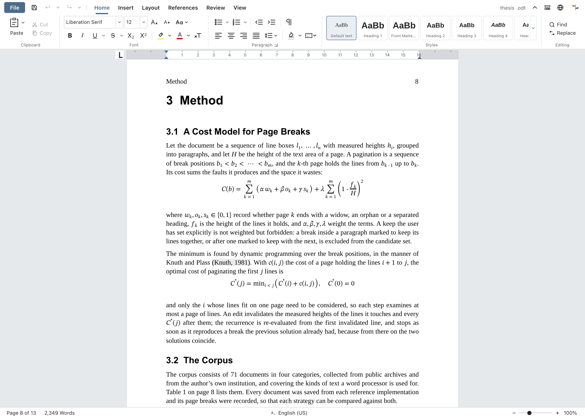
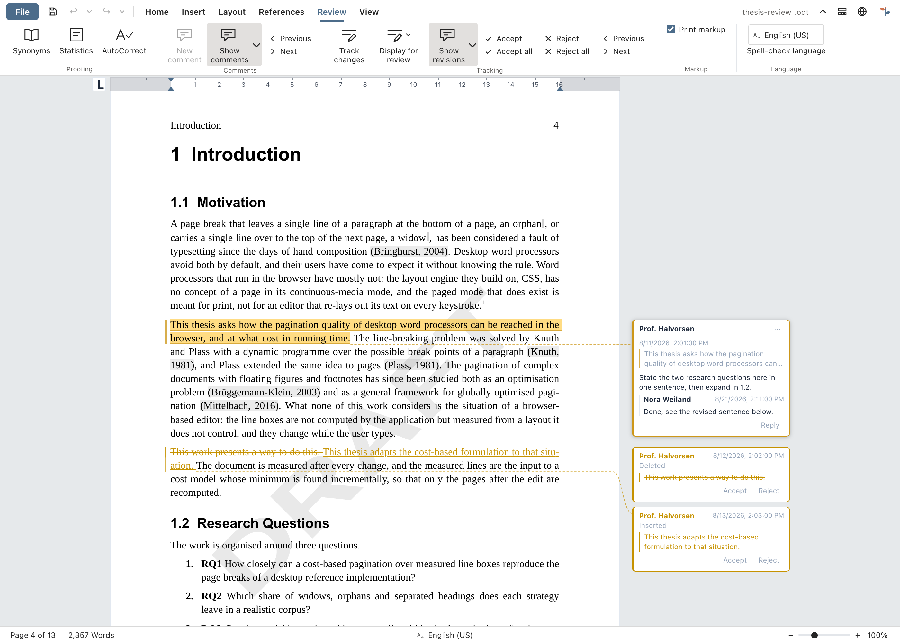
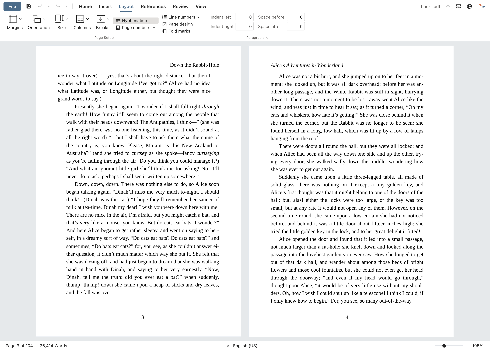
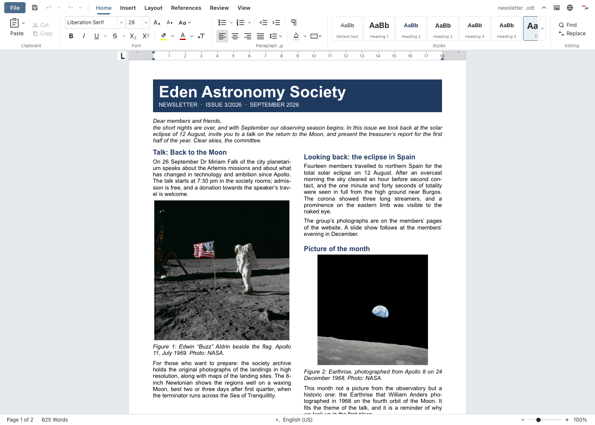
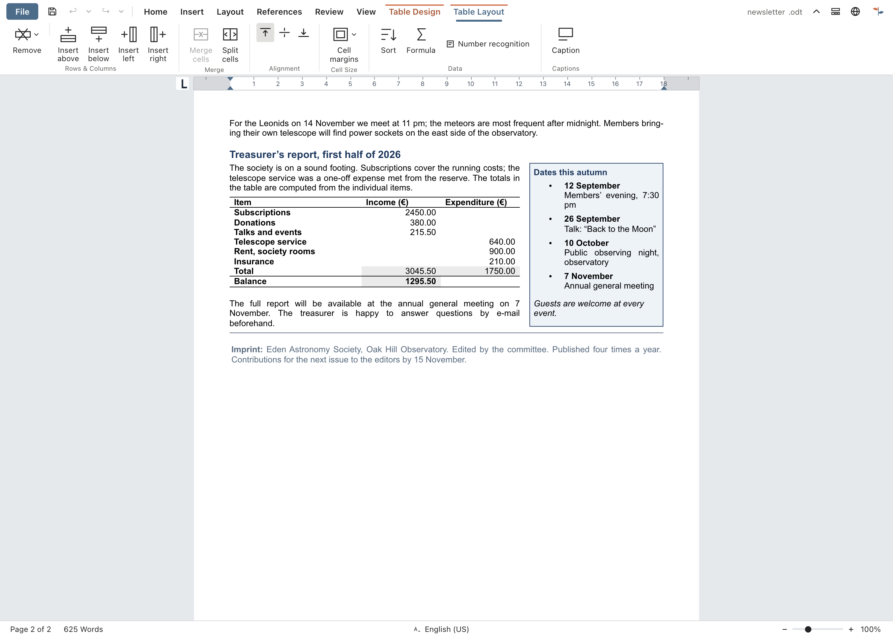
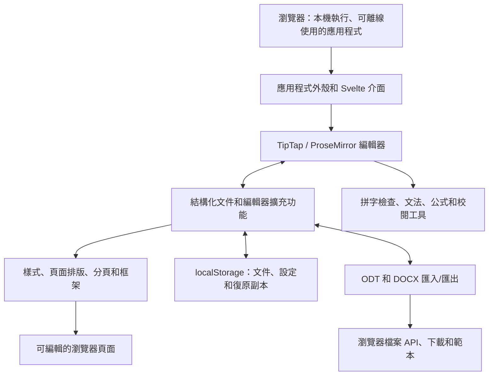

<p align="center">
  
</p>

<h1 align="center">
  
</h1>

<p align="center">
  <strong>功能強大的文書處理軟體——開啟網址即可使用。</strong><br>
  免費 · 開源 · 隱私優先
</p>

<p align="center">
  <a href="https://github.com/stffnb/edentext/actions/workflows/ci.yml"></a>
  <a href="../../LICENSE"></a>
  <a href="../../CHANGELOG.md"></a>
  
</p>

<p align="center">
  <a href="https://edentext.app"><strong>▶ 開啟 EdenText</strong></a>
</p>

<p align="center">
  <a href="../../README.md">English</a> · <a href="README.de.md">Deutsch</a> · <a href="README.es.md">Español</a> · <a href="README.fr.md">Français</a> · <a href="README.pt.md">Português</a> · <a href="README.el.md">Ελληνικά</a> · <a href="README.ru.md">Русский</a> · <a href="README.uk.md">Українська</a> · <a href="README.ja.md">日本語</a> · <a href="README.zh-CN.md">简体中文</a> · <b>繁體中文</b>
</p>

<picture>
  <source media="(prefers-color-scheme: dark)" srcset="../hero-dark.webp">
  
</picture>

---

EdenText 是在瀏覽器中執行、功能強大的文書處理軟體，從隨手筆記到整本書都能勝任。不需要伺服器，也不需要帳號——所有處理都在本機完成，文件不會離開你的電腦。開啟網址即可使用，也可以安裝成應用程式離線使用。大多數語言第一次開啟需下載約 2 MB，字典和字型會在需要時才載入[^1]。介面提供英文、德文、西班牙文、法文、葡萄牙文、希臘文、俄文、烏克蘭文、日文和中文（簡體與繁體）。

> [!NOTE]
> EdenText 目前仍是 **beta** 版，持續開發中。測試和往返轉換檢查會驗證各項功能，
> 但現階段仍無法排除 bug，重要文件請自行備份。另外，瀏覽器會保留目前文件最近的
> 三個版本，萬一文件打不開，可以從中還原。
>
> **發現問題，或是文件顯示不正確？** 歡迎
> [提 issue](https://github.com/stffnb/edentext/issues)，每則回報都很有幫助。
> 尤其歡迎在 EdenText 裡顯示得和 Word、LibreOffice 或 WPS Office 不一樣的文件：
> 附上檔案（或刪減過的副本），它就會成為一個測試案例。

<a href="https://edentext.app"><picture>
  <source media="(prefers-color-scheme: dark)" srcset="../showcase/thesis-dark.png">
  
</picture></a>

## 功能

- **真正的頁面排版**——A4/Letter 頁面、邊界、頁首頁尾、註腳、分欄、頁碼與行號、
  浮水印；書籍可使用左右對稱的邊界，章節從右頁開始
- **開啟並儲存 `.odt` 和 `.docx`**，可匯出 PDF；支援範本（`.ott`/`.dotx`）和信函範本庫
  （DIN 5008）；兩種格式都支援密碼保護的檔案
- **與 Word、LibreOffice 和 WPS Office 相容**——文件維持原有版面；
  自動化往返轉換和排版測試以 LibreOffice 為基準進行驗證
- **樣式**——段落、字元、表格和清單樣式，支援繼承，以及章節編號
- **表格**——表格樣式、排序，以及類似試算表的公式
- **論文需要的都有**——目錄、圖表標號、交互參照、引用與參考文獻、索引、數學公式（LaTeX）
- **校閱工具**——追蹤修訂、頁邊註解框中的討論串、與其他檔案比較和合併、可列印的修訂標記、拼字檢查（英文、
  德文、西班牙文、法文、葡萄牙文、希臘文、俄文和烏克蘭文）、同義詞（上述語言中除
  希臘文外皆支援）、文法檢查（英文）
- **可選用的 AI 助理**——使用你自己的服務供應商或本機模型；可以回答與文件有關的問題，
  並以追蹤修訂的方式編輯文件。可以關閉；請求會直接送到服務供應商，不經過任何
  EdenText 伺服器
- **隱私優先**——文件不會離開你的電腦，所有處理都在本機完成；安裝成應用程式後也能
  離線使用。edentext.app 會匿名統計造訪次數（GoatCounter，代管於歐盟，不使用 Cookie；自行架設的實例和桌面版不統計任何內容）；編輯器
  本身不傳送任何內容，只有開啟 AI 助理後，才會把請求送給你選擇的服務供應商。文件會
  自動儲存在瀏覽器中；在「最近使用的文件」裡可以設定已關閉的文件在下次啟動時刪除，
  或者乾脆不儲存。無痕視窗關閉後不會留下任何痕跡
- **支援所有現代瀏覽器**——在 Chrome 和 Edge 中，「儲存」會直接寫回開啟的檔案；Brave
  啟用 `brave://flags/#file-system-access-api` 後也一樣；其他瀏覽器每次儲存都是一次
  下載，想自己選擇儲存位置的話，請在瀏覽器設定中開啟「下載前詢問每個檔案的儲存位置」

因瀏覽器限制而無法與 Word 或 LibreOffice 完全一致的地方，見
[已知限制](../../CHANGELOG.md#known-limitations)（英文）。

## 展示

這些圖片背後的文件以 `.odt` 和 `.docx` 格式放在 [`docs/showcase/`](../showcase/) 中，
可以直接在 EdenText、LibreOffice 或 Word 中開啟。它們由 `scripts/showcase/run.mjs` 產生；
照片來自 NASA，書籍是路易斯·卡羅的作品，都屬於公有領域。

<table>
<tr>
<td width="50%" valign="top"><a href="../showcase/thesis-review.png"></a><br><b>校閱</b>——追蹤修訂、頁邊的討論串註解、「草稿」浮水印</td>
<td width="50%" valign="top"><a href="../showcase/book-spread.png"></a><br><b>書籍</b>——A5，左右對稱邊界。每章從右頁開始，頁首在左頁顯示書名、在右頁顯示章名，頁碼從第一章開始編號</td>
</tr>
<tr>
<td width="50%" valign="top"><a href="../showcase/newsletter.png"></a><br><b>電子報</b>——分欄、附標號的圖片、側欄文字方塊</td>
<td width="50%" valign="top"><a href="../showcase/newsletter-tables.png"></a><br><b>表格</b>——表格樣式和類似試算表的公式</td>
</tr>
</table>

## 桌面應用程式

每個版本也附有以 Electron 建置、未經簽署的桌面安裝檔：

- **macOS**——`EdenText-<version>-arm64.dmg`（Apple 晶片）或 `EdenText-<version>.dmg`（Intel）。
  將應用程式拖到「應用程式」資料夾。由於沒有簽署，第一次請用右鍵 →「打開」啟動，或執行
  `xattr -d com.apple.quarantine /Applications/EdenText.app`。
- **Windows**——`EdenText-Setup-<version>.exe`。SmartScreen 會提示發行者不明：
  點「其他資訊」→「仍要執行」。
- **Linux**——`EdenText-<version>.AppImage`（先 `chmod +x` 再執行）或 `.deb`
  （`sudo apt install ./edentext_*.deb`）。

桌面應用程式可以從檔案管理員開啟文件並直接存回原檔，不經列印對話框即可寫出 PDF，
並在啟動時提示是否有新版本。

## 開發

```bash
npm install
npm run dev      # 有熱重載的開發伺服器
npm test         # 測試套件
npm run build    # 正式版建置 → dist/
cd desktop && npm install && npm start   # 以同一份建置執行桌面應用程式
```

使用 Svelte 5、TypeScript、Vite 和 TipTap 3（ProseMirror）建置。

## 自行架設

EdenText 不需要後端，也不在伺服器上保存任何內容；文件始終留在瀏覽器中。
每個版本都會發布容器映像檔（amd64 和 arm64）：

```bash
docker run -p 8080:80 ghcr.io/stffnb/edentext
```

此外，每個版本都附有包含已建置應用程式的 `edentext-<tag>.zip`；執行 `npm run build` 也會在 `dist/` 中產生相同的檔案。
任何 Web 伺服器都可以託管這個資料夾。
也可以用 `docker build -t edentext .` 在本機建置容器映像檔。
適用於 Kubernetes 的社群維護 Helm chart 位於 [`charts/edentext`](../../charts/edentext)。

更新時，請將新檔案覆蓋到舊檔案上，不要先清空資料夾。
更新前開啟的分頁在重新載入之前，會繼續載入其所屬版本的檔案。
伺服器應對缺少的檔案回傳 404，而不是 `index.html`，這樣這些分頁才能提示重新載入。

建議透過 HTTPS 部署 EdenText。使用一般 HTTP 時編輯器也能執行，但瀏覽器會停用部分功能：
離線使用、安裝為應用程式、直接存回已開啟的檔案（改為下載）以及複製按鈕。
在 localhost 上，所有功能都與 HTTPS 一樣可用。

## 架構



EdenText 完全在瀏覽器中執行：`App.svelte` 圍繞 TipTap 文件模型及其編輯器擴充功能組成介面。
樣式和排版把這個模型轉成可編輯的頁面；儲存層保存本機狀態和復原副本。匯入和匯出在同一個
模型與 ODT、DOCX 之間轉換，瀏覽器檔案 API 負責儲存或下載產生的檔案。
格式和排版的細節見[架構文件](../architecture/)（英文）。

## 參與貢獻

歡迎貢獻——請參閱 [CONTRIBUTING.md](../../CONTRIBUTING.md)（英文）。合併前需要簽署
[CLA](../../CLA.md)，每個 pull request 都會自動檢查。

### 貢獻者

感謝所有提供想法、問題回報、測試和意見回饋的人。除 GitHub 上列出的貢獻者外，我也要感謝：

Patrick R.、[@Deleh](https://github.com/Deleh)、[@lukasmwerner](https://github.com/lukasmwerner)、[@JinJieBeWater](https://github.com/JinJieBeWater)、[@farragoo](https://github.com/farragoo), [@sbvelinga](https://github.com/sbvelinga)

<p>
<a href="https://github.com/stffnb"></a>
<a href="https://github.com/Camthalion77"></a>
<a href="https://github.com/ehrensperger-niklas"></a>
<a href="https://github.com/farragoo"></a>
<a href="https://github.com/blairhoddinott"></a>
<a href="https://github.com/Deleh"></a>
<a href="https://github.com/lukasmwerner"></a>
<a href="https://github.com/JinJieBeWater"></a>
<a href="https://github.com/sbvelinga"></a>
</p>

## 授權

Copyright © 2026 Steffen Becker · 德國製造

[AGPL-3.0](../../LICENSE)。如果 AGPL 不適合你的用途，可以選擇[商業授權](../../LICENSE.commercial.md)。
隨附的字型和語言資料保留各自的授權——見 [THIRD-PARTY-NOTICES.md](../../THIRD-PARTY-NOTICES.md)。

*EdenText 是獨立專案，與 Microsoft 或 The Document Foundation 無關。支援 `.docx`
和 `.odt` 是為了互通性。*

*本文為英文 [README](../../README.md) 的翻譯；如有出入，以英文版為準。*

[^1]: 指壓縮後的網路傳輸量：約 1.0 MB 的應用程式程式碼，其餘是拼字檢查器（含瀏覽器語言
    對應的字典）以及頁面顯示所需的字型；希臘文和烏克蘭文字典分別再多約 2.5 MB 和 1.5 MB。
    其他所有內容都在第一次需要時才下載，並保留供離線使用；全部字型、字典和同義詞庫合計
    約 18 MB，加上英文文法檢查約 26 MB。
